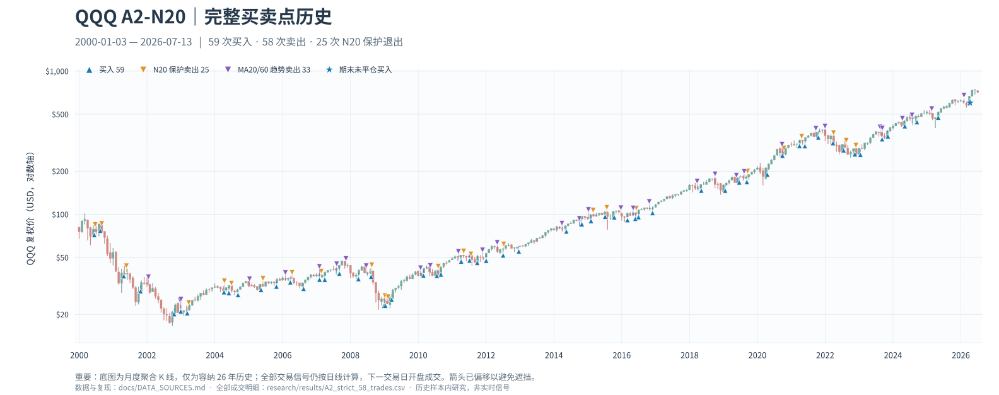

# QQQ A2-N20 · 可复现的日线趋势策略

> A frozen baseline + reproducible backtest + complete good/bad case ledger + experimental branches.  
> **研究与模拟跟踪用途。没有券商交易接口，不会自动下单。**

A2 的核心不是猜顶抄底，而是：**MA20 新上穿 MA60 入场；入场前20个交易日用带浮亏条件的 MA10/20 新死叉控制失败；其余时间等 MA20/60 新死叉退出；出场后只等下一次新的 MA20/60 金叉。**

策略按 QQQ 日线收盘确认、**下一交易日开盘**成交。它只有约 **41.38%** 的历史胜率；历史优势来自较高的平均盈亏比，**不等于高胜率、保本或可直接加杠杆**。

## 全部历史买点与卖点 · K 线总览

[](assets/a2_trade_map_2000_2026.svg)

> **点击图片可放大**，查看完整的买入、N20 保护卖出、MA20/60 趋势卖出标记。为了让26年的交易放在**一张静态图**中，**底图将日线聚合成月 K**；**所有买卖信号仍使用真实日 K 计算，标记仍位于对应的实际交易日期与复权开盘价附近**（箭头仅作视觉偏移）。此图截至 **2026-07-13**，并非当前实时信号。逐笔精确值以 [58笔成交 CSV](research/results/A2_strict_58_trades.csv) 为准。

这张图可完全离线重新生成，无需 HTML 或交互式网页：

```bash
python -m pip install -e '.[charts]'
python scripts/render_trade_chart.py --old sources/qqq_jtang.csv \
  --new sources/qqq_james.csv --end 2026-07-13
```

## 1. 运行

环境：Python 3.10+。

```bash
python -m pip install -e .
python -m unittest discover -s tests -v
```

把你有权使用的每日 QQQ OHLCV CSV 放到本地（`sources/` 已由 `.gitignore` 排除）。必须包含：`Date,Open,High,Low,Close,Adj Close`，可含 `Volume`。`Adj Close` 应与历史 `Open/High/Low/Close` 属于**同一原始价格基准**，程序会统一复权；不要用盘中未完成的日 K。

```bash
# 自备单一数据源；适用于当前信号跟踪
qqq-a2 --csv sources/qqq_daily.csv --start 2000-01-03 --out .a2-output

# 精确复现研究时使用的两份相互重叠的历史源（须自行合法取得）
qqq-a2 --old sources/qqq_jtang.csv --new sources/qqq_james.csv \
  --start 2000-01-03 --end 2026-07-13 --out .a2-output

# 使用同一份历史源独立核对全部58笔交易的日期、退出原因和回报
python research/verify_frozen_baseline.py \
  --old sources/qqq_jtang.csv --new sources/qqq_james.csv

# 亦可不安装命令入口：python -m qqq_a2 --csv ...
```

输出：

- `.a2-output/trades.csv`：每次开仓、平仓、原因、净收益；
- `.a2-output/equity.csv`：每天的账户权益、历史峰值、最大回撤、待执行方向；
- `.a2-output/summary.json`：当前持仓/待执行信号、指标与完整策略统计。

**历史数据截止 2026-07-13，不能拿现存的旧基准当成 2026-11-10 的实时仓位。** 第一次运行实盘跟踪必须先更新最新日线，从历史开端逐日重建策略状态。如果现实账户空仓、系统显示历史模型已持仓，只记录影子持仓，不能把价格仍在 MA60 上方当成一笔新金叉。

## 2. 冻结基准 A2 V1.0

| 规则 | 公式与动作 |
|---|---|
| 新金叉开仓 | `MA20[t] > MA60[t] && MA20[t-1] <= MA60[t-1]`，下个正常交易日开盘买 QQQ |
| N20 早期保护 | 从**买入次日**算第1日到第20日，`MA10` **新下穿** `MA20`，且 `收盘价 < 该笔开盘买价`，次日开盘卖 |
| 趋势退出 | `MA20[t] < MA60[t] && MA20[t-1] >= MA60[t-1]`，次日开盘卖 |
| 卖出后 | 等新的 `MA20/60` 金叉。**MA10/20 金叉不直接重买** |
| 发生两个退出信号 | MA20/60 死叉优先，其他研究警报不干涉 |
| 测试假设 | QQQ 全进全出、单边手续费 0.05%、现金利息 0、滑点/税费 0；研究假设**不是建议配置100%家庭资产** |

完整定义、执行状态机、错失赢家与风险案例：[docs/STRATEGY_V1.md](docs/STRATEGY_V1.md)。

## 3. 核验过的历史结果

`2000-01-03` 至 `2026-07-13`，**严格等待真实新金叉**、不人为带仓：

| 指标 | A2-N20 V1.0 | 取消 N20 的反事实 |
|---|---:|---:|
| 已平仓 | **58** | 58 |
| 赢家 / 输家 | **24 / 34** | 28 / 30 |
| 胜率 | **41.38%** | 48.28% |
| Payoff | **4.02** | 2.18 |
| Profit Factor | **2.84** | 2.04 |
| 账户 MDD | **−20.29%** | −31.88% |
| CAGR | **5.84%** | 5.06% |
| $100k 模拟期末权益 | **$450,596** | $370,052 |

- **25 次 N20 出场**：16 次比无 N20 更好，9 次更差；2003-03-24 那笔 N20 −1.50%，没保护可赚 +34.98%（**反例**），但 2001/2004/2008/2015/2022 等保护明显减少多笔损失（**正例**）。
- **58笔全部完成交易**、**25笔 N20 反事实**、**25次 B 两日观察**、**20次放量急跌退出实验**均保留在 `research/results/`，便于独立检查，而不只是附有漂亮指标的总结。
- 起初档案的“59笔已完成”含一笔 `warm_start=True` 合成入场，不属于真实金叉策略；**官方 V1.0 是 58 笔已完成 + 期末1笔未平仓**。详见手册。

> 这些是已看过全部历史的**样本内**结果，不是样本外证明；历史数据有分红与价格调整、开盘滑点、来源一致性等限制。仅凭 Payoff 高不能推断存在稳定超额收益。

## 4. 数据与研究证据

| 入口 | 内容 |
|---|---|
| [docs/DATA_SOURCES.md](docs/DATA_SOURCES.md) | 历史源链接、拼接/复权算法、原始数据许可、缺失数据及数据质量 |
| [docs/EXPERIMENTS.md](docs/EXPERIMENTS.md) | 所有参数与机制研究、证实/否定结果、样本偏差和复现方式 |
| [docs/research/](docs/research/) | 原始独立研究报告和正反例分析原文 |
| [research/results/](research/results/) | 逐笔交易、反事实事件、候选参数实验 CSV |
| [research/a2_n20.py](research/a2_n20.py) | 旧版独立研究引擎（基准复现） |
| [research/verify_frozen_baseline.py](research/verify_frozen_baseline.py) | 对照冻结台账核验58笔交易逐笔一致性 |
| [research/experiments/](research/experiments/) | 对比实验脚本；部分 TQQQ 实验需要私有/另行授权数据 |
| [src/qqq_a2/](src/qqq_a2/) | 可以对自备行情运行的 **只读**策略执行器/命令行 |

**注意**：仓库不公开无明确再分发授权的原始 QQQ/TQQQ 行情、FirstRate Data 数据或账户敏感信息。公开统计结果与实验代码不等于附带数据本身的使用授权。

## 5. 如何继续研究而不污染 V1.0

每个候选策略必须有独立名字/版本、独立输出、固定原 A2 对照；报告包括**失去的最大赢家、账户 MDD、交易频率和交易成本**，不能只选最好的参数或追着单个坏案例改公式。

当前保留两个重点方向：

1. **B 两日观察**：QQQ 单日跌≥3%、量≥过去20日均量1.2倍后再看2个交易日；如果第二个观察日收盘仍低于急跌日收盘，则下一开盘卖。原策略止损优先。历史 B 的 Payoff 4.19/CAGR6.42%，但 MDD −20.90% 反而略差，暂作**影子策略**。
2. **未来 Agent/Skill**：先做只读数据完整性检查、当日收盘信号、证据引用、反事实仿真和警报；交易执行须以后单独授权、审计与风控。见 [docs/AGENT_ROADMAP.md](docs/AGENT_ROADMAP.md)。

贡献请先阅读 [AGENTS.md](AGENTS.md) 和 [CONTRIBUTING.md](CONTRIBUTING.md)。欢迎独立复现、提交失败案例和新的可证伪假设。

## 6. 协作与许可状态

本仓库目前**尚未由作者选择开源软件许可证**。代码可以被 GitHub 用户查看/克隆，但这**不意味着**自动获得修改后再分发或商业使用许可。作者确认授权政策（常见选项 MIT / Apache-2.0）后再增加正式 `LICENSE`。第三方行情数据必须分别遵守自己的条款。

**免责声明**：本项目为研究、教育和模拟跟踪用途，不提供任何可保证收益的交易信号、投资建议或自动订单服务。
