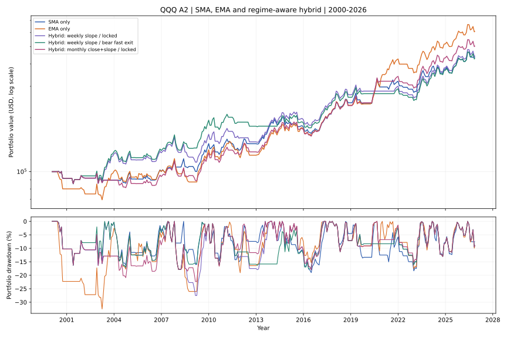
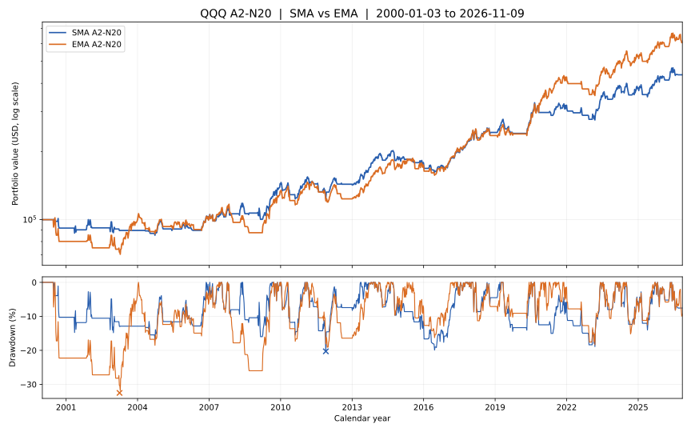

# QQQ A2-N20 · 可复现的日线趋势策略

> A frozen baseline + reproducible backtest + complete good/bad case ledger + experimental branches.  
> **研究与模拟跟踪用途。没有券商交易接口，不会自动下单。**

> **当前第三实验分支：`experiment/hybrid-sma-ema-regime`。** 用周／月线趋势判断，**下行使用 SMA 金叉入场，上行使用 EMA 金叉入场**，并单独验证下行期快速退出。`main` 的 SMA A2 V1.0 和 `experiment/ema-a2-n20` 的 EMA 独立版本都不变。下面未注明混合的既有章节、SVG 和60笔交易表仍描述 **SMA**，不会偷偷覆盖原始结果。

A2 的核心不是猜顶抄底，而是：**MA20 新上穿 MA60 入场；入场前20个交易日用带浮亏条件的 MA10/20 新死叉控制失败；其余时间等 MA20/60 新死叉退出；出场后只等下一次新的 MA20/60 金叉。**

策略按 QQQ 日线收盘确认、**下一交易日开盘**成交。它在最新完整样本中只有约 **41.67%** 的历史胜率；历史优势来自较高的平均盈亏比，**不等于高胜率、保本或可直接加杠杆**。

## 第三分支：Hybrid 混合策略｜下行收紧，上行给趋势空间

**研究目标：** 若周 K／月 K 趋势正在下行，使用 SMA20/60 新金叉入场及 SMA 的保护／退出；趋势上行时使用 EMA20/60 新金叉入场及 EMA 的保护／退出。进场时锁定选用的均线体系，另独立测试：持仓期间一旦已完成的周／月线显示下行且日 SMA10 < SMA20，是否提前在次日开盘退出。绝不引用未收盘的本周、本月行情。

同口径：QQQ 2000-01-03—2026-11-09、$100k 起步、单边费 0.05%、税前、现金利息 0，MDD 逐日统计。

| 对照 | 期末权益 | CAGR | MDD | Payoff | 完整交易 |
|---|---:|---:|---:|---:|---:|
| SMA A2-N20 | $436,163 | 5.64% | **−20.29%** | **4.04** | 60 |
| EMA A2-N20 | **$608,362** | **6.96%** | −32.52% | 3.62 | 54 |
| Hybrid：周线 MA20 斜率，入场锁定 SMA/EMA | $443,131 | 5.70% | −29.05% | 3.31 | 54 |
| **Hybrid：同周线入场 + 熊市快退** | $428,950 | 5.57% | **−19.48%** | 2.90 | 54 |
| Hybrid：月线 MA10 斜率，入场锁定 | $518,836 | 6.32% | −32.36% | 3.40 | 57 |
| Hybrid：月线“站上 MA10 + 斜率向上”，入场锁定 | $503,132 | 6.20% | −23.99% | 3.66 | 57 |

[](assets/a2_hybrid_equity_drawdown_2000_2026.svg)

**关键反例：2020 年两套金叉分别落在趋势切换前后。** 2020-04-24 EMA 金叉时周线斜率仍判下行，Hybrid 等 SMA；但 04-30 SMA 金叉时周线已判上行，Hybrid 又等 EMA。结果两次机会都没有入场，**错失 EMA 2020—2021 年 +67.48% 大交易**。相对地，周线 Hybrid 在 2000-06 判下行，避开首笔 EMA −14.66%，改用 SMA 首笔 −1.71%。月线斜率则在 2000 年依然偏多，没有避开那笔 EMA 亏损。

**本轮结论：** 简单按周／月趋势选择 SMA/EMA 并不能同时拿到两条独立策略的优势；周线快退可将 MDD 压到 −19.48%，但 CAGR 与 Payoff 下降。已经测试 **4 种可解释的趋势定义 × 2 种出场模式**，不能挑历史最漂亮的一行宣称最优。详见下面的完整反例和交易台账。

- [Hybrid 完整研究：入场／风险覆盖规则、2000 与 2020 冲突、8 种对照、跨周期反例](docs/research/A2_Hybrid_周月趋势切换SMA与EMA_独立回测_2026-11-10.md)
- [10 种完整指标](research/results/hybrid_2026_11_09/summary.csv) · [分年代表现](research/results/hybrid_2026_11_09/period_slices.csv) · [月末权益](research/results/hybrid_2026_11_09/monthly_equity.csv) · [8 份混合策略完整交易](research/results/hybrid_2026_11_09/)

```bash
python research/experiments/a2_hybrid_regime.py \
  --csv sources/qqq_merged_updated_local.csv --end 2026-11-09
```

下面的 EMA 章节仍是**第二分支的纯 EMA 对照**，与本次 Hybrid 的结果彼此独立。

## EMA 独立实验｜收益更高，但最大回撤显著变差

**相同 QQQ 复权日线**（2000-01-03 至 2026-11-09），初始 $100,000，每次全仓，单边 0.05% 费用。仅把 **SMA10/20/60/200 换成相同周期的 EMA**，包括买入 MA20/60、N20 保护 MA10/20 和正常退出 MA20/60；其他交易规则一律保持一致。

| 指标 | 原 SMA A2-N20 | 实验 EMA A2-N20 |
|---|---:|---:|
| **期末权益** | $436,163 | **$608,362** |
| **年化 CAGR** | 5.64% | **6.96%** |
| **最大回撤 MDD** | **−20.29%** | **−32.52%** |
| 已完成交易 | 60 | **54** |
| 胜率 | 41.67% | 44.44% |
| Payoff（平均盈利 / 平均亏损绝对值） | **4.04** | 3.62 |
| 资金在场比例 | 51.42% | **65.98%** |
| 平均每笔持仓交易日 | 57.88 | 82.52 |

[](assets/a2_ema_vs_sma_equity_2000_2026.svg)

图形为**每周末账户点**以保持可读；叉号标注全日线计算的 MDD 最深点，表中指标仍按**每个交易日**计算。

**为什么差这么多？** EMA 从 2020-04-27 入场并持有到 2021-10-12，一笔取得约 **+67.48%**，而 SMA 2020 年那笔主要趋势交易只取得 **+31.75%**；EMA 也抓到 2003—2004 的 +30.53% 长波段。但 EMA 2000 年首笔交易亏 **−14.66%**，且在 **2000-07-17 至 2003-03-31** 的账户峰谷出现 **−32.52%** 回撤。EMA 不是单纯“交叉更快、风险更小”，它**更常持仓、单笔亏损也更重**。从降低 MDD 的初衷出发，**尚不能把 EMA 作为 SMA 的无条件替代**。

- [详细研究：EMA 正反例、定义、归因和复现](docs/research/A2_EMA替代SMA_独立回测_2026-11-10.md)
- [双策略指标 CSV](research/results/ema_2026_11_09/summary.csv) · [EMA 全部 54 笔交易](research/results/ema_2026_11_09/EMA_A2_N20_trades.csv) · [SMA 全部 60 笔交易](research/results/ema_2026_11_09/SMA_A2_N20_trades.csv) · [每月账户权益](research/results/ema_2026_11_09/monthly_equity.csv)

复现代码属于**独立研究**，不改变原 SMA 引擎：

```bash
python research/experiments/a2_ema_comparison.py \
  --csv sources/qqq_merged_updated_local.csv --end 2026-11-09
```

标准 EMA 使用 `ewm(span=N, adjust=False, min_periods=N)`，仅完成收盘后产生信号、次日开盘成交；历史结果**均为样本内、税前、零空仓收益**，未来不保证复现。

## 最新状态｜已补齐至美东 2026-11-09 收盘

**从 2026-07-13 冻结快照向后增加 84 个真实完整交易日，策略规则一字未改。** 2026-11-10（北京时间）观察时，美股最近完整日 K 为 **11月9日**；此项目不是连续联网行情源，往后仍须刷新本地数据并重算。

| 指标 | 7月13日原冻结快照 | 11月9日完整样本 |
|---|---:|---:|
| 已完成交易 | 58 | **60** |
| 赢家 / 输家 | 24 / 34 | **25 / 35** |
| 胜率 | 41.38% | **41.67%** |
| Payoff（平均盈利/平均亏损绝对值） | 4.02 | **4.04** |
| Profit Factor | 2.84 | **2.89** |
| 账户历史最大回撤 MDD | −20.29% | **−20.29%** |
| 年化复合收益率 CAGR | 5.84% | **5.64%** |
| 初始 $100,000 对应期末权益（现金0利息） | $450,595.85 | **$436,162.72** |
| 期末状态 | 持仓（4月23日买入） | **空仓，无待执行委托** |

**这84个交易日的账户收益为 −3.20%（−$14,433.13）**，并非策略自 2000 年累计收益。同区间参考：QQQ **复权买入持有 −4.45%**（不计新交易费）；A2 空仓现金按 **DGS3MO−15bp** 计息的账户阶段收益约 **−2.15%**。阶段窗口有选择偏差，不代表未来可复制。原因：7月13日账面已有一笔浮盈，7月27日离场时回吐了一部分；之后8月短暂重入又小亏。虽然新增已完成交易一赢一亏，账户这段时间依然是负收益。

| 交易 | 已知收盘信号 → 次交易日开盘成交 | 本笔已完成回报（含两次0.05%费） | 说明 |
|---|---|---:|---|
| #59 | 4/22 金叉 → 4/23 买；**7/24 MA20/60 死叉 → 7/27 卖** | **+5.84%** | 7月13日仍持有，不能把整笔收益当成7月之后赚的 |
| #60 | **8/26 金叉 → 8/27 买**；8/28 亏损状态下 MA10/20 新死叉 → **8/31 N20 卖** | **−0.35%** | 两个持仓交易日，N20 保护触发 |

11月9日 QQQ 未复权收盘价 **$679.35**；按本次复权序列计算的 MA10/20/60/200 分别约 **689.35 / 704.30 / 719.12 / 680.09**。**11月3日虽然出现 MA20/60 死叉，但模型早已空仓，这一天不是一笔额外卖单。** [补样审计报告](docs/research/A2_2026_07_14到11_09_样本扩展复核.md) · [全部60笔交易](research/results/A2_current_trades_to_2026_11_09.csv) · [新增两笔](research/results/A2_newly_completed_trades_2026_07_14_to_11_09.csv) · [新时期每日权益](research/results/A2_forward_daily_equity_2026_07_14_to_11_09.csv) · [信号事件](research/results/A2_forward_signal_events_2026_07_14_to_11_09.csv) · [审计元数据](research/results/A2_forward_update_to_2026_11_09.json)。

## 同一起点的买入并持有基准｜收益高，不代表回撤可承受

**将“尽可能大的长期回报”和“人能够坚持执行的最大回撤”一起作为研究目标。** 严格核对 2000-01-03 同日首开、$100,000、复权日线及首次 0.05% 交易费后，QQQ 买入持有的数据如下。A2 冻结版仍单独保留，不因新数据更新改写历史。

| 策略和指标 | 2000-01-03 — **2026-07-13** 冻结样本 | 2000-01-03 — **2026-11-09** 更新样本 |
|---|---:|---:|
| **A2-N20** $100k 终值 | $450,596 | $436,163 |
| **QQQ 买入并持有** $100k 终值 | **$877,700** | **$838,629** |
| A2 累计收益 / CAGR | +350.60% / 5.84% | +336.16% / 5.64% |
| **买入持有累计收益 / CAGR** | **+777.70% / 8.53%** | **+738.63% / 8.24%** |
| **A2 账户最大回撤 MDD** | **−20.29%** | **−20.29%** |
| QQQ 买入持有最大回撤 MDD | **−82.96%** | **−82.96%** |

[](assets/a2_vs_buy_hold_equity_drawdown.svg)

**−82.96% 回撤之后，要上涨约 487% 才能回本。** 这段真实历史峰值出现在 2000-03-27，低谷在 2002-10-09，复权账户直到 **2015-02-20** 才收复前高，水下约 **14.9 年**。买入并持有终值是 A2 的近两倍，但能否承受长期水下、是否会在最差时期卖出，都是投资结果的一部分。**A2 历史 −20.29% 不是未来最大损失保证**；它也牺牲了约 2.6 个百分点的长期税前 CAGR，下一轮要继续研究这个权衡。

**税务未包含在上表**：买入通常不产生已实现资本利得，但股票价差是否在卖出时纳税取决于个人**税务居民地**；即使一直不卖，QQQ 持有期间的分红仍可能发生美国预扣税。A2 多次平仓可能提前实现应税损益，Buy&Hold 通常延迟资本利得实现，但**不能**假定每个人最终一定要缴相同税率。复权收盘价只是**税前毛分红复投代理**，不是税后券商净值。中国税务居民的境外财产转让/股息分类所得、新加坡个人投资的一般免税待遇、美国非居民股息与价差分开的官方口径见[完整基准与税务报告](docs/research/A2_QQQ买入持有基准_回撤与税务口径_2026-11-10.md)。

[独立基准结果 JSON](research/results/a2_vs_buy_hold_2026_07_13_and_11_09.json) · [月末账户资产/回撤 CSV](research/results/a2_vs_buy_hold_monthly_equity.csv) · [复现程序](research/experiments/a2_buy_hold_benchmark.py)。图按月末绘制以保持清晰，MDD 与 CAGR **按完整日线**计算；截止日 B&H 仍持仓，未扣假设的最终卖出费和个人税。

## 全部历史买点、卖点和完整交易表 · 单张 SVG

[](assets/a2_trade_map_facets_2000_2026.svg)

> **点击图片可放大，往下滚动到表格**。上半部分把全历史分成**七个四年区间**，各自独立价格刻度，背景用**周 K** 提升清晰度。蓝色上三角是开仓，橙色下三角是 N20 保护退出，紫色下三角是 MA20/60 趋势退出；若期末持仓才标星号。**60 次买入 / 60 次退出均按原始日线信号与次日开盘成交价定位；周 K 只用于画底图，不用于产生信号。**

**下半部分是同一张 SVG 内嵌的完整交易台账**：60 行 × 13 列，逐笔展示买入/卖出信号日与次日实际成交日、复权买卖价格、退出原因、持有日数、含两次 0.05% 费用的净收益、持仓最高/最低收盘浮盈亏（MFE/MAE）及模拟卖后账户权益。盈利绿色、亏损红色；没有用文字另行猜测成交点。**交易时间截止 2026-11-09**，并非实时信号。完整可下载、可排序、可计算的机器可读版见 [60 笔原始派生交易 CSV](research/results/A2_current_trades_to_2026_11_09.csv)。这张 SVG 不含 HTML 或 JavaScript，所有表格文本都属于 SVG 本身。

这张图可完全离线重新生成，无需 HTML 或交互式网页：

```bash
python -m pip install -e '.[charts]'
python scripts/render_trade_chart_facets.py \
  --csv sources/qqq_merged_updated_local.csv --end 2026-11-09
```

## 1. 运行

环境：Python 3.10+。

```bash
python -m pip install -e .
python -m unittest discover -s tests -v
```

把你有权使用的每日 QQQ OHLCV CSV 放到本地（`sources/` 已由 `.gitignore` 排除）。必须包含：`Date,Open,High,Low,Close,Adj Close`，可含 `Volume`。`Adj Close` 应与历史 `Open/High/Low/Close` 属于**同一原始价格基准**，程序会统一复权；不要用盘中未完成的日 K。

```bash
# 自备单一数据源；适用于当前信号跟踪
qqq-a2 --csv sources/qqq_daily.csv --start 2000-01-03 --out .a2-output

# 精确复现研究时使用的两份相互重叠的历史源（须自行合法取得）
qqq-a2 --old sources/qqq_jtang.csv --new sources/qqq_james.csv \
  --start 2000-01-03 --end 2026-07-13 --out .a2-output

# 使用同一份历史源独立核对全部58笔交易的日期、退出原因和回报
python research/verify_frozen_baseline.py \
  --old sources/qqq_jtang.csv --new sources/qqq_james.csv

# 补全 2026-07-14 至 11-09（需自行获得、校验并放入本地的后续日线；原 CSV 不随仓库发布）
python research/experiments/a2_forward_update.py \
  --old sources/qqq_jtang.csv --new sources/qqq_james.csv \
  --update sources/qqq_stockquote_2026_11_09.csv --asof 2026-11-09

# 用补全后的每日 QQQ 历史重新计算当期状态
qqq-a2 --csv sources/qqq_merged_updated_local.csv \
  --start 2000-01-03 --end 2026-11-09 --out .a2-output

# 与同起点 QQQ 买入并持有核对收益、日度 MDD 与历史最长水下期，生成静态对比图
python research/experiments/a2_buy_hold_benchmark.py \
  --old sources/qqq_jtang.csv --new sources/qqq_james.csv \
  --csv sources/qqq_merged_updated_local.csv

# 包含动态短端利率的空仓现金回放与图表（需要本地另外下载 DGS3MO）
python research/experiments/a2_cash_yield_backtest.py \
  --csv sources/qqq_merged_updated_local.csv \
  --yield-csv sources/DGS3MO.csv --end 2026-11-09 \
  --outdir research/results/forward_2026_11_09 \
  --chart assets/a2_cash_yield_equity.svg

# 亦可不安装命令入口：python -m qqq_a2 --csv ...
```

输出：

- `.a2-output/trades.csv`：每次开仓、平仓、原因、净收益；
- `.a2-output/equity.csv`：每天的账户权益、历史峰值、最大回撤、待执行方向；
- `.a2-output/summary.json`：当前持仓/待执行信号、指标与完整策略统计。

**冻结基准截至 2026-07-13；已扩展的本地研究样本截至 2026-11-09。两份结果分别保存。** 第一次运行实盘跟踪必须先更新最新日线，从历史开端逐日重建策略状态。如果现实账户空仓、系统显示历史模型已持仓，只记录影子持仓，不能把价格仍在 MA60 上方当成一笔新金叉。

## 2. 冻结基准 A2 V1.0

| 规则 | 公式与动作 |
|---|---|
| 新金叉开仓 | `MA20[t] > MA60[t] && MA20[t-1] <= MA60[t-1]`，下个正常交易日开盘买 QQQ |
| N20 早期保护 | 从**买入次日**算第1日到第20日，`MA10` **新下穿** `MA20`，且 `收盘价 < 该笔开盘买价`，次日开盘卖 |
| 趋势退出 | `MA20[t] < MA60[t] && MA20[t-1] >= MA60[t-1]`，次日开盘卖 |
| 卖出后 | 等新的 `MA20/60` 金叉。**MA10/20 金叉不直接重买** |
| 发生两个退出信号 | MA20/60 死叉优先，其他研究警报不干涉 |
| 测试假设 | QQQ 全进全出、单边手续费 0.05%、现金利息 0、滑点/税费 0；研究假设**不是建议配置100%家庭资产** |

完整定义、执行状态机、错失赢家与风险案例：[docs/STRATEGY_V1.md](docs/STRATEGY_V1.md)。

## 3. 核验过的历史结果

**原冻结审计口径** `2000-01-03` 至 `2026-07-13`，**严格等待真实新金叉**、不人为带仓；本表留作历史不可变对照，新样本结果见页面顶部：

| 指标 | A2-N20 V1.0 | 取消 N20 的反事实 |
|---|---:|---:|
| 已平仓 | **58** | 58 |
| 赢家 / 输家 | **24 / 34** | 28 / 30 |
| 胜率 | **41.38%** | 48.28% |
| Payoff | **4.02** | 2.18 |
| Profit Factor | **2.84** | 2.04 |
| 账户 MDD | **−20.29%** | −31.88% |
| CAGR | **5.84%** | 5.06% |
| $100k 模拟期末权益 | **$450,596** | $370,052 |

- **25 次 N20 出场**：16 次比无 N20 更好，9 次更差；2003-03-24 那笔 N20 −1.50%，没保护可赚 +34.98%（**反例**），但 2001/2004/2008/2015/2022 等保护明显减少多笔损失（**正例**）。
- **58笔全部完成交易**、**25笔 N20 反事实**、**25次 B 两日观察**、**20次放量急跌退出实验**均保留在 `research/results/`，便于独立检查，而不只是附有漂亮指标的总结。
- 起初档案的“59笔已完成”含一笔 `warm_start=True` 合成入场，不属于真实金叉策略；**官方 V1.0 是 58 笔已完成 + 期末1笔未平仓**。详见手册。

> 这些是已看过全部历史的**样本内**结果，不是样本外证明；历史数据有分红与价格调整、开盘滑点、来源一致性等限制。仅凭 Payoff 高不能推断存在稳定超额收益。

### A2 的空仓资金是否可以赚短期美债利息？

**可以增加模拟期末资产，但不能据此推断降低 MDD。** 完全不改变 A2 交易信号和单边 0.05% 股票交易费，只让 A2 空仓时的美元现金按 [FRED `DGS3MO` 历史 3 个月期美国国债恒定到期收益率](https://fred.stlouisfed.org/series/DGS3MO) 累积参考利息。延长后覆盖 **2000-01-03 至 2026-11-09**；全部样本空仓日历天数约 **48.55%**，空仓时段的加权历史参考收益率约 **2.12%/年**。

**完整更新口径（2000-01-03 — 2026-11-09，60笔已完成交易）：**

| 空仓现金方案 | $100k 期末权益 | CAGR | 每日权益最大回撤 |
|---|---:|---:|---:|
| **原 A2：现金 0%** | **$436,163** | **5.64%** | **−20.29%** |
| 历史 DGS3MO 浮动参考收益（毛） | $575,325 | 6.73% | −20.28% |
| **历史 DGS3MO 减 15bp/年模拟摩擦** | **$564,179** | **6.66%** | **−20.33%** |
| 假设**永远固定** 2%/年（非历史产品） | $566,161 | 6.67% | −19.58% |
| 假设**永远固定** 3%/年（非历史产品） | $645,031 | 7.19% | −19.23% |
| 假设**永远固定** 4%/年（非历史产品） | $734,883 | 7.71% | −18.87% |

本次最新样本空仓现金净利率代理比零收益多 **$128,016**（全历史累计，不是7月以来的新增收益），但最大回撤仍略差。具体采用官方 2026-10-26 至 11-06 H.15 更新；**11月9日利率尚未公布时，严格使用上次已知的 11月6日报价**。图中按月末绘线，指标按全量日度权益计算：

[](assets/a2_cash_yield_equity.svg)

**历史冻结口径（仅截至2026-07-13，保留原研究对照，不与新表混用）：**

| 空仓现金方案 | $100k 期末权益 | CAGR | 每日权益最大回撤 |
|---|---:|---:|---:|
| **原 A2：现金 0%** | **$450,596** | **5.84%** | **−20.29%** |
| 历史 DGS3MO 浮动参考收益（毛） | $587,708 | 6.91% | −20.28% |
| **历史 DGS3MO 减 15bp/年模拟摩擦** | **$576,562** | **6.83%** | **−20.33%** |
| 假设**永远固定** 2%/年（非历史产品） | $581,668 | 6.86% | −19.58% |
| 假设**永远固定** 3%/年（非历史产品） | $660,867 | 7.38% | −19.23% |
| 假设**永远固定** 4%/年（非历史产品） | $750,846 | 7.90% | −18.87% |

> **反直觉的反例**：在最新样本中，减 15bp 的浮动参考方案让期末资金增加约 **$128,016**、CAGR 多约 **1.02 个百分点**，但 MDD 由 −20.29% **略变差为 −20.33%**；因为累计利息同时改变每次历史权益高点，回撤是相对峰值计算的。**固定4% 26年是虚构利率路径**，不能当作稳健预期。上述 DGS3MO 不是可直接交易的资产净值；实际购买短债 ETF、滚动国库券、货币基金或定期存款，存在再投资利率、净值、成本、税费、资金可用时间和汇率等差异。

方法、历史利率出处、权益计算公式、反例及复现命令详见 [原空仓美债独立报告（7月13日冻结）](docs/research/A2_空仓美债现金收益_独立回测_2026-11-10.md) 与 [补样复核报告（11月9日）](docs/research/A2_2026_07_14到11_09_样本扩展复核.md)。新 [六种场景对照 CSV](research/results/forward_2026_11_09/a2_cash_yield_scenarios.csv) · 新 [月末权益派生 CSV](research/results/forward_2026_11_09/a2_cash_yield_monthly_equity.csv)；原 [7月冻结场景数据](research/results/a2_cash_yield_scenarios.csv) 完整保留。此结果**不修改 A2 V1.0 冻结交易规则**。

## 4. 数据与研究证据

| 入口 | 内容 |
|---|---|
| [docs/DATA_SOURCES.md](docs/DATA_SOURCES.md) | 历史源链接、拼接/复权算法、原始数据许可、缺失数据及数据质量 |
| [docs/EXPERIMENTS.md](docs/EXPERIMENTS.md) | 所有参数与机制研究、证实/否定结果、样本偏差和复现方式 |
| [docs/research/](docs/research/) | 原始独立研究报告和正反例分析原文 |
| [research/results/](research/results/) | 逐笔交易、反事实事件、候选参数实验 CSV |
| [research/a2_n20.py](research/a2_n20.py) | 旧版独立研究引擎（基准复现） |
| [research/verify_frozen_baseline.py](research/verify_frozen_baseline.py) | 对照冻结台账核验58笔交易逐笔一致性 |
| [research/experiments/](research/experiments/) | 对比实验脚本；部分 TQQQ 实验需要私有/另行授权数据 |
| [research/experiments/a2_cash_yield_backtest.py](research/experiments/a2_cash_yield_backtest.py) | 按历史浮动短债利率、固定假设利率回放空仓现金，并生成资产曲线 |
| [research/experiments/a2_buy_hold_benchmark.py](research/experiments/a2_buy_hold_benchmark.py) | 同一起点的独立 Buy&Hold 对照，输出两段结果、权益/MDD 图及税前口径说明 |
| [research/experiments/a2_forward_update.py](research/experiments/a2_forward_update.py) | 校验新旧来源重叠/分红复权后，补齐完整日 K 并要求冻结58笔回测逐笔不变 |
| [src/qqq_a2/](src/qqq_a2/) | 可以对自备行情运行的 **只读**策略执行器/命令行 |

**注意**：仓库不公开无明确再分发授权的原始 QQQ/TQQQ 行情、FirstRate Data 数据或账户敏感信息。公开统计结果与实验代码不等于附带数据本身的使用授权。

## 5. 如何继续研究而不污染 V1.0

每个候选策略必须有独立名字/版本、独立输出、固定原 A2 对照；报告包括**失去的最大赢家、账户 MDD、交易频率和交易成本**，不能只选最好的参数或追着单个坏案例改公式。

当前保留两个重点方向：

1. **B 两日观察**：QQQ 单日跌≥3%、量≥过去20日均量1.2倍后再看2个交易日；如果第二个观察日收盘仍低于急跌日收盘，则下一开盘卖。原策略止损优先。历史 B 的 Payoff 4.19/CAGR6.42%，但 MDD −20.90% 反而略差，暂作**影子策略**。
2. **未来 Agent/Skill**：先做只读数据完整性检查、当日收盘信号、证据引用、反事实仿真和警报；交易执行须以后单独授权、审计与风控。见 [docs/AGENT_ROADMAP.md](docs/AGENT_ROADMAP.md)。

贡献请先阅读 [AGENTS.md](AGENTS.md) 和 [CONTRIBUTING.md](CONTRIBUTING.md)。欢迎独立复现、提交失败案例和新的可证伪假设。

## 6. 协作与许可状态

本仓库目前**尚未由作者选择开源软件许可证**。代码可以被 GitHub 用户查看/克隆，但这**不意味着**自动获得修改后再分发或商业使用许可。作者确认授权政策（常见选项 MIT / Apache-2.0）后再增加正式 `LICENSE`。第三方行情数据必须分别遵守自己的条款。

**免责声明**：本项目为研究、教育和模拟跟踪用途，不提供任何可保证收益的交易信号、投资建议或自动订单服务。
