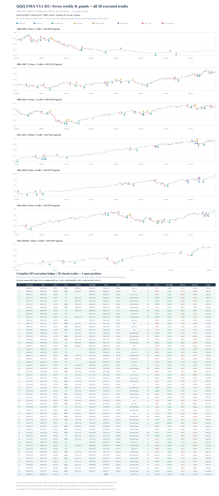
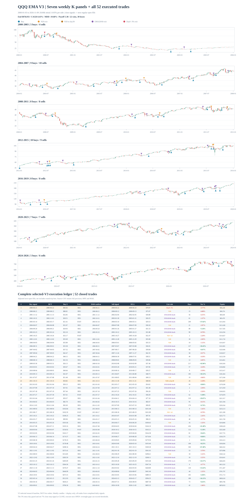
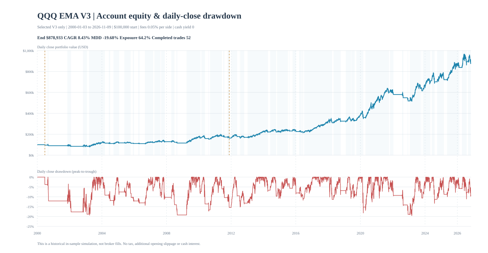
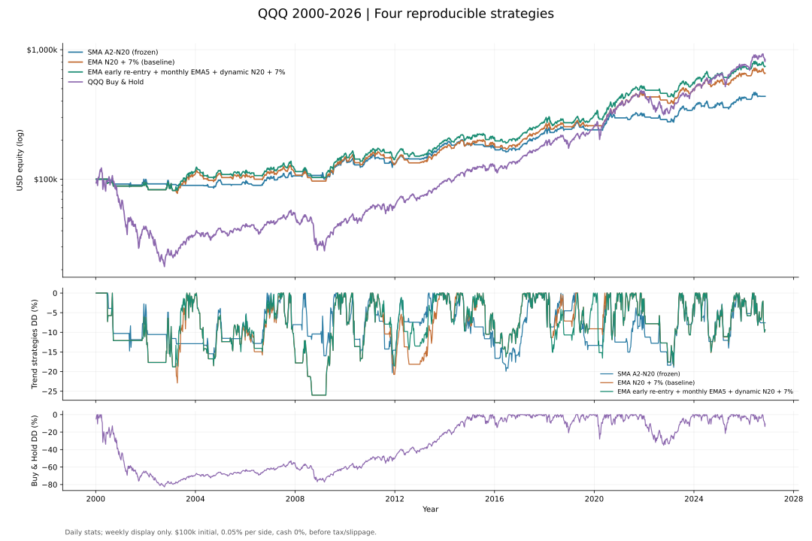
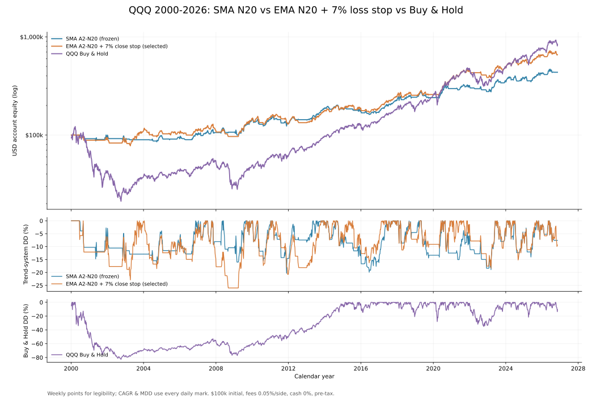
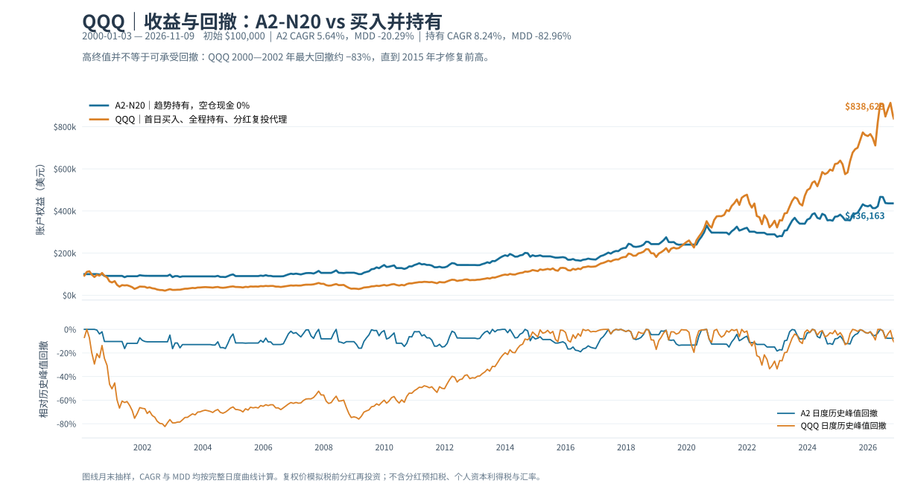
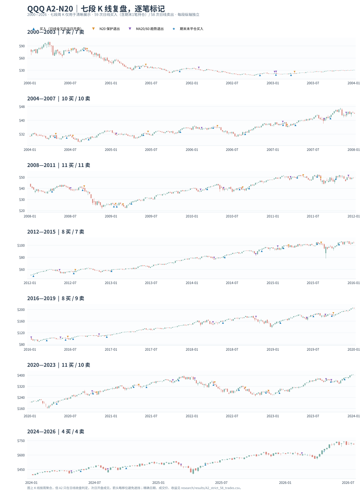
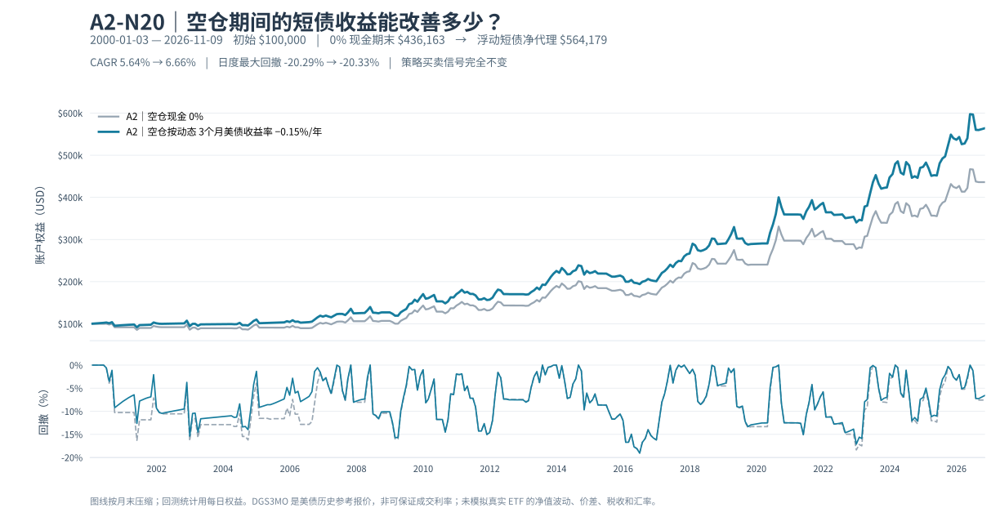

# QQQ A2-N20 · 可复现的日线趋势策略

> **当前分支：V3.1-A 跨标的验证（尚未提升为正式策略）。** 本分支在原 V3 上仅增加「卖出后被月线拦截的 FAST 金叉资格延续」。原 V3 默认规则仍保持冻结。  
> [完整规则、QQQ/SPY 正反测试与复现](docs/research/V3_1_A_FAST资格延续_跨标的QQQ_SPY_2026-11-12.md) · [独立执行入口](research/experiments/a2_v3_1_cross_asset.py) · [派生对照统计](research/results/v3_1_cross_asset_2026_07_13/summary.csv) · [QQQ 新增 FAST 交易](research/results/v3_1_cross_asset_2026_07_13/qqq_candidate_only_completed_trades.csv)  
> **QQQ 截至 2026-07-13:** V3 $924,686 / CAGR 8.747% / MDD −19.68%；A $928,191 / CAGR 8.763% / MDD −19.42%。该截止日两者有未平仓头寸；禁止与 2026-11-09 的冻结 V3 期末资产混比。当前属于历史样本内研究，不代表今天的实时仓位或自动交易许可。

> **2026-11-12 H1/H2 后续检验：** 月 EMA5 下跌减速时提前放行 FAST 在 **QQQ / SPY 均显著恶化回撤**；仅限制延迟 FAST 为慢线多头也未改善 A。作为反向对照，“月线下跌加速 + 日线新金叉”历史表现出较强反弹，但高度依赖大行情、可能过拟合，**不纳入正式策略**。见 [逐笔和事件证据](docs/research/V3_1_H1_H2_月线斜率与日线趋势冲突_2026-11-12.md)、[策略对照 CSV](research/results/v3_1_regime_2026_07/strategy_summary.csv)、[20 日金叉事件 CSV](research/results/v3_1_regime_2026_07/fast_gold_20day_event_summary.csv)。


### QQQ V3.1-H3 交易地图：七段周 K、58 笔完整交易与提前 FAST 标记（研究候选）

[](assets/a2_ema_v3_1_h3_trade_map_2000_2026_07.svg)

- **数据区间：** 2000-01-03～2026-07-13，初始 $100,000，单边手续费 0.05%，日线收盘信号、下一交易日开盘成交；周 K **只用于展示**。
- **H3 样本内账户：** 期末权益 **$1,323,429**（含最后一笔仍持有的头寸），CAGR **10.23%**，日末 MDD **−24.30%**；**58 笔已平仓**（25 盈 / 33 亏）、另有 **1 笔 2026-04-10 买入且截至 07-13 未平仓**。
- **图中买点：** 蓝色常规入场、青色原有 FAST、绿色 **H3「上两个完整月 EMA5 斜率均负且最近更负」豁免触发的 FAST**。21 笔 H3 专属 FAST 已平仓；最后一笔未平仓也是 H3 FAST，不纳入 58 笔已平仓统计。
- **退出标记：** 橙色 N20、深橙色 N20 到第 30 日、紫色 EMA20/60 死叉、红色首日 3% 保护或净亏损 7% 收盘止损；均以**下一开盘价**成交，可能遇到跳空。
- **核查数据：** [58 笔完整衍生交易账本](research/results/v3_1_h3_2026_07_13/h3_trades.csv) · [完整汇总及未平仓日期](research/results/v3_1_h3_2026_07_13/summary.csv) · [21 笔 H3 FAST 与 A 同窗口归因](docs/research/V3_1_H3_21笔FAST与A逐笔同窗口归因_2026-11-12.md)。测试：`python -m unittest tests.test_v3_1_h3_trade_map -v`。

**版本边界：** 这是 H3 探索性反向条件的历史图，尚未选定正式策略，也不是 2026-11-09 的 V3 图；这两个截止日期和账本不可混合。原 `main` 的 V3 SVG 不变。原始行情（OHLCV）未经授权不在本仓库发布。

> A frozen baseline + reproducible backtest + complete good/bad case ledger + experimental branches.  
> **研究与模拟跟踪用途。没有券商交易接口，不会自动下单。**

冻结版 **SMA A2-N20 V1.0** 的核心不是猜顶抄底，而是：**SMA20 新上穿 SMA60 入场；入场前20个交易日用带浮亏条件的 MA10/20 新死叉控制失败；其余时间等 MA20/60 新死叉退出；出场后只等下一次新的 MA20/60 金叉。**

这套冻结策略按 QQQ 日线收盘确认、**下一交易日开盘**成交。它在最新完整样本中只有约 **41.67%** 的历史胜率；历史优势来自较高的平均盈亏比，**不等于高胜率、保本或可直接加杠杆**。

## 当前选定研究基准 V3：动态延长 N20 ＋ 首日亏损 3% 退出（2026-11-11）

**V3 是当前优先研究与模拟跟踪的基准；并非实盘自动交易策略。** 它完整继承 V2 的月 EMA5 上升减速过滤、延迟补买、FAST 回补与买入首日 N20；保留原 **7% 净亏损收盘止损**，新增两条：

1. **常规入场动态延期 N20**：第 20 个完整持仓日收盘时，若最近 5 日有至少 2 日收盘低于本笔买入开盘价，且 EMA10/EMA20 相对距离较 5 日前收窄，则将原 N20 保护期有条件延长至第 30 日。仍须新 EMA10/20 死叉且收盘低于入场价才会退出。
2. **买入当天快速失败保护**：若成交日收盘价相对买入开盘价跌幅达到 **3%**，则下一交易日正常开盘卖出。**不假设当日收盘价成交，也不假设盘中能精确成交在 −3%。**

| 同一 QQQ 全周期（2000-01-03～2026-11-09） | 期末权益 | CAGR | 日末 MDD | 完成交易 | 最差单笔 |
|---|---:|---:|---:|---:|---:|
| V2（冻结历史对照） | $835,957 | 8.229% | −19.68% | 52 | −8.32% |
| **V3（当前选定）** | **$878,933** | **8.432%** | **−19.68%** | **52** | **−6.35%** |
| 4% 收盘止损（**样本内过拟合风险示例，不选**） | $899,532 | 8.525% | −19.58% | 52 | −6.08% |
| QQQ Buy & Hold（机会成本基准） | $838,631 | 8.24% | −82.96% | — | — |

V3 比 V2 仅改变 **2000-06-22**（−5.73% → −3.77%）和 **2011-10-14**（−8.32% → −5.58%）两笔退出；样本中无新增错杀赢家，**但这并不构成未来错杀概率为零的证据**。4% 止损虽然历史得分更高，却是根据同一份样本比较参数而得到的结果；它和动态 N20 在 2011 年同一天触发，既不能保证精确在 −4% 成交，也不能证明未来不会提前退出赢家。**保留作为参数选择偏差的示例，不加入 V3。** 两条 V3 新规则同样有历史特例依赖，尚待独立验证，最大回撤并没有随之下降。

- [V3 完整选定规则、风险与决策记录](docs/STRATEGY_SELECTED_V3.md) · [单一可复现回测入口](research/experiments/a2_v3_selected.py)
- [V3 汇总数据](research/results/a2_v3_selected_2026_11_09/summary.csv) · [52 笔交易账本](research/results/a2_v3_selected_2026_11_09/selected_v3_trades.csv) · [V2→V3 完整变化](research/results/a2_v3_selected_2026_11_09/changed_trades_vs_v2.csv)
- [动态 N20、首日 3% 与 4% 对照的全部敏感性反例](docs/research/A2_V2动态延长N20与买入首日3pct退出_2026-11-11.md) · [独立测试数据](research/results/a2_dynamic_n20_day0_2026_11_09/summary.csv)

### V3 全周期 SVG：七段 K 线、所有买卖点与完整交易表

[](assets/a2_ema_v3_trade_map_2000_2026.svg)

蓝色上三角是实际买入开盘，紫色下三角是 EMA20/60 死叉卖出，橙色是 N20，深橙色是**延期至第 30 日**的 N20 卖出（2011-11-21），红色是**首日收盘跌 3%、次日开盘**卖出（2000-06-23）。底图是按周聚合的 K 线，仅用于显示；所有信号与成交仍严格按**日线**计算。完整 SVG 下半部列出全部 52 笔，表内价格和收益四舍五入；原始精度以 CSV 为准。

[](assets/a2_ema_v3_equity_drawdown_2000_2026.svg)

两张图都是**V3 专属**，不覆盖旧第四方案、V2 和 SMA 冻结图。图中采用仓库已提交的 V3 交易/权益账本；七段周 K 图的矢量底图复用旧图中已发布的同截止日蜡烛图几何形状，**不**在仓库新增有授权限制的原始行情。复现静态图（无需私有 OHLCV 文件）：

```bash
python scripts/render_v3_audit_charts.py
```

图表固定截至 2026-11-09，并非今天的实时交易状态；若更新行情或 V3 版本，必须先重新执行 V3 状态机、更新 CSV 和匹配的行情底图，不能只把图标题的日期改掉。

复现：准备合法取得的三段 QQQ 复权日 K，执行 `python research/experiments/a2_v3_selected.py --old /local/old/QQQ.csv --new /local/new/QQQ.csv --update /local/update.csv --end 2026-11-09`。默认保存到 `research/results/a2_v3_selected_2026_11_09/`。**下文的 V2、四方案、三方案全部为历史研究档案，不代表当前选定基准。**

## 历史研究候选 V2：月 EMA5 上升减速过滤＋延迟补买＋首日 N20（2026-11-11）

**V2 现为历史对照，不再是当前选定版本。** 保留全部 SMA A2 V1.0、EMA 第四方案和它们的历史账本不变。V2 在第四方案上增加月 EMA5 上升减速时暂缓新入场、条件恢复时在有效 EMA20/60 多头趋势内补买，并让**所有买入当天**的亏损 EMA10/20 新死叉触发动态 N20；仍在信号完成后的**下一交易日开盘**成交。

| 同一 QQQ 全周期对照（2000-01-03～2026-11-09） | 期末权益 | CAGR | 日末最大回撤 | 完成交易 | 在场时间 |
|---|---:|---:|---:|---:|---:|
| 原第四方案 | $742,709 | 7.75% | −26.00% | 59 | 68.46% |
| **V2：月线减速＋延迟补买＋所有入场首日 N20** | **$835,957** | **8.23%** | **−19.68%** | **52** | **64.27%** |
| QQQ Buy & Hold | **$838,631** | **8.24%** | −82.96% | — | 100% |

**V2 期末资产达到 Buy & Hold 的 99.68%，仅相差约 $2,674。** 这是税前、零现金利息、无额外滑点的样本内历史对比；Buy & Hold 末日尚未卖出、没有计入终止卖出费。**不能据此认定未来能够持续贴近 Buy & Hold 或稳定维持较低回撤。**

最重要的反证：V2 相对先前月线减速＋延迟补买版本，**26 年仅 2015-08-18 一笔 FAST 入场的退出日期发生改变**，单笔历史亏损由 −15.41% 变为 −0.78%。当天 EMA10 与 EMA20 仅相差 −$0.0009012，轻微的单日收盘价扰动就可能将死叉移至下一天，结果极其依赖精确数据与保护起算日。历史 52 次入场中只有这一次触发新的首日 N20，不能据此估计未来错杀率。分钟级成交质量及滑点尚未实测。

- [V2 完整可执行定义（研究/模拟，不含实盘订单授权）](docs/STRATEGY_CANDIDATE_V2.md)
- [月线 EMA5 上升减速、延迟补买的全部正反例](docs/research/A2_月EMA5斜率减速_牛熊切换信号独立回测_2026-11-11.md)
- [首日 N20 的全周期消融、2015 逐笔审计及微小价格扰动](docs/research/A2_N20买入当日保护_FAST与全部入场审计_2026-11-11.md)
- [V2 与基线的 8 组指标 CSV](research/results/a2_n20_day0_2026_11_09/summary.csv) · [V2 52 笔完整交易](research/results/a2_n20_day0_2026_11_09/month_slowdown_defer_all_trades.csv) · [全部开仓日交叉审计](research/results/a2_n20_day0_2026_11_09/entry_day_opportunities.csv)
- [独立回测入口](research/experiments/a2_n20_entry_day_study.py) · [研究版状态机](research/experiments/a2_month_ema5_slope_regime.py) · [回归测试](tests/test_month_ema5_slope_regime.py)

复现：合法本地取得旧版、新版及增量 QQQ 复权行情后，执行 `python research/experiments/a2_n20_entry_day_study.py --old /local/old/QQQ.csv --new /local/new/QQQ.csv --update /local/update.csv --end 2026-11-09 --outdir research/results/a2_n20_day0_2026_11_09`，查看 `summary.csv` 中的 `month_slowdown_defer/all` 行。下列第四方案和三方案是**保留的历史对照**，不应被 V2 覆盖。

## 最新四方案：月 EMA5 提前回补 + 动态 N20（2026-11-10）

同一 QQQ 复权日线（2000-01-03—2026-11-09）、$100,000 初始资金、买卖各 0.05% 费用、收盘信号与次日开盘成交、空仓现金利息 0、税前且不含滑点。**第四方案是可复现的研究候选，不是生产交易或自动下单授权。**

| 对照 | 期末权益 | CAGR | 日末 MDD | 完整交易 | 在场时间 |
|---|---:|---:|---:|---:|---:|
| SMA A2-N20（冻结） | $436,163 | 5.64% | **−20.29%** | 60 | 51.42% |
| EMA A2-N20 + 7% 收盘止损 | $658,227 | 7.27% | −26.00% | 54 | 65.56% |
| **EMA 月 EMA5 + 提前回补 + 动态 N20 + 7%** | **$742,703** | **7.75%** | −26.00% | 59 | 68.46% |
| QQQ Buy & Hold | **$838,629** | **8.24%** | −82.96% | — | 100% |

[](assets/a2_fourway_sma_ema7_dynamic_buyhold_2000_2026.svg)

第四方案在**任何退出后**允许**日 EMA10/20 新金叉 + 上一个已完成月线 EMA5 斜率上行**提前回补；普通 EMA20/60 新金叉不受月线过滤。提前入场时，EMA10/20 新死叉且持仓亏损的 N20 保护一直有效，直至 EMA20/60 金叉确认，**再延续 20 个交易日**。随后进入成熟趋势持仓。全程 EMA20/60 死叉与净亏损 7% 收盘阈值仍有效；所有卖出均在次日开盘，跳空可造成超过 7% 的实际亏损。**月线用的是 EMA5，不是 SMA5。**

**反证与限制：**相比“提前回补但从买入日起固定计数 N20”，动态方案 **26 年仅一笔交易改变卖出日期**（2011-07-01 买，原 08-09 卖 −10.13%，新 08-04 卖 −1.99%），但更高复利本金使期末从 $681,032 增至 $742,703。全周期 MDD 仍 −26%，2016—2021 的局部回撤还比 EMA+7% 更深。并无样本外证明。

- [第四方案完整规则、收益、反例、分段与复现](docs/research/A2_四方案_月EMA5提前回补_动态N20_2026-11-10.md)
- [七段 K 线、所有买卖点与完整 59 笔交易表](assets/a2_ema_dynamic_n20_trade_map_2000_2026.svg) · [2011 每日 K 线对照](assets/a2_ema_dynamic_n20_2011_daily_candles.svg)
- [四方案指标 CSV](research/results/fourway_current_2026_11_09/summary.csv) · [第四方案全部交易 CSV](research/results/fourway_current_2026_11_09/EMA_A2_DynamicN20_monthEMA5_close7_trades.csv) · [2011 唯一不同卖出事件](research/results/fourway_current_2026_11_09/dynamic_n20_changed_trades.csv)

复现：`python research/experiments/a2_fourway_current.py --csv sources/qqq_merged_updated_local.csv --end 2026-11-09`（行情需自行合法取得，仓库不分发原始日 K）。下方原三方案视为**历史冻结对照**，保留原文和结果。

## 历史三方案定调策略（2026-11-10）

**研究决策：EMA20/60 金叉入场 + EMA N20 + 全程净亏损 7%「收盘确认、次日开盘退出」**设为当前优先研究与模拟跟踪方案。原始 **SMA A2-N20 V1.0 完全冻结**，长期 **QQQ Buy & Hold** 始终保留为机会成本基准。以下数据均为历史样本内研究，不是生产交易信号。

统一口径：QQQ 复权日线 **2000-01-03—2026-11-09**；初始 **$100,000**，空仓开始（Buy & Hold 首日买入）；每次买卖各收 **0.05%** 费用；收盘确认信号，**下一交易日开盘**执行；现金利息 0，税前、无滑点。

| 指标 | SMA A2-N20（冻结） | **EMA A2-N20 + 7%（当前选定）** | QQQ Buy & Hold |
|---|---:|---:|---:|
| 期末权益 | $436,163 | **$658,227** | **$838,629** |
| 累计收益 | +336.16% | **+558.23%** | **+738.63%** |
| CAGR | 5.64% | **7.27%** | **8.24%** |
| 日末最大回撤 MDD | **−20.29%** | −26.00% | −82.96% |
| 完成交易笔数 | 60 | 54 | 不适用 |
| 胜率 | 41.67% | 44.44% | 不适用 |
| 平均盈亏比 Payoff | **4.04** | 3.84 | 不适用 |
| 持仓日占比 | 51.42% | 65.56% | 100% |
| 最差已完成单笔净回报 | −7.63% | −8.32% | 不适用 |

**怎么理解三个方案：**

- **SMA：风控优先。** 历史 MDD 最小、接近一半时间空仓，但牛市较容易错过一段趋势。
- **EMA + N20 + 7%：收益/回撤折中。** 比 SMA 多捕捉趋势、期末高约 **$222k**；代价是 MDD 深约 **5.71 个百分点**，且 7% 的历史改善高度依赖 2000 年首笔交易，不是已证实的最优阈值。
- **Buy & Hold：长期收益最大、执行简单。** 历史终值最高，但曾需承担约 **−83%** 账户回撤；不适合将其风险视为可忽略。

> **7% 不是保证最大亏损 7%。** 是持仓后持续检查的单笔*税前、含往返费用*日收盘亏损阈值；卖单仍在次交易日开盘成交，可能因隔夜跳空亏得更多，历史最差已完成单笔约 **−8.32%**。EMA N20 和 EMA20/60 死叉照常生效；止损后**只等下一次新 EMA20/60 金叉**。

[](assets/a2_threeway_sma_ema7_buyhold_2000_2026.svg)

**完整研究档案：**[三方案方法、利弊与阶段复核](docs/research/A2_SMA_EMA7_BuyHold_三方案定版_2026-11-10.md) · [统一回测代码](research/experiments/a2_threeway_current.py) · [三方案汇总 CSV](research/results/threeway_current_2026_11_09/summary.csv) · [分阶段敏感性](research/results/threeway_current_2026_11_09/period_metrics.csv) · [EMA+7% 完整交易](research/results/threeway_current_2026_11_09/EMA_A2_N20_close7_trades.csv) · [SMA 完整交易](research/results/threeway_current_2026_11_09/SMA_A2_N20_trades.csv) · [数据审计假设](research/results/threeway_current_2026_11_09/audit_metadata.json)。

复现：`python research/experiments/a2_threeway_current.py --csv sources/qqq_merged_updated_local.csv --end 2026-11-09`（本地使用有授权的复权日线；不公开原始行情）。此表为**独立研究版本**，不会修改下文冻结 SMA 的旧报告或历史结果。

## 最新状态｜已补齐至美东 2026-11-09 收盘

**从 2026-07-13 冻结快照向后增加 84 个真实完整交易日，策略规则一字未改。** 2026-11-10（北京时间）观察时，美股最近完整日 K 为 **11月9日**；此项目不是连续联网行情源，往后仍须刷新本地数据并重算。

| 指标 | 7月13日原冻结快照 | 11月9日完整样本 |
|---|---:|---:|
| 已完成交易 | 58 | **60** |
| 赢家 / 输家 | 24 / 34 | **25 / 35** |
| 胜率 | 41.38% | **41.67%** |
| Payoff（平均盈利/平均亏损绝对值） | 4.02 | **4.04** |
| Profit Factor | 2.84 | **2.89** |
| 账户历史最大回撤 MDD | −20.29% | **−20.29%** |
| 年化复合收益率 CAGR | 5.84% | **5.64%** |
| 初始 $100,000 对应期末权益（现金0利息） | $450,595.85 | **$436,162.72** |
| 期末状态 | 持仓（4月23日买入） | **空仓，无待执行委托** |

**这84个交易日的账户收益为 −3.20%（−$14,433.13）**，并非策略自 2000 年累计收益。同区间参考：QQQ **复权买入持有 −4.45%**（不计新交易费）；A2 空仓现金按 **DGS3MO−15bp** 计息的账户阶段收益约 **−2.15%**。阶段窗口有选择偏差，不代表未来可复制。原因：7月13日账面已有一笔浮盈，7月27日离场时回吐了一部分；之后8月短暂重入又小亏。虽然新增已完成交易一赢一亏，账户这段时间依然是负收益。

| 交易 | 已知收盘信号 → 次交易日开盘成交 | 本笔已完成回报（含两次0.05%费） | 说明 |
|---|---|---:|---|
| #59 | 4/22 金叉 → 4/23 买；**7/24 MA20/60 死叉 → 7/27 卖** | **+5.84%** | 7月13日仍持有，不能把整笔收益当成7月之后赚的 |
| #60 | **8/26 金叉 → 8/27 买**；8/28 亏损状态下 MA10/20 新死叉 → **8/31 N20 卖** | **−0.35%** | 两个持仓交易日，N20 保护触发 |

11月9日 QQQ 未复权收盘价 **$679.35**；按本次复权序列计算的 MA10/20/60/200 分别约 **689.35 / 704.30 / 719.12 / 680.09**。**11月3日虽然出现 MA20/60 死叉，但模型早已空仓，这一天不是一笔额外卖单。** [补样审计报告](docs/research/A2_2026_07_14到11_09_样本扩展复核.md) · [全部60笔交易](research/results/A2_current_trades_to_2026_11_09.csv) · [新增两笔](research/results/A2_newly_completed_trades_2026_07_14_to_11_09.csv) · [新时期每日权益](research/results/A2_forward_daily_equity_2026_07_14_to_11_09.csv) · [信号事件](research/results/A2_forward_signal_events_2026_07_14_to_11_09.csv) · [审计元数据](research/results/A2_forward_update_to_2026_11_09.json)。

## 同一起点的买入并持有基准｜收益高，不代表回撤可承受

**将“尽可能大的长期回报”和“人能够坚持执行的最大回撤”一起作为研究目标。** 严格核对 2000-01-03 同日首开、$100,000、复权日线及首次 0.05% 交易费后，QQQ 买入持有的数据如下。A2 冻结版仍单独保留，不因新数据更新改写历史。

| 策略和指标 | 2000-01-03 — **2026-07-13** 冻结样本 | 2000-01-03 — **2026-11-09** 更新样本 |
|---|---:|---:|
| **A2-N20** $100k 终值 | $450,596 | $436,163 |
| **QQQ 买入并持有** $100k 终值 | **$877,700** | **$838,629** |
| A2 累计收益 / CAGR | +350.60% / 5.84% | +336.16% / 5.64% |
| **买入持有累计收益 / CAGR** | **+777.70% / 8.53%** | **+738.63% / 8.24%** |
| **A2 账户最大回撤 MDD** | **−20.29%** | **−20.29%** |
| QQQ 买入持有最大回撤 MDD | **−82.96%** | **−82.96%** |

[](assets/a2_vs_buy_hold_equity_drawdown.svg)

**−82.96% 回撤之后，要上涨约 487% 才能回本。** 这段真实历史峰值出现在 2000-03-27，低谷在 2002-10-09，复权账户直到 **2015-02-20** 才收复前高，水下约 **14.9 年**。买入并持有终值是 A2 的近两倍，但能否承受长期水下、是否会在最差时期卖出，都是投资结果的一部分。**A2 历史 −20.29% 不是未来最大损失保证**；它也牺牲了约 2.6 个百分点的长期税前 CAGR，下一轮要继续研究这个权衡。

**税务未包含在上表**：买入通常不产生已实现资本利得，但股票价差是否在卖出时纳税取决于个人**税务居民地**；即使一直不卖，QQQ 持有期间的分红仍可能发生美国预扣税。A2 多次平仓可能提前实现应税损益，Buy&Hold 通常延迟资本利得实现，但**不能**假定每个人最终一定要缴相同税率。复权收盘价只是**税前毛分红复投代理**，不是税后券商净值。中国税务居民的境外财产转让/股息分类所得、新加坡个人投资的一般免税待遇、美国非居民股息与价差分开的官方口径见[完整基准与税务报告](docs/research/A2_QQQ买入持有基准_回撤与税务口径_2026-11-10.md)。

[独立基准结果 JSON](research/results/a2_vs_buy_hold_2026_07_13_and_11_09.json) · [月末账户资产/回撤 CSV](research/results/a2_vs_buy_hold_monthly_equity.csv) · [复现程序](research/experiments/a2_buy_hold_benchmark.py)。图按月末绘制以保持清晰，MDD 与 CAGR **按完整日线**计算；截止日 B&H 仍持仓，未扣假设的最终卖出费和个人税。

## 全部历史买点、卖点和完整交易表 · 单张 SVG

[](assets/a2_trade_map_facets_2000_2026.svg)

> **点击图片可放大，往下滚动到表格**。上半部分把全历史分成**七个四年区间**，各自独立价格刻度，背景用**周 K** 提升清晰度。蓝色上三角是开仓，橙色下三角是 N20 保护退出，紫色下三角是 MA20/60 趋势退出；若期末持仓才标星号。**60 次买入 / 60 次退出均按原始日线信号与次日开盘成交价定位；周 K 只用于画底图，不用于产生信号。**

**下半部分是同一张 SVG 内嵌的完整交易台账**：60 行 × 13 列，逐笔展示买入/卖出信号日与次日实际成交日、复权买卖价格、退出原因、持有日数、含两次 0.05% 费用的净收益、持仓最高/最低收盘浮盈亏（MFE/MAE）及模拟卖后账户权益。盈利绿色、亏损红色；没有用文字另行猜测成交点。**交易时间截止 2026-11-09**，并非实时信号。完整可下载、可排序、可计算的机器可读版见 [60 笔原始派生交易 CSV](research/results/A2_current_trades_to_2026_11_09.csv)。这张 SVG 不含 HTML 或 JavaScript，所有表格文本都属于 SVG 本身。

这张图可完全离线重新生成，无需 HTML 或交互式网页：

```bash
python -m pip install -e '.[charts]'
python scripts/render_trade_chart_facets.py \
  --csv sources/qqq_merged_updated_local.csv --end 2026-11-09
```

## 1. 运行

环境：Python 3.10+。

```bash
python -m pip install -e .
python -m unittest discover -s tests -v
```

把你有权使用的每日 QQQ OHLCV CSV 放到本地（`sources/` 已由 `.gitignore` 排除）。必须包含：`Date,Open,High,Low,Close,Adj Close`，可含 `Volume`。`Adj Close` 应与历史 `Open/High/Low/Close` 属于**同一原始价格基准**，程序会统一复权；不要用盘中未完成的日 K。

```bash
# 自备单一数据源；适用于当前信号跟踪
qqq-a2 --csv sources/qqq_daily.csv --start 2000-01-03 --out .a2-output

# 精确复现研究时使用的两份相互重叠的历史源（须自行合法取得）
qqq-a2 --old sources/qqq_jtang.csv --new sources/qqq_james.csv \
  --start 2000-01-03 --end 2026-07-13 --out .a2-output

# 使用同一份历史源独立核对全部58笔交易的日期、退出原因和回报
python research/verify_frozen_baseline.py \
  --old sources/qqq_jtang.csv --new sources/qqq_james.csv

# 补全 2026-07-14 至 11-09（需自行获得、校验并放入本地的后续日线；原 CSV 不随仓库发布）
python research/experiments/a2_forward_update.py \
  --old sources/qqq_jtang.csv --new sources/qqq_james.csv \
  --update sources/qqq_stockquote_2026_11_09.csv --asof 2026-11-09

# 用补全后的每日 QQQ 历史重新计算当期状态
qqq-a2 --csv sources/qqq_merged_updated_local.csv \
  --start 2000-01-03 --end 2026-11-09 --out .a2-output

# 与同起点 QQQ 买入并持有核对收益、日度 MDD 与历史最长水下期，生成静态对比图
python research/experiments/a2_buy_hold_benchmark.py \
  --old sources/qqq_jtang.csv --new sources/qqq_james.csv \
  --csv sources/qqq_merged_updated_local.csv

# 包含动态短端利率的空仓现金回放与图表（需要本地另外下载 DGS3MO）
python research/experiments/a2_cash_yield_backtest.py \
  --csv sources/qqq_merged_updated_local.csv \
  --yield-csv sources/DGS3MO.csv --end 2026-11-09 \
  --outdir research/results/forward_2026_11_09 \
  --chart assets/a2_cash_yield_equity.svg

# 亦可不安装命令入口：python -m qqq_a2 --csv ...
```

输出：

- `.a2-output/trades.csv`：每次开仓、平仓、原因、净收益；
- `.a2-output/equity.csv`：每天的账户权益、历史峰值、最大回撤、待执行方向；
- `.a2-output/summary.json`：当前持仓/待执行信号、指标与完整策略统计。

**冻结基准截至 2026-07-13；已扩展的本地研究样本截至 2026-11-09。两份结果分别保存。** 第一次运行实盘跟踪必须先更新最新日线，从历史开端逐日重建策略状态。如果现实账户空仓、系统显示历史模型已持仓，只记录影子持仓，不能把价格仍在 MA60 上方当成一笔新金叉。

## 2. 冻结基准 A2 V1.0

| 规则 | 公式与动作 |
|---|---|
| 新金叉开仓 | `MA20[t] > MA60[t] && MA20[t-1] <= MA60[t-1]`，下个正常交易日开盘买 QQQ |
| N20 早期保护 | 从**买入次日**算第1日到第20日，`MA10` **新下穿** `MA20`，且 `收盘价 < 该笔开盘买价`，次日开盘卖 |
| 趋势退出 | `MA20[t] < MA60[t] && MA20[t-1] >= MA60[t-1]`，次日开盘卖 |
| 卖出后 | 等新的 `MA20/60` 金叉。**MA10/20 金叉不直接重买** |
| 发生两个退出信号 | MA20/60 死叉优先，其他研究警报不干涉 |
| 测试假设 | QQQ 全进全出、单边手续费 0.05%、现金利息 0、滑点/税费 0；研究假设**不是建议配置100%家庭资产** |

完整定义、执行状态机、错失赢家与风险案例：[docs/STRATEGY_V1.md](docs/STRATEGY_V1.md)。

## 3. 核验过的历史结果

**原冻结审计口径** `2000-01-03` 至 `2026-07-13`，**严格等待真实新金叉**、不人为带仓；本表留作历史不可变对照，新样本结果见页面顶部：

| 指标 | A2-N20 V1.0 | 取消 N20 的反事实 |
|---|---:|---:|
| 已平仓 | **58** | 58 |
| 赢家 / 输家 | **24 / 34** | 28 / 30 |
| 胜率 | **41.38%** | 48.28% |
| Payoff | **4.02** | 2.18 |
| Profit Factor | **2.84** | 2.04 |
| 账户 MDD | **−20.29%** | −31.88% |
| CAGR | **5.84%** | 5.06% |
| $100k 模拟期末权益 | **$450,596** | $370,052 |

- **25 次 N20 出场**：16 次比无 N20 更好，9 次更差；2003-03-24 那笔 N20 −1.50%，没保护可赚 +34.98%（**反例**），但 2001/2004/2008/2015/2022 等保护明显减少多笔损失（**正例**）。
- **58笔全部完成交易**、**25笔 N20 反事实**、**25次 B 两日观察**、**20次放量急跌退出实验**均保留在 `research/results/`，便于独立检查，而不只是附有漂亮指标的总结。
- 起初档案的“59笔已完成”含一笔 `warm_start=True` 合成入场，不属于真实金叉策略；**官方 V1.0 是 58 笔已完成 + 期末1笔未平仓**。详见手册。

> 这些是已看过全部历史的**样本内**结果，不是样本外证明；历史数据有分红与价格调整、开盘滑点、来源一致性等限制。仅凭 Payoff 高不能推断存在稳定超额收益。

### A2 的空仓资金是否可以赚短期美债利息？

**可以增加模拟期末资产，但不能据此推断降低 MDD。** 完全不改变 A2 交易信号和单边 0.05% 股票交易费，只让 A2 空仓时的美元现金按 [FRED `DGS3MO` 历史 3 个月期美国国债恒定到期收益率](https://fred.stlouisfed.org/series/DGS3MO) 累积参考利息。延长后覆盖 **2000-01-03 至 2026-11-09**；全部样本空仓日历天数约 **48.55%**，空仓时段的加权历史参考收益率约 **2.12%/年**。

**完整更新口径（2000-01-03 — 2026-11-09，60笔已完成交易）：**

| 空仓现金方案 | $100k 期末权益 | CAGR | 每日权益最大回撤 |
|---|---:|---:|---:|
| **原 A2：现金 0%** | **$436,163** | **5.64%** | **−20.29%** |
| 历史 DGS3MO 浮动参考收益（毛） | $575,325 | 6.73% | −20.28% |
| **历史 DGS3MO 减 15bp/年模拟摩擦** | **$564,179** | **6.66%** | **−20.33%** |
| 假设**永远固定** 2%/年（非历史产品） | $566,161 | 6.67% | −19.58% |
| 假设**永远固定** 3%/年（非历史产品） | $645,031 | 7.19% | −19.23% |
| 假设**永远固定** 4%/年（非历史产品） | $734,883 | 7.71% | −18.87% |

本次最新样本空仓现金净利率代理比零收益多 **$128,016**（全历史累计，不是7月以来的新增收益），但最大回撤仍略差。具体采用官方 2026-10-26 至 11-06 H.15 更新；**11月9日利率尚未公布时，严格使用上次已知的 11月6日报价**。图中按月末绘线，指标按全量日度权益计算：

[](assets/a2_cash_yield_equity.svg)

**历史冻结口径（仅截至2026-07-13，保留原研究对照，不与新表混用）：**

| 空仓现金方案 | $100k 期末权益 | CAGR | 每日权益最大回撤 |
|---|---:|---:|---:|
| **原 A2：现金 0%** | **$450,596** | **5.84%** | **−20.29%** |
| 历史 DGS3MO 浮动参考收益（毛） | $587,708 | 6.91% | −20.28% |
| **历史 DGS3MO 减 15bp/年模拟摩擦** | **$576,562** | **6.83%** | **−20.33%** |
| 假设**永远固定** 2%/年（非历史产品） | $581,668 | 6.86% | −19.58% |
| 假设**永远固定** 3%/年（非历史产品） | $660,867 | 7.38% | −19.23% |
| 假设**永远固定** 4%/年（非历史产品） | $750,846 | 7.90% | −18.87% |

> **反直觉的反例**：在最新样本中，减 15bp 的浮动参考方案让期末资金增加约 **$128,016**、CAGR 多约 **1.02 个百分点**，但 MDD 由 −20.29% **略变差为 −20.33%**；因为累计利息同时改变每次历史权益高点，回撤是相对峰值计算的。**固定4% 26年是虚构利率路径**，不能当作稳健预期。上述 DGS3MO 不是可直接交易的资产净值；实际购买短债 ETF、滚动国库券、货币基金或定期存款，存在再投资利率、净值、成本、税费、资金可用时间和汇率等差异。

方法、历史利率出处、权益计算公式、反例及复现命令详见 [原空仓美债独立报告（7月13日冻结）](docs/research/A2_空仓美债现金收益_独立回测_2026-11-10.md) 与 [补样复核报告（11月9日）](docs/research/A2_2026_07_14到11_09_样本扩展复核.md)。新 [六种场景对照 CSV](research/results/forward_2026_11_09/a2_cash_yield_scenarios.csv) · 新 [月末权益派生 CSV](research/results/forward_2026_11_09/a2_cash_yield_monthly_equity.csv)；原 [7月冻结场景数据](research/results/a2_cash_yield_scenarios.csv) 完整保留。此结果**不修改 A2 V1.0 冻结交易规则**。

## 4. 数据与研究证据

| 入口 | 内容 |
|---|---|
| [docs/DATA_SOURCES.md](docs/DATA_SOURCES.md) | 历史源链接、拼接/复权算法、原始数据许可、缺失数据及数据质量 |
| [docs/EXPERIMENTS.md](docs/EXPERIMENTS.md) | 所有参数与机制研究、证实/否定结果、样本偏差和复现方式 |
| [docs/research/](docs/research/) | 原始独立研究报告和正反例分析原文 |
| [research/results/](research/results/) | 逐笔交易、反事实事件、候选参数实验 CSV |
| [research/a2_n20.py](research/a2_n20.py) | 旧版独立研究引擎（基准复现） |
| [research/verify_frozen_baseline.py](research/verify_frozen_baseline.py) | 对照冻结台账核验58笔交易逐笔一致性 |
| [research/experiments/](research/experiments/) | 对比实验脚本；部分 TQQQ 实验需要私有/另行授权数据 |
| [research/experiments/a2_cash_yield_backtest.py](research/experiments/a2_cash_yield_backtest.py) | 按历史浮动短债利率、固定假设利率回放空仓现金，并生成资产曲线 |
| [research/experiments/a2_buy_hold_benchmark.py](research/experiments/a2_buy_hold_benchmark.py) | 同一起点的独立 Buy&Hold 对照，输出两段结果、权益/MDD 图及税前口径说明 |
| [research/experiments/a2_forward_update.py](research/experiments/a2_forward_update.py) | 校验新旧来源重叠/分红复权后，补齐完整日 K 并要求冻结58笔回测逐笔不变 |
| [src/qqq_a2/](src/qqq_a2/) | 可以对自备行情运行的 **只读**策略执行器/命令行 |

**注意**：仓库不公开无明确再分发授权的原始 QQQ/TQQQ 行情、FirstRate Data 数据或账户敏感信息。公开统计结果与实验代码不等于附带数据本身的使用授权。

## 5. 如何继续研究而不污染 V1.0

每个候选策略必须有独立名字/版本、独立输出、固定原 A2 对照；报告包括**失去的最大赢家、账户 MDD、交易频率和交易成本**，不能只选最好的参数或追着单个坏案例改公式。

当前保留两个重点方向：

1. **B 两日观察**：QQQ 单日跌≥3%、量≥过去20日均量1.2倍后再看2个交易日；如果第二个观察日收盘仍低于急跌日收盘，则下一开盘卖。原策略止损优先。历史 B 的 Payoff 4.19/CAGR6.42%，但 MDD −20.90% 反而略差，暂作**影子策略**。
2. **未来 Agent/Skill**：先做只读数据完整性检查、当日收盘信号、证据引用、反事实仿真和警报；交易执行须以后单独授权、审计与风控。见 [docs/AGENT_ROADMAP.md](docs/AGENT_ROADMAP.md)。

贡献请先阅读 [AGENTS.md](AGENTS.md) 和 [CONTRIBUTING.md](CONTRIBUTING.md)。欢迎独立复现、提交失败案例和新的可证伪假设。

## 6. 协作与许可状态

本仓库目前**尚未由作者选择开源软件许可证**。代码可以被 GitHub 用户查看/克隆，但这**不意味着**自动获得修改后再分发或商业使用许可。作者确认授权政策（常见选项 MIT / Apache-2.0）后再增加正式 `LICENSE`。第三方行情数据必须分别遵守自己的条款。

**免责声明**：本项目为研究、教育和模拟跟踪用途，不提供任何可保证收益的交易信号、投资建议或自动订单服务。
