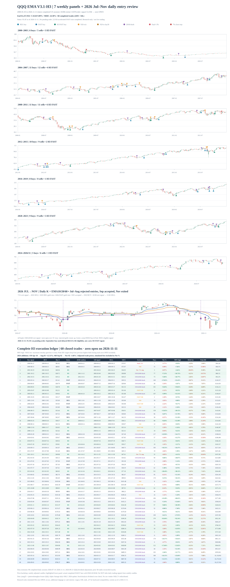

# H3 趋势量化策略｜QQQ

**当前主研究版本：H3（冻结参考）** · **利润保护候选：A / B v1.0** · **研究/纸面回测，不接通实盘下单**

本项目研究如何通过日线趋势识别与风险保护，捕捉 QQQ 等资产的中长期上涨，同时控制账户回撤。主线是 **H3 趋势引擎**；A/B 是建立在相同 H3 持仓之上的两套可选止盈保护，并**未合并为正式 H3 默认规则**。

- [H3 完整规则与执行语义](docs/STRATEGY_H3_FROZEN.md)
- [A/B v1.0 唯一冻结规则](docs/STRATEGY_H3_PROFIT_GUARD_AB_V1.md) · [冻结机器配置](research/config/h3_profit_guard_ab_v1.json)
- [历史策略版本及失败实验归档索引](docs/research/INDEX.md)
- [数据来源与回测可复现条件](docs/DATA_SOURCES.md)

## 1. H3：趋势入场与风险退出

| 状态 | 规则概要 |
|---|---|
| **常规入场 REGULAR** | 日 EMA20 新上穿 EMA60；月 EMA5 使用**上一已完成月**的斜率过滤。月线仍上升但减速时暂缓，允许在条件恢复且慢线仍多头时延期补买。 |
| **快速入场 FAST** | 日 EMA10 新上穿 EMA20；在 H3 FAST 资格有效、月线总闸门放行的基础上，可延续被月线拒绝的 FAST 金叉资格。也允许**前两完整月 EMA5 斜率连续为负且下跌加速**的特殊 FAST 月度资格。 |
| **趋势退出** | EMA20 新下穿 EMA60，下一正常交易日开盘卖出。 |
| **N20 保护** | 买入即进入保护；发生 EMA10/20 **新死叉**且收盘价低于本次买价时退出。常规约20日保护、在明确条件下可延至30日；FAST 在慢线趋势确认前及确认后的规定窗口内持续保护。 |
| **亏损退出** | 全持仓期 7% **净亏损收盘触发**；另有买入首日收盘亏损3%规则。二者均为**次日开盘成交**，不是保证实际损失上限的盘中止损单。 |

所有买卖基于已经完成的日 K 和最后已完成的月 K；**当日收盘发信号、下一正常交易日开盘执行**。不预测日内最低点，不使用尚未完成的月线或未来价格。

更严格的资格、N20延长触发条件、优先级以及代码入口均以 [H3 冻结参考合同](docs/STRATEGY_H3_FROZEN.md) 为准。

## 2. A/B v1.0：H3 持仓中的额外利润保护

两套规则具有**完全相同的底层 H3 影子持仓（shadow）**，仅额外提前卖出逻辑不同。

| 条件 | **A v1.0** | **B v1.0** |
|---|---|---|
| 最高已完成收盘毛浮盈 | ≥10% | ≥10% |
| 当前持仓 | 仍盈利，EMA20>EMA60 | 同 A |
| 最低持仓天数 | 无（age0） | 无（age0） |
| 提前卖出触发 | **EMA5 新死叉 EMA20** | A 条件 **再加** EMA10>EMA20，且最近3日收盘跌幅≥**1.5×ATR20** |
| 特别买回 | EMA5 新金叉 EMA10，EMA20>EMA60，原H3影子仍持仓 | 同 A |
| 同一笔原H3交易额外卖出 / 买回上限 | 1 / 1 | 1 / 1 |

**重要边界：** A/B 的提前卖出不改变 H3 本来的入场、N20、月线状态、退出日期；原 H3 强制卖出优先。B 的 `ATR20×1.5` 是**冻结研究值**，`ATR30×1.5` 虽然在 QQQ 历史敏感性实验中收益较高，**尚未通过独立验证，不取代 B v1.0**。

## 3. QQQ 历史回测对比

<sub>2000-01-03～2026-11-11；初始 $100,000；单边手续费 0.05%；无息现金；未计税及额外滑点。相同复权价格与信号/成交时序。</sub>

| 版本 | CAGR | 最大回撤 MDD | 期末模拟资产 | 额外卖出 / 特别买回 |
|---|---:|---:|---:|---:|
| 买入持有 | 8.31% | −82.96% | 约 $852,247 | — |
| **H3（基础策略）** | **9.89%** | **−24.30%** | 约 $1,257,934 | 0 / 0 |
| **H3 + A v1.0** | 10.69% | **−23.94%** | 约 $1,528,788 | 28 / 18 |
| **H3 + B v1.0** | **11.01%** | −24.30% | 约 $1,652,616 | 22 / 12 |

- **冻结 H3**：60 笔已完成交易，26 盈 / 34 亏；历史资金在场约 67.47%，平均盈亏比约 5.42。
- **A/B 的相对价值尚未通过样本外验证**：B 历史 CAGR 略高，但**未比原 H3 降低最大回撤**；A 历史回撤略低。
- 该期间已被多轮研究反复使用，不能把回测收益解释为未来保证收益或实盘账户结果。

[查看 H3 截止 2026-11-11 的逐笔成交与信号审计](docs/research/V3_1_H3_2026年7至11月补样与进出场审计_2026-11-12.md) · [查看 A/B 全账户归因及负面案例](docs/research/H3_QQQ_AB_利润保护完整对比_2026-11-13.md)

### H3 完整交易地图

[](assets/a2_ema_v3_1_h3_trade_map_2000_2026_11.svg)

[单独查看 H3 SVG](assets/a2_ema_v3_1_h3_trade_map_2000_2026_11.svg) · [派生交易账本](research/results/v3_1_h3_2026_11_11/h3_trades.csv) · [历史回测快照](research/results/v3_1_h3_2026_11_11/summary.json)

## 4. 本地复现

本仓库**不分发没有授权的第三方原始行情**。自行准备1999年起、足够EMA预热的完整拆分/分红一致复权日线 OHLCV。使用统一调整基准，核验交易日与缺失值。

```bash
python -m pip install -e '.[dev]'

# H3：自备、经过复权/预热校验的完整日线
python research/experiments/a2_v3_1_h3_trend_spread_quick_reentry.py \
  --symbol QQQ \
  --csv sources/qqq_adjusted_with_warmup.csv \
  --end 2026-11-11 \
  --outdir research/results/h3_local

# A/B v1.0：验证冻结参数、交易、四路账户对照
# 数据需符合研究脚本引用的历史来源和数据覆盖要求
python research/experiments/h3_profit_guard_ab_v1_frozen.py \
  --outdir research/results/h3_ab_local

# 不依赖实时行情的回归测试
python -m unittest discover -s tests -v
```

[完整运行口径](docs/STRATEGY_H3_FROZEN.md) · [数据复权、授权与更新步骤](docs/DATA_SOURCES.md)。A/B 冻结脚本会校验截至 2026-11-11 的基准数值；使用不同数据或延长样本时须建立新版本，**不可为匹配旧结果修改冻结规则**。

## 5. 当前研究边界与其他版本

本仓库包含 EMA V3/V2、SMA A2 V1 和大量成功/失败候选，但它们**不再逐条堆在首页**。统一从以下入口查看：

| 主题 | 文档 |
|---|---|
| 完整研究归档和原始规则 | [历史策略与实验索引](docs/research/INDEX.md) |
| A/B 参数敏感性（ATR14/20/30 等） | [B 参数与 EMA 新形态事件研究](docs/research/H3_QQQ_B_ATR参数敏感性与EMA20_60近金叉失败_FAST再金叉_2026-11-13.md) |
| 可迁移的多标的研究设计 | [H3 跨标的框架 v0.1](docs/research/H3_CROSS_ASSET_RESEARCH_SYSTEM_FRAMEWORK_V0_1.md) |
| 历史独立冻结 SMA 基线 | [A2 V1.0](docs/STRATEGY_V1.md) |
| 之前选定的 EMA V3 | [EMA V3 历史合同](docs/STRATEGY_SELECTED_V3.md) |

**版本管理原则：** 本次把 H3 和 A/B v1.0 同步为 `main` 的**研究展示重点**，不是宣布它们成为生产交易系统或独立样本外验证通过。实验只增新版本，不覆盖冻结原始记录；默认只分析和报警、不发送交易订单。

最后历史数据日期：**2026-11-11**。若需要当前交易信号，必须获取最新的完整美东日K，重新运行整个 H3 状态机，不能复用旧的 `FLAT` 标记。
