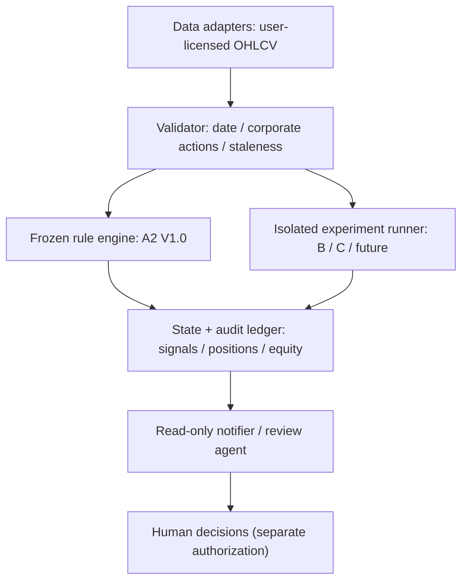

# A2 Agent 与未来 Skill：架构与安全接口约定

**当前状态：** 提供可执行只读回测器与研究资料；尚未创建可真实交易的 Agent、安装式 Skill 或实盘 broker adapter。这份文档让后续工程可以直接延续，而不把研究脚本误当成交易服务。

## 1. 目标

克隆后每个人可以用自己的**合法行情源**复现 A2 V1.0，独立建立 B、C 等候选，进行每日 Shadow Tracking，收到确定性信号和附证据的通知。AI 解释日志、研究假设和异常，但**不更改数学触发条件**。

## 2. 分层



**不能跨的边界**：AI 不直接解释出新的交叉定义；任何自动发送订单是未来单独项目，需要显式授权、额度和停机机制，不能默认从信号/通知模块升级。

## 3. 统一信号对象（建议 JSON Schema 概念契约）

```json
{
  "strategy_id": "a2-n20",
  "strategy_version": "1.0.0",
  "symbol": "QQQ",
  "market_date_et": "YYYY-MM-DD",
  "market_bar_status": "COMPLETE",
  "data_source": "user-provided",
  "data_hash": "sha256:...",
  "position_state": "FLAT | HOLD_N20 | HOLD_TREND",
  "indicators": {"sma10": 0.0, "sma20": 0.0, "sma60": 0.0},
  "entry_date": null,
  "n20_day_after_fill": null,
  "signal": "BUY | SELL | HOLD | NO_ACTION | STALE_DATA",
  "reason_code": "GOLD_20_60 | DEATH_20_60 | N20_LOSS_FAST_DEATH | NONE",
  "signal_confirmed_at_et": "YYYY-MM-DD HH:mm:ss",
  "planned_execution_session": "YYYY-MM-DD",
  "order_submitted": false,
  "research_shadows": {"B_two_day_watch": "NONE | WATCHING | WOULD_EXIT | CANCELLED"}
}
```

此结构是后续集成的**建议契约**，不是声称现有CLI已完整输出所有字段。当前CLI输出 `summary.json / trades.csv / equity.csv`，可逐步增量演进到协议；不要在没有数据时填充伪值。

## 4. 迭代里程碑

| 阶段 | 最小交付 | 验收门槛 |
|---|---|---|
| M0 基准仓库（当前） | 严格A2引擎、历史指标、正反例、数据说明、自动测试 | 58笔严格基准；8个规则语义测试；无原始授权不明CSV |
| M1 Data adapter | CSV/API适配、公司行动一致性、交易日历、调整因子双源对照 | 缺失/未完成日K一律报警，不允许生成伪信号 |
| M2 State service | 每日信号、前一日待执行、权益、幂等事件流 | 同一日重复运行不重复信号；支持历史回放与版本切换 |
| M3 Agent + installable Skill | 定义可安装 `SKILL.md`、工具能力、提示规则与文件路由 | Agent不发明阈值，回答附数据/版本，默认只读 |
| M4 Paper tracking | A2正式 + B影子，提醒与真实价格差异、异常重放 | 实盘信号与预期最多只有可解释的数据/成交差；追踪 >1完整行情周期 |
| M5 Broker execution（可选） | 风险预算、人工审批、止损异常、熔断和对账 | 单独授权后实施，绝不由本仓库默认启用 |

## 5. 未来 Skill 的建议指令

当用户询问 A2 最新状态时，先检查最近完整美股日线、数据授权和调整口径；从历史状态机重放，不允许以昨日日线均线当前位置替代新金叉；返回信号日、计划执行日、N20保护天数、成本和数据时间戳；B、ATR、MA200仅在 `research_shadows` 中展示；产生 `STALE_DATA` 时暂停回答具体买卖信号。

当用户提出改进时，先建立可证伪假设，然后离线复现原始A2和独立候选，列出**每笔得失、误杀赢家、对 MDD 的影响**；提供可复跑命令和输出，不能仅选最漂亮一组数字。

## 6. 容易失败的环节

- 不同数据源复权分歧导致虚假均线交叉；
- 最新一条盘中K误作已收盘日K；
- 恢复运行时只检查 `MA20>MA60`，错误地当作全新金叉；
- N20从买入日而非**次日**开始计数；
- 把模拟的开盘市价当作保证成交价；
- 反事实实验误用已知未来低点或未来强弱标签；
- 没有现金收益、税费和滑点分析就宣称跑赢长期持有；
- 把3倍日杠杆TQQQ当作QQQ多日收益的三倍；
- 未经许可将第三方历史行情放进Git仓库或交给公共AI服务。
