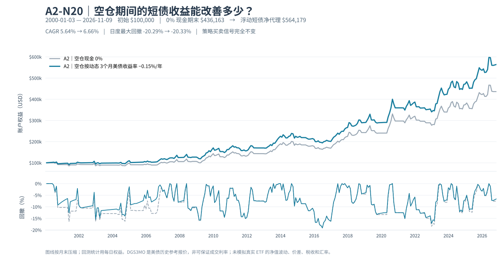
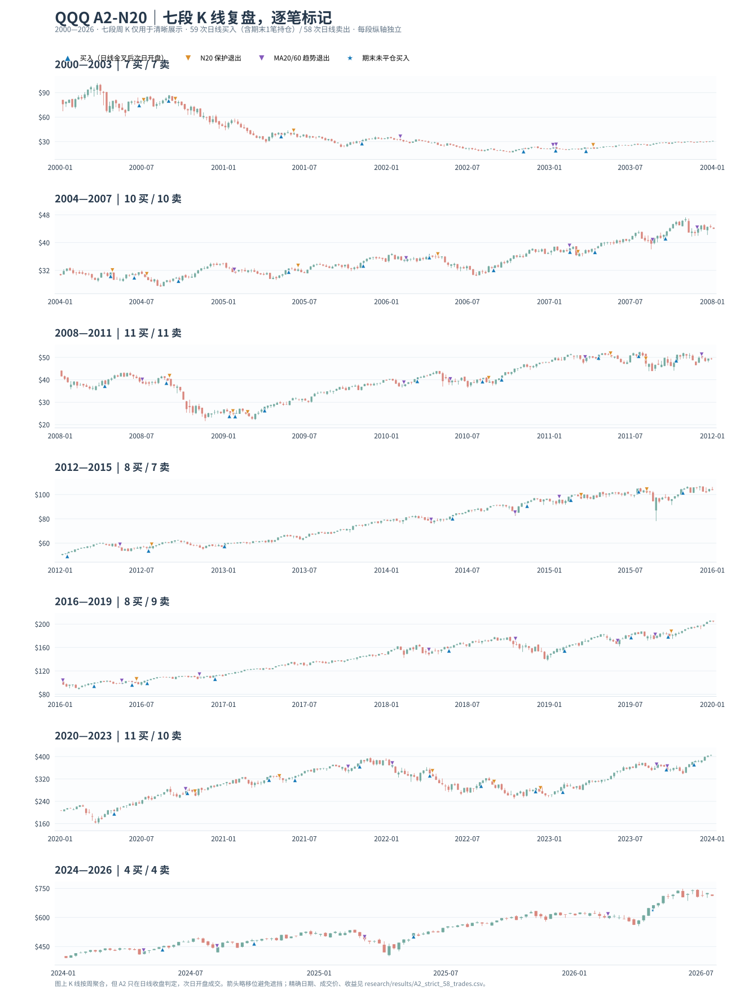

# A2-N20 V1.0：2026-07-14 至 2026-11-09 补样、逐笔对账、现金收益再回放

> 核查日：2026-11-10（北京时间）。这是在**规则和原冻结样本均不变**前提下，把最新完整美东交易日补到 2026-11-09 的前推记录，不是又一个优化参数的 A2 变体。全部美元金额为历史模拟账户，不是真实账户资产。2026-11-10 美东交易日尚未完成，因此不得纳入该日不完整数据。

## 1. 结论先行

| 主指标 | 2026-07-13 原冻结 | 2026-11-09 追加84交易日 | 变化与解读 |
|---|---:|---:|---|
| 已平仓交易 | 58 | **60** | 完成第59、60笔 |
| 胜/负 | 24/34 | **25/35** | 新增1赢1输 |
| 胜率 | 41.38% | **41.67%** | 不是高胜率交易策略 |
| Payoff | 4.0168 | **4.0431** | 本指标受完整交易样本影响 |
| Profit Factor | 2.8354 | **2.8879** | 此项较原样本提高 |
| 账户 MDD | −20.2882% | **−20.2882%** | 新增样本没创造新的全周期最大回撤 |
| CAGR | 5.8397% | **5.6387%** | 追踪期账户下跌且年化分母变长 |
| 期末权益，现金年息0 | $450,595.85 | **$436,162.72** | **阶段 −3.2031%（−$14,433.13）** |
| 状态 | 持有4月23日入场仓位 | **空仓，未产生待执行委托** | 不准把历史持仓当现实强制补仓 |

本次 2026-11-09 最新 QQQ **未复权**收盘价 $679.35；模型按统一最新分红基准得到的 MA10=$689.35、MA20=$704.30、MA60=$719.12、MA200=$680.09。MA20 低于 MA60，最后一日没有新的交叉委托。**纯模型状态，不是建议现在开盘交易。**

**只比较 2026-07-13 收盘至 11-09 收盘的共同持有窗口：** QQQ 复权价格 $711.00045 → $679.35，买入持有约 **−4.45%**（无额外交易费用）；A2 现金0%账户 **−3.20%**；A2 按 DGS3MO 减15bp 的现金净收益代理账户 **−2.15%**（其完整资产约 $576,561.67 → $564,178.66）。这三组的历史观察起点相同，但此前风险暴露与持仓方式不同；不保证下一个窗口的排序。

### 两笔新增完成交易（QQQ 全进全出，单边0.05%费用）

| 编号 | 买入信号 → 开盘成交 | 卖出信号 → 开盘成交 | 原因 | 持仓交易日 | 完整单笔净收益 | 卖后模拟账户权益 |
|---|---|---|---|---:|---:|---:|
| **59** | 2026-04-22 → **04-23** | 2026-07-24 → **07-27** | MA20/60 **新死叉** | 64 | **+5.8445%** | **$437,676.32** |
| **60** | 2026-08-26 → **08-27** | 2026-08-28 → **08-31** | 20日保护期内、亏损时 MA10/20 **新死叉** | 2 | **−0.3458%** | **$436,162.72** |

- **为何完整交易#59赚5.84%，7月以来账户反而亏？** #59 的收益从4月23日买入算起；到7月13日时，持仓按当天收盘浮盈已被计入账户 **$450,595.85**。等7月27日按趋势信号实际卖出，账户回落至 **$437,676.32**。那段浮盈的回吐，不能重记成7月13日之后才发生的盈利。
- **8月为何买入又立刻卖？** 8月26日收盘日线 MA20 新上穿 MA60；8月27日开盘成交。8月28日收盘处于买入后20个完整交易日保护期，MA10 **新下穿** MA20，且收盘低于入场开盘价，因此产生次日开盘平仓单，并在8月31日执行。没有等待三日、没有自行修改止损线。
- **11月3日的 MA20/60 死叉不等于交易。** 该时模型已经空仓，虽然指标层出现卖出型信号，但状态机没有可卖的持仓，因此 `actual_pending` 为空。不能把每一次指标交叉都画成真实买卖。
- 新增期间10月19日还有一次 MA10/20 的下降交叉，但那时空仓，同样不是保护卖单。

逐笔最完整表格请查 [全部60笔](../../research/results/A2_current_trades_to_2026_11_09.csv)、[仅新增两笔](../../research/results/A2_newly_completed_trades_2026_07_14_to_11_09.csv)、[84日账户权益](../../research/results/A2_forward_daily_equity_2026_07_14_to_11_09.csv)、[新时期信号状态记录](../../research/results/A2_forward_signal_events_2026_07_14_to_11_09.csv) 和 [机器可读核查记录](../../research/results/A2_forward_update_to_2026_11_09.json)。

## 2. 行情质量：防止分红产生“假金叉”

| 校验 | 本次结果 |
|---|---|
| 原冻结原始源 | `jtang25` 早期 + `jameswdonoghue` 较近期，原先合并 6877 完整交易日，至7/13 |
| 新增源 | [StockQuote.io QQQ history](https://www.stockquote.io/stocks/QQQ/history?page=1)，逐页获取2026年增量日 OHLCV 与复权收盘，至11/09 |
| 独立最后收盘交叉验证 | [StockAnalysis / S&P Global QQQ history](https://stockanalysis.com/etf/qqq/history/)，11/09 收盘 $679.35 |
| 增量交易日数 | **84**；总数 **6961** |
| 中间节假日 | 2026-09-07 美国劳动节；按交易所休市排除，其他工作日无缺失 |
| 与原冻结序列重叠对账 | 10个交易日；未复权收盘最大差 $0.000029 |
| 历史复权基准缩放比 | **0.9989609457128912**（新版本 Adj Close / 旧版本 Adj Close）；重叠样本最大离差约 **8.50×10⁻⁶** |
| 新快照本地原始数据 SHA-256 | `2cef4c6567a0e44295033d3d8bd84d26e95942840b3f8683fd1e7a290613e248` |
| 原始冻结交易与权益 | **58笔逐一核对信号日、成交日、卖出原因、持有日、单笔收益；冻结日之前的每日账户权益全一致** |

**为什么老数据会变？** QQQ 2026年9月发生现金分红，晚于7月13日的新供应商快照会把老日期的 `Adj Close` 重算至更晚的分红基准。若不把所有老复权 OHLC 统一乘上缩放因子，直接把旧7月收盘价与新7月开盘价拼接，交界处会产生人工价格台阶，可能导致不存在的信号。此脚本明确拒绝重叠未复权原价冲突、复权比例不恒定、目标日期不完整、日期重复、缺失栏位和无解释的工作日空白。

我们核对的是**重复交易日与末日收盘**，并不声称第三方新源的所有84根 K 线都逐日与另一独立供应商交叉校验。新的数据供应商可能修订行情；若重跑要记录当前文件哈希，并在必要时重新审计。第三方原始行情**不在公开仓库内再分发**。

## 3. 空仓现金收益再次回放，60笔信号仍不变

原研究已在 [2026-07-13 冻结现金利率报告](A2_空仓美债现金收益_独立回测_2026-11-10.md) 解释：现金部分按 [FRED DGS3MO](https://fred.stlouisfed.org/series/DGS3MO) 的**当时已知 3个月美国国债恒定到期报价**代理计息（非真实 ETF 或银行定存回报）；按日历天数累积，保留 A2 原单边0.05%交易费。新增加 2026-10-26 至11-06 官方 [H.15 日度利率](https://www.federalreserve.gov/releases/h15/)，避免把10月23日的历史镜像利率无限沿用；**11月9日尚未取得官方当日报价，按上次可用的11月6日 4.19%计息**。

| 情景 | 2026-11-09期末模拟权益 | 对现金0的全历史累计多赚 | CAGR | 日度 MDD |
|---|---:|---:|---:|---:|
| **A2 + 现金不计息** | **$436,162.72** | — | **5.6387%** | **−20.2882%** |
| A2 + 历史 DGS3MO 毛报价 | $575,324.69 | +$139,161.97 | 6.7338% | −20.2763% |
| **A2 + DGS3MO 减15bp/年模拟摩擦** | **$564,178.66** | **+$128,015.94** | **6.6561%** | **−20.3290%** |
| A2 + 永远固定2%/年（**虚拟假设**） | $566,160.65 | +$129,997.93 | 6.6700% | −19.5819% |
| A2 + 永远固定3%/年（**虚拟假设**） | $645,031.06 | +$208,868.34 | 7.1894% | −19.2265% |
| A2 + 永远固定4%/年（**虚拟假设**） | $734,883.47 | +$298,720.75 | 7.7113% | −18.8694% |

完整回测中的空仓资金经历约 **4761 / 9807 个日历日，48.55%**。这些空仓日加权的历史 DGS3MO 年化报价均值约 **2.12%**。动态 −15bp 的净代理情景较纯0现金把账户终值抬高约 **29.35%**，但**最大回撤仍比纯0现金略差（−20.33% 对 −20.29%）**。因此不能宣称“多赚利息就把策略MDD降低了”。



[更新版六情景 CSV](../../research/results/forward_2026_11_09/a2_cash_yield_scenarios.csv) · [更新版月末账户权益 CSV](../../research/results/forward_2026_11_09/a2_cash_yield_monthly_equity.csv)。原 2026-07-13 的两张冻结情景 CSV 未改动；新曲线只更新 README 使用的视觉资产。

## 4. 静态成交图：新时期的买卖落点



蓝色买标/橙色 N20 卖标/紫色 MA20/60 卖标均来自**每日策略真实订单**，仅把背景 K 线聚成周线确保图能读清，周线从不生成策略信号。原冻结口径最后一笔4月23日买单已在本次补样中7月27日卖出，因此没有期末持仓星号。

## 5. 使用者本地完整复现

该仓库**不含未确认再分发权的原始 QQQ OHLCV 以及 FRED 利率 CSV**，下载链接和校验哈希不等于提供使用授权。需先在自己的运行环境通过合法来源获得：

- `sources/qqq_jtang.csv`、`sources/qqq_james.csv`：原冻结两家日线源。
- `sources/qqq_stockquote_2026_11_09.csv`：2026-11-09 前的增量日线（至少包含冻结附近可比的重叠日、截止日完整日K），结构为 `Date,Open,High,Low,Close,Adj Close,Volume`。原本地文件哈希见上。
- `sources/DGS3MO.csv`：自1999末至2026-11-06、包含官方同期修正的每日 DGS3MO 历史（可从 FRED 下载）；若只拥有原2026-10-23镜像，可用单独 `--yield-csv-extra` 增量 CSV。

```bash
python -m pip install -e '.[charts]'
python -m unittest discover -s tests -v

# 只读核验58笔冻结交易，生成新60笔派生数据+本地合并K线
python research/verify_frozen_baseline.py \
  --old sources/qqq_jtang.csv --new sources/qqq_james.csv
python research/experiments/a2_forward_update.py \
  --old sources/qqq_jtang.csv --new sources/qqq_james.csv \
  --update sources/qqq_stockquote_2026_11_09.csv --asof 2026-11-09

# 生成全部成交点静态图
python scripts/render_trade_chart_facets.py \
  --csv sources/qqq_merged_updated_local.csv --end 2026-11-09

# 用含最新 H.15 报价的全历史利率文件回放六场景
python research/experiments/a2_cash_yield_backtest.py \
  --csv sources/qqq_merged_updated_local.csv --yield-csv sources/DGS3MO.csv \
  --end 2026-11-09 --outdir research/results/forward_2026_11_09 \
  --chart assets/a2_cash_yield_equity.svg
```

输出证据中，**现金0% 的期末权益必须与主 A2 引擎一致**。若供应商修订 QQQ 数据导致价格重叠校验失败，或者历史利率序列缺失超过10个日历日，研究必须终止并报告原因，不能在缺失数据上静默重算新结果。现金图只按月末抽点，但表中 **MDD是每日权益**的峰谷回撤。

## 6. 对真实跟踪与未来 Agent 的启发

1. **信号 ≠ 委托**：记录 `signal_date`、`execution_date` 和当时实际状态；空仓时的卖出型指标变化只入事件日志，不执行卖出。
2. **回放而非续接猜测状态**：拿到每天完整收盘价格后从头计算交叉，并在当次研究截止日给出 `LONG/FLAT`、`pending order`、行情 `asof` 与任何断档。
3. **跟踪多套账**：策略 V1.0 完全不变；现金管理只是资金账户层的对照，若实际存款/T-bill因结算导致买入延误，要单独记录；不能事后用模型假定永远流动性充足。
4. **把反例也永久保留**：此阶段新完成交易一赢一亏且整体权益下跌，说明“逐笔 Payoff 还不错”与“持有人从观察日起赚钱”可以同时相反；真正做低风险模型，要持续观察账户每日MDD、滑点与**真实可实现的**空仓收益。

进一步研究须单独建分支/版本，对比相同时段原 A2，不应看完这84根 K线又调整N20天数、MA周期或暴跌观察天数去拟合结果。
