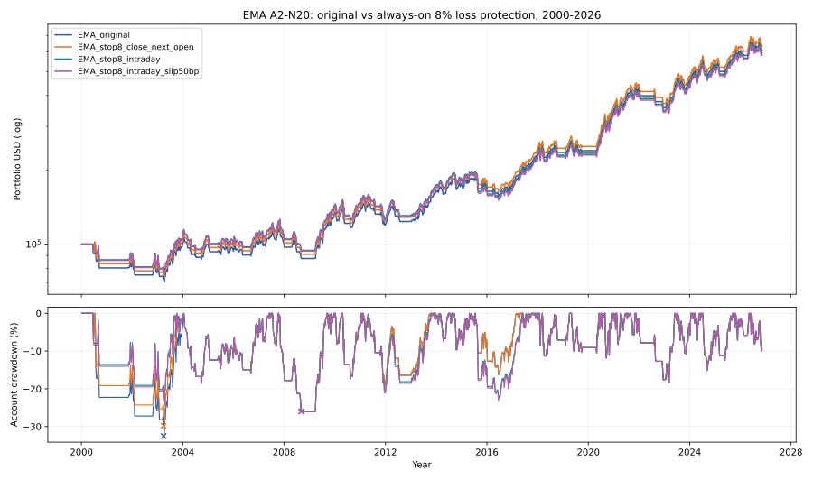

# EMA A2-N20：N20 与全程 8% 亏损保护，哪个先触发哪个执行

> 2026-11-10 · 实验分支 `experiment/ema-a2-n20-hardstop8` · QQQ 2000-01-03 至 2026-11-09 · **原始 SMA 和 EMA A2-N20 状态机不变**。

## 结论

**8% 全程止损能降低这份历史样本的账户最大回撤，但无法把实际单笔最大亏损锁死在 8%；执行方式决定了收益与风险的权衡。** 在已有 EMA A2-N20 出场规则之上，新增一个持仓全程有效、以**含双边手续费的净收益**判定的 8% 亏损条件；没有调整入场、仓位、EMA 口径、N20 期限或等待新金叉的重新入场规则。

| 指标 | EMA 原版 | 8% 收盘判定→次开盘 | 8% 盘中止损，跳空按开盘 | 盘中止损 + 50bp 额外滑点 |
|---|---:|---:|---:|---:|
| **期末权益（$100k 起步）** | $608,362 | **$632,733** | $593,063 | $584,212 |
| **CAGR** | 6.96% | **7.11%** | 6.85% | 6.79% |
| **账户 MDD（日末权益）** | −32.52% | −29.81% | **−26.00%** | **−26.00%** |
| **最差已完成单笔亏损** | −14.66% | −11.24% | −14.18% | −14.61% |
| 交易完成数 / 赢 / 输 | 54 / 24 / 30 | 54 / 24 / 30 | 54 / 24 / 30 | 54 / 24 / 30 |
| 胜率 | 44.44% | 44.44% | 44.44% | 44.44% |
| Payoff | 3.62 | **3.73** | 3.55 | 3.51 |
| 平均亏损 | −4.05% | **−3.93%** | −4.13% | −4.17% |
| 8% 条件触发并退出 | — | 3 | 3 | 3 |
| 其中跳空越过止损位 | — | 不适用 | **2** | **2** |
| N20 退出 / EMA20/60 普通退出 | 14 / 40 | 14 / 37 | 14 / 37 | 14 / 37 |
| 在场时间 | 65.98% | 65.93% | 65.59% | 65.59% |

[](../../assets/a2_ema_stop8_equity_drawdown_2000_2026.svg)

以上均按 **6,754 个模拟交易日**计算（1999-03-10 起提供历史预热，2000-01-03 才开始模拟），每次全仓、单边费用 0.05%、空仓收益 0、税前、不计实际交易滑点（独立 50bp 情景除外）。曲线仅为周末展示抽样，**MDD 为全部日线**；盘中止损使用日 K 的最低价和开盘价做简化订单模拟，**不是逐笔撮合或可保证的真实滑点分布**。

## 1. 四组实验如何定义

**对照组：** 原版 EMA20/60 新金叉在当日收盘确认、次交易日开盘进场；成交后的前 20 个完整交易日，EMA10/20 新死叉并且收盘低于入场价时，次日开盘 N20 退出；不管持仓多久，EMA20/60 新死叉均次日开盘退出。平仓后只允许下一个**新的** EMA20/60 金叉进入。EMA 初始化固定为 `ewm(span=N, adjust=False, min_periods=N)`，1999 年数据预热；没有做首次持仓的特殊删减。

新增的 8% 损失阈值使用**扣除买入和卖出各 0.05% 费用的单笔净收益**：

`stop_price = entry_adjusted_open × (1 + 0.0005) × (1 − 0.08) / (1 − 0.0005)`

每笔买入后阈值即固定，持仓全程生效，既不只限 N20 窗口，也不会随着浮盈上移。它是**入场成本亏损止损**，不是追踪最高价的止盈或回撤保护。

1. **收盘触发→次开盘：** 每个已完成日 K 收盘，若按该收盘价模拟卖出净收益 ≤ −8%，触发次日开盘卖出。N20、趋势退出也在收盘判定；若同一收盘同时满足，实际成交时间相同，交易记录注明并发，不能凭日 K 猜先后。即使收盘刚触发 −8%，次日跳空也可能使实际亏损明显大于 8%。
2. **盘中跳空感知：** 从入场开盘起检查当日日 K 的复权 Low 是否触及阈值。若开盘价已低于止损价，则模拟按**较差的开盘价**成交；否则模拟按止损阈值成交。盘中退出比当晚才产生的 N20/EMA20/60 信号更早。若前一晚已发出 N20/趋势卖出，则该笔委托先在今天开盘执行，不会假设它又被盘中止损覆盖。
3. **盘中 +50bp 滑点：** 在上一组模拟价格基础上，再折减 0.5% 以衡量撮合不利的敏感性。它是压力情景，不代表真实最差成交保证；极端流动性和停牌可能更差。

所有方案仅用当日或更早的 OHLC 与均线，未来的日高/低不会进入入场信号。盘中方案依赖日内 High/Low 的范围；无法知道触发瞬间的真实成交价、订单簿深度或具体秒级走势。**策略引擎默认的信号后次开盘执行规则没有被改写**：盘中版明确是单独的下单机制实验，不能伪装成原策略。

## 2. 关键三笔：风险控制与“误伤”

| 买入日期 | EMA 原版离场 / 回报 | 8% 收盘止损 | 8% 盘中模拟 | 事件归因 |
|---|---|---|---|---|
| **2000-06-22** | 08-03 / **−14.66%** | 07-31 / **−11.24%** | **06-29 / −8.00%** | N20 没能在前 20 日触发；全程止损提前离场，是主要正例 |
| **2011-10-14** | 11-28 / **−6.41%** | 11-28 / **−6.41%** | 11-25 / **−8.32%** | 收盘 8% 与趋势死叉同日触发，次开盘反弹；盘中止损遇开盘跳空反而更差 |
| **2015-07-14** | 08-25 / **−7.04%** | 08-25 / **−7.04%** | 08-24 / **−14.18%** | 2015-08-24 跳空跌开、盘中巨震，止损按较差开盘价格模拟卖出，错过次日反弹 |

对应 50bp 滑点版三笔依次为 **−8.46%、−8.78%、−14.61%**。实际对照交易全部为 54 笔，**入场日期与次数均相同**，没有丢失 2003、2009、2020—2021 年的关键入场；真正改变成交日期的只有 2000 年一笔（收盘模型）或三笔（盘中模型）。说明改善不是由事后筛掉坏入场伪造的，而是出场交易时序的差别。

重要反例：**2015 年，设置了“8% 止损”却可能在模拟中实际亏 −14.18%**。因为止损是触发市价卖单的价格条件，而不是交易所承诺以该价成交。日 K 中 2015-08-24 的调整后开盘已低于止损价，模型不能填一个不存在的 −8% 成交；反而原 EMA20/60 当日收盘死叉，第二日开盘退出时只亏约 −7.04%。这并不证明真实开盘必可成交在回测开盘价，实际情况仍受流动性影响。

## 3. 对“极端下行”的帮助与遗漏

- **熊市早期确有作用。** EMA 原版 MDD **2000-07-17 至 2003-03-31：−32.52%**；收盘版降至 −29.81%。盘中版压低该段的回撤后，全周期最大回撤转移到 **2007-10-31 至 2008-09-03，约 −26.00%**。
- **8% 单笔入场亏损止损不等于账户 MDD ≤8%。** 某笔持仓可能先赚 20% 再回吐到略赚或接近成本，仍不触发按入场价的 8% 固定止损；账户从历史权益峰值算的 MDD 可以远高于 8%。
- **样本仅 3 次止损事件。** 严重跳空 2 次，足以使盘中版在长期 CAGR 上反而落后原版。不能凭 −26% 的更好 MDD 断言盘中 8% 是稳健最优参数；其他阈值、交易制度、市场流动性和真实滑点可能改变排序。
- **机会成本。** 本次新止损没有错失后续三大趋势的入场，但这仅是给定历史与当前“必须等新 EMA 金叉”的重新入场规则的观察；未来若刚止损后没有新金叉，仍可能长时间错过上涨。本轮没有新增快速重入机制。

## 4. 时间段与验证

非重叠分段内，2000—2003 年原版账户收益约 +0.52%、收盘版 +4.55%、盘中版 +8.37%；但 **2010—2015 年**原版 +30.77%、盘中版只有 +18.25%（2015 跳空造成）。**2016—2021 年**与 **2022—2026 年**各方案的周期内收益基本相同，因为没有对应新的止损退出事件。完整分段归档在 CSV，分段数值不是独立的样本外检验。

核心复现断言：把止损比例设成几乎不可能触发的 `99.9%` 时，两种守护模式的 **54 笔交易与每日账户权益逐行等于原 EMA 引擎**；额外合成测试涵盖入场当日保护、触价卖出、跳空越线、收盘后次开盘超额亏损、N20 先触发及双边手续费阈值。全仓库 **35 项测试通过**。

```bash
python -m pip install -e '.[charts]'
PYTHONPATH=src python -m unittest discover -s tests -v
python research/experiments/a2_ema_hard_stop8.py \
  --csv sources/qqq_merged_updated_local.csv --end 2026-11-09
```

公开派生文件：

- [回测源码](../../research/experiments/a2_ema_hard_stop8.py)与[回归测试](../../tests/test_ema_hard_stop8.py)；
- [四种模型汇总](../../research/results/ema_stop8_2026_11_09/summary.csv)和[分周期对照](../../research/results/ema_stop8_2026_11_09/period_slices.csv)；
- [仅三笔受影响交易逐列对照](../../research/results/ema_stop8_2026_11_09/changed_trades.csv)；
- [四种方案全部成交 CSV](../../research/results/ema_stop8_2026_11_09/)与[每月账户权益](../../research/results/ema_stop8_2026_11_09/monthly_equity.csv)；
- [四模型账户权益／日末 MDD SVG](../../assets/a2_ema_stop8_equity_drawdown_2000_2026.svg)。

原始 6,961 条 OHLCV 研究文件 `sources/qqq_merged_updated_local.csv` SHA-256：`2e0f003b81d46ab432b303d63ede8c768adfe59fcd3d44ecb9540875d0c80e9c`。**未确认再分发许可的历史行情不上传仓库。** 复权调整为税前毛分红再投代理，未计现金利率、个人所得税、股息预扣税、汇率、市场冲击、借贷或实际止损价成交；仅历史样本内研究，不是未来损失或止损可成交价格的保证。

## 下一步研究判断

本轮证据更支持“**收盘确认的持续亏损条件，能改善一部分长期风险；但当日开盘跳空直接机械砍仓，可能制造意料之外的更差成交**”，而不是“8% 自动封顶所有交易亏损”。相比反复优化 7%、8%、9% 阈值，更值得下一轮将**账户峰值回撤保护**与本次**成本亏损止损**明确分离，并先固定异常波动 / 开盘流动性情景，避免用事后看到的 2015 年回撤去设计只针对该日的特例。
