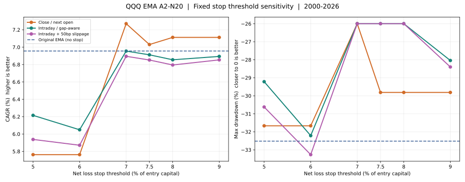

# EMA A2-N20：全程固定亏损止损 5%—9% 参数敏感性

> 独立分支 `experiment/ema-a2-n20-stop-sweep` · 固定候选 `{5%, 6%, 7%, 7.5%, 8%, 9%}` · QQQ 2000-01-03—2026-11-09 · **不改原版 SMA、EMA 入场／N20／趋势退出／只等新金叉重新买入规则**。

## 先讲结论

**止损阈值的历史结果不单调，5%—6% 并不必然好于 7%—9%；7% 的全周期优势尤其依赖 2000 年首笔交易。**

- 以**收盘确认、次日开盘卖出**定义：7% 历史期末权益 **$658,227**，CAGR **7.27%**，日末最大回撤 **−26.00%**；看起来优于无硬止损的 EMA（$608,362、6.96%、−32.52%）。但改从 **2004 或 2010 年独立建仓**，7% 的终值**均落后于原 EMA**。这不是样本外胜利。
- 5%/6% 的收盘止损都只有 **$450,102**，主要原因是误杀了 **2003 年一笔本来盈利 +30.53% 的长趋势**，提前以约 −5.35% 离场。更紧的阈值会增加被日常波动扫出后错失牛市的机会成本。
- 以**盘中触价、跳空按较差开盘价**模拟，5% 止损把最差已完成单笔回报从 −14.66% 改成 **−5.78%**，但 CAGR 只有 **6.21%**，终值与原 EMA 相比低约 **$103,611**。若额外施加 50bp 不利滑点，表现进一步下降。
- **固定成本止损与账户峰值 MDD 是两个概念**；跳空也使“5% 止损”不是绝对的 5% 亏损上限。应把此机制视为可计价的尾部风险保险，不能先假定“加了就必然更好”。

[](../../assets/a2_ema_stop_threshold_sweep_2000_2026.svg)

## 1. 同口径全周期回测

起始资金 **$100,000**；6,754 个模拟交易日；初始持仓为空，**必须等新 EMA20/60 金叉才开第一笔**；每笔全仓，买卖各收 0.05% 手续费；税前、空仓利息 0。指标采用相同复权 QQQ 日线，1999 年已有数据作为 EMA 预热；截至 2026-11-09 完整收盘。

**原始 EMA A2-N20（无新增固定止损）：** $608,362；CAGR 6.96%；账户 MDD −32.52%；54 笔完成交易；最差单笔 −14.66%。

### 方案 A：收盘亏损达标，次交易日开盘卖出

| 全程净亏损阈值 | 期末权益 | CAGR | 日末 MDD | 最差单笔 | 强制止损标记 | 相对原 EMA 期末差额 |
|---|---:|---:|---:|---:|---:|---:|
| **5%** | $450,102 | 5.76% | −31.67% | −14.18% | 9 | −$158,261 |
| **6%** | $450,102 | 5.76% | −31.67% | −14.18% | 5 | −$158,261 |
| **7%** | **$658,227** | **7.27%** | **−26.00%** | **−8.32%** | 3 | **+$49,864** |
| **7.5%** | $619,767 | 7.03% | −29.81% | −11.24% | 3 | +$11,405 |
| **8%** | $632,733 | 7.11% | −29.81% | −11.24% | 3 | +$24,371 |
| **9%** | $632,733 | 7.11% | −29.81% | −11.24% | 2 | +$24,371 |

8% 与 9% 虽然触发标记数不同，却**实际交易成交价、成交日完全相同**；有些额外“止损触发”与本来就要执行的 EMA20/60 死叉重合，标记数不等于新增、改变结局的交易数。

### 方案 B：盘中触价，跳空按较差开盘价

| 全程净亏损阈值 | 期末权益 | CAGR | 日末 MDD | 最差单笔 | 止损卖出次数 | 其中跳空越线 |
|---|---:|---:|---:|---:|---:|---:|
| **5%** | $504,752 | 6.21% | −29.22% | **−5.78%** | 14 | 2 |
| **6%** | $483,989 | 6.05% | −32.21% | −6.08% | 9 | 0 |
| **7%** | $608,169 | 6.95% | **−26.00%** | −14.18% | 3 | 1 |
| **7.5%** | $601,647 | 6.91% | **−26.00%** | −14.18% | 3 | 1 |
| **8%** | $593,063 | 6.85% | **−26.00%** | −14.18% | 3 | 2 |
| **9%** | $598,889 | 6.89% | −28.04% | −14.18% | 2 | 1 |

**盘中再额外减 50bp 成交滑点的压力测试**：阈值从 5% 到 9%，依次取得终值 **$470,545 / $462,641 / $599,092 / $592,667 / $584,212 / $592,915**；对应 CAGR **5.94% / 5.87% / 6.89% / 6.85% / 6.79% / 6.85%**。所有情景的完整指标与 54 笔明细均已归档，不只保留最优一行。

## 2. 为什么不是越紧越好：4 笔反例

所有候选均保留 **54 次相同的真实 EMA 金叉入场日期**；区别仅是某些仓位更早卖出，期间仍然执行“必须等下一次新 EMA 金叉才能重新入场”。按照**入场日期**核对变化，不能只看最后的 CAGR。

| 入场日期 | 原 EMA 的结果 | 新止损结果 | 解释 |
|---|---|---|---|
| **2000-06-22** | 2000-08-03 卖出，**−14.66%** | 7% 收盘版 2000-06-26 卖出，**−5.73%** | 净少亏约 **8.93 个百分点**；7% 全周期优势主要由这一笔带动 |
| **2003-03-19** | 2004-03-11 卖出，**+30.53%** | 5%/6% 收盘版 2003-04-01 卖出，**−5.35%** | 单笔少赚约 **35.88 个百分点**，长期复利随后被不断放大 |
| **2011-10-14** | 2011-11-28 卖出，**−6.41%** | 7% 收盘版 2011-11-25 卖出，**−8.32%** | 更早触发未必有利，次日开盘成交甚至更差 |
| **2015-07-14** | 2015-08-25 卖出，**−7.04%** | 5%/6% 收盘版 2015-08-24 卖出，**−14.18%** | 前一日收盘触发，次日跳空急跌，出现显著亏损超限；5% 盘中版则在 08-21 提前止损约 −5% |

这里 7% 优于 7.5%/8% 的核心不是市场长期稳定存在精确的“7% 转折点”，而是个别日线**首次触发日期**恰好发生变化；阈值是离散执行规则，输出天然是路径依赖的阶梯函数。在一份已见过的历史样本上连续寻找最漂亮的参数，容易把偶然交易路径误判成可复用规律。

## 3. 换起点验证：7% 优势在后续历史并不稳健

每一行都从对应起点 **$100,000 独立重新开始**（不继承 2000 年的复利本金），但保留此前历史数据计算均线。下面仅列“收盘确认、次开盘卖出”这一执行模型；各阈值和盘中版完整结果在 `start_date_sensitivity.csv`。

| 研究起点 → 同截止日 | 原 EMA 期末 | 5% / 6% 期末 | 7% / 7.5% 期末 | 8% / 9% 期末 | 原 EMA MDD | 7% MDD |
|---|---:|---:|---:|---:|---:|---:|
| **2004-01-02** | **$629,521** | $581,489 | $616,621 | **$629,521** | −26.00% | −26.00% |
| **2010-01-04** | **$486,089** | $449,001 | $476,129 | **$486,089** | **−19.71%** | −21.36% |
| **2016-01-04** | $371,528 | $371,528 | $371,528 | $371,528 | −18.36% | −18.36% |

**重要限定**：这是*历史起点敏感性*，不是未看过行情的样本外（OOS）检验；阈值是通过已经看见的整段 2000—2026 数据比较的。它只能说明“7% 的优势不耐起点变化”，不能推导出未来哪个固定百分比最优。

## 4. 执行模型定义与真正的风险边界

新增止损在每次成交买入后立即生效，**持续覆盖完整持仓期**，与入场后前 20 个持仓交易日有效的 N20 和不受时间限制的 EMA20/60 死叉**同时检查，先达到可执行条件者先退出**。不添加部分止盈、不改变仓位、不允许没有新 EMA 金叉的快速回补。

统一以**扣除买卖两次 0.05% 费用后的单笔净回报**设定退出价：

`stop_price = adjusted_entry_open × (1 + 0.0005) × (1 − stop_pct) / (1 − 0.0005)`

1. **日线收盘确认**：收盘净亏损跨过阈值，下一交易日按开盘成交，和 N20/EMA 趋势信号一样；日内最低价并不提前触发收盘规则。
2. **盘中止损单近似**：已复权日内 Low 达阈值，模拟在阈值成交；若**当日开盘已经跌破阈值**，按更差的开盘价成交。前一晚已发出的 N20/EMA 卖出委托，优先当日开盘执行。
3. **50bp 压力模拟**：在盘中版模拟执行价再减少 0.5% 处理不利滑点。日 K 无法提供逐笔成交、点差和真实订单簿；模型不具备真实止损成交保证。

**账户的日末最大回撤即使只有 −26%，也不意味着日内跌幅受此限制**；同时固定入场成本亏损保护不会保住一笔交易从 +20% 浮盈回吐到 +1% 的利润。保护“单笔尾部亏损”和保护“账户高水位收益”，需要分别研究。

## 5. 复现、回归与归档

```bash
python -m pip install -e '.[charts]'
PYTHONPATH=src python -m unittest discover -s tests -q
python research/experiments/a2_ema_stop_threshold_sweep.py \
  --csv sources/qqq_merged_updated_local.csv --end 2026-11-09
```

40 项回归测试通过，包含独立 EMA 的趋势重放、原先的 8% 逐笔止损边界、此次不同百分比的触发标签和逐笔归因。新脚本继续复用既有 EMA 和 8% 保护研究的同一套交易撮合代码；7%/8%/9% 及 5%/6% 的结果可直接比对前一份 8% 报告。源行情文件不随仓库发布，使用者须以有权使用且计算口径一致的复权 OHLCV 重新执行；本实验研究数据 SHA-256 为 `2e0f003b81d46ab432b303d63ede8c768adfe59fcd3d44ecb9540875d0c80e9c`。

- [固定参数扫描源码](../../research/experiments/a2_ema_stop_threshold_sweep.py) · [合成回归测试](../../tests/test_ema_stop_sweep.py)
- [全部 19 组整体指标](../../research/results/ema_stop_sweep_2026_11_09/summary.csv) · [不同阶段的表现](../../research/results/ema_stop_sweep_2026_11_09/period_slices.csv)
- [按入场日期逐笔归因的差异](../../research/results/ema_stop_sweep_2026_11_09/changed_trades.csv) · [2004/2010/2016 独立起点敏感性](../../research/results/ema_stop_sweep_2026_11_09/start_date_sensitivity.csv)
- [原版与 18 个强制止损版本各 54 笔交易 CSV](../../research/results/ema_stop_sweep_2026_11_09/) · [CAGR/MDD 阈值曲线 SVG](../../assets/a2_ema_stop_threshold_sweep_2000_2026.svg)

全部结果是**历史样本内、税前**，不包含真实订单摩擦、现金利息或资本利得税。**本轮不能宣称 7% 是最优值，甚至不能宣称新增固定止损必然提高 CAGR 或降低 MDD。** 更合理的下一步是：先固定对尾部亏损的容忍边界，再用时间隔离的样本或其他指数检验同一规则的有效性，并单独研究极端跳空及高水位盈利保护。
