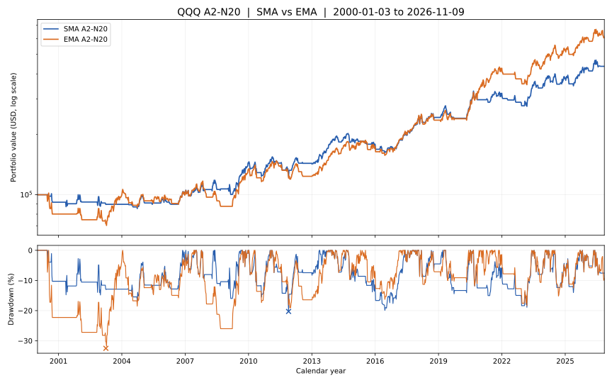

# A2-N20：把 SMA 全部换成 EMA 的独立回测

> 2026-11-10 · 仅实验分支 `experiment/ema-a2-n20` · QQQ 日线截至美东 2026-11-09 · **原始 SMA A2 V1.0 不变**。

## 核心结论

**EMA 减少了交叉和交易次数，提高了资金在场时间与历史收益，但并未达到“更低最大回撤”的目标。** 相比 SMA，EMA 的 CAGR 高约 1.32 个百分点，账户 MDD 却由 −20.29% 扩大为 −32.52%。历史收益提高主要依赖 2003 年以及 2020—2021 年等少数持续上涨段；2000—2003 年的连续亏损是反例。

| 指标（相同完整日 K） | SMA A2-N20 V1.0 | EMA A2-N20 实验版 | 对照 |
|---|---:|---:|---|
| 研究起点 / 截止 | 2000-01-03 / 2026-11-09 | 同左 | 同一份数据 |
| 初始资金 | $100,000 | $100,000 | 同一资金 |
| **期末权益** | **$436,162.72** | **$608,362.40** | EMA 多 **$172,199.68（相对高 39.48%）** |
| **CAGR** | **5.64%** | **6.96%** | EMA 高约 **1.32 个百分点/年** |
| **账户最大回撤** | **−20.29%** | **−32.52%** | EMA **恶化 12.23 个百分点** |
| 已完成交易 | 60 | 54 | EMA 少 6 笔 |
| 胜 / 负 | 25 / 35 | 24 / 30 | 不把浮盈当已完成交易 |
| 胜率 | 41.67% | 44.44% | EMA 高约 2.78 个百分点 |
| 平均盈利 | +10.70% | +14.66% | EMA 单笔盈利更大 |
| 平均亏损 | −2.65% | **−4.05%** | EMA 单笔亏损也更大 |
| Payoff（平均盈 / 平均亏绝对值） | **4.04** | **3.62** | EMA 下降 |
| Profit Factor（盈利收益率之和 / 亏损绝对值之和） | 2.89 | 2.90 | 近似持平 |
| N20 保护卖出 | 26 | 14 | EMA 减少早期保护触发 |
| MA20/60 死叉卖出 | 34 | 40 | EMA 更多退出依赖慢线 |
| 平均已完成持有交易日 | 57.88 | 82.52 | EMA 延长约 24.64 日 |
| 资金在场比例 | 51.42% | **65.98%** | EMA 高约 14.55 个百分点 |
| 截止日状态 | 空仓，无待执行委托 | 空仓，无待执行委托 | **不是实时信号** |

[](../../assets/a2_ema_vs_sma_equity_2000_2026.svg)

图上方是**对数纵轴**的税前账户权益，下方是从各自历史最高账户权益计算的回撤。为保证 README 中 SVG 清晰、体积可控，**曲线按每周最后一个交易日抽样展示**，叉号额外标出**真实日度最大回撤的最低点**。MDD、CAGR 和所有交易计算均使用原始全部日 K，**不能拿图上的周点重新估算 MDD**。

## 1. 明确假设与仅有的一项变化

假设：指数加权均线比简单移动平均更重视近期收盘，可能让入场和趋势退出更及时；但更快也可能导致噪声与错误退出。研究仅改变**均线公式**，不调仓位、日期、卖出规则或寻找另一个最佳参数组合。

| 项目 | SMA 基准 | EMA 变体 |
|---|---|---|
| MA10、MA20、MA60、MA200 | 最近 N 个**复权收盘价的简单均值** | `ewm(span=N, adjust=False, min_periods=N).mean()`，`alpha=2/(N+1)` |
| 金叉买入 | `MA20[t] > MA60[t]` 且上一日 `MA20<=MA60` | 完全相同表达式，但两线均为 EMA |
| 入场前 20 个交易日亏损保护 | EMA **不参与**：SMA10/20 新死叉，且当日复权收盘低于买入复权开盘 | 改用 EMA10/20 新死叉，同样要求亏损且仅前 20 日有效 |
| 正常退出 | SMA20/60 新死叉 | EMA20/60 新死叉 |
| 出场后重入 | 只能等待**新的**慢均线金叉 | 完全相同，使用新的 EMA20/60 金叉 |
| 成交价格 | 信号在已完成日线收盘产生，下一常规交易日**复权开盘**执行 | 完全相同 |
| 资金 / 费用 / 现金 | $100k 全进全出；单边手续费 0.05%；空仓收益 0；无税、滑点 | 完全相同 |

**EMA 初始化口径必须固定**：第一条有效复权收盘价作为递推种子，`adjust=False`；虽然内部先递推，前 `N−1` 根 EMA 先隐藏为 NaN。1999-03-10 开始提供历史日线，2000-01-03 开始交易，保留足够的历史预热。**这不是“用前 N 根 SMA 作为 EMA 的首值”的另一种常见定义**；选择不同种子会改变早期部分交叉，复现者需明确约定。

MA200 虽也全部替换为 EMA200，但**基准 A2 规则并不引用 MA200**，所以它不会额外改变交易；绝不把 MA200 过滤偷偷加入这次对比。

## 2. 为什么 EMA 最终赢得更多

### 2020—2021 年：EMA 更早进入，并保留超长主升浪

| 事件 | SMA A2 | EMA A2 |
|---|---|---|
| 2020 年春季慢均线重新金叉（信号收盘） | 2020-04-30 | **2020-04-24** |
| 下一常规交易日入场 | 2020-05-01 | **2020-04-27** |
| 该笔趋势退出 | 2020-10-08 | **2021-10-12** |
| 该笔已实现回报 | **+31.75%** | **+67.48%** |

SMA 2020-10-12 随即又买入，2020-10-29 经 N20 保护退出并亏损 **−6.13%**。EMA 在该时期没有经历这一笔中断，单笔吃到了更长的后续趋势。这是 EMA 拉高最终复利的重要正例，**不能推广为“EMA 每次都更早并更好”**。

### 2003—2004 年：另一笔长趋势正例

- EMA 2003-03-19 买入，2004-03-11 卖出，净赚 **+30.53%**。
- 同期 SMA 有多笔短仓、重新等待金叉，未以相同方式完整持有这一段上涨。
- 这意味着**策略差异不只是同一笔卖出提前两三天，而是改变了整个状态机后续是否在场**。不能按同一笔逐项相减模拟复利差额。

## 3. 为什么 EMA 最大回撤更差

### 2000—2003 年：最重要的反例

| 风险事件 | SMA | EMA |
|---|---|---|
| 2000 年第一次入场 | 2000-06-26 | 2000-06-22 |
| 第一次已完成交易回报 | −1.71% | **−14.66%** |
| 2002 年年末账户 | $86,009 | **$75,024** |
| 2008 年年末账户 | $106,916 | **$87,543** |
| 2009 年年末账户 | $143,448 | $132,670 |
| 全样本最大回撤区间 | 2011-02-16 至 2011-11-25 | **2000-07-17 至 2003-03-31** |
| 该区间 MDD | −20.29% | **−32.52%** |

EMA 的近期权重更高，并不保证在熊市迅速离场，更不保证每笔亏损收得更小。由于 N20 保护**必须同时满足早期、刚发生快线死叉和仍低于入场价**，一个交叉早于亏损出现或出现在窗口外，都可能错过保护；EMA 的平均亏损绝对幅度由约 2.65% 扩大为约 4.05%，应该重视。

### 2011、2022 等阶段也不能只看盈利

回测当年的局部回撤：2011 年 SMA 约 −20.29%，EMA 约 −19.71%；2022 年 SMA 约 −14.66%，EMA 约 −17.23%。这不是某条规则在所有年份都更稳健的证据。

## 4. “EMA 更快交叉”需要怎样理解

EMA 对最新收盘价的权重大，所以**面对突然变化通常反应更快**；但具体交叉是否提前由两条曲线的历史位置决定，不能证明每次 EMA 金叉必然早于 SMA。

在完整数据中，不依赖仓位、只统计新慢线交叉：

| 价格信号频率 | SMA | EMA |
|---|---:|---:|
| 新 MA20/60 金叉 | 61 | **55** |
| 新 MA20/60 死叉 | 61 | **55** |
| 新 MA10/20 死叉 | 174 | **147** |

因此不能把“对最新价格更敏感”等同于“信号一定更多”。这组周期中 EMA **少了 6 次慢线完整穿越**，但由于状态机规定出场后只等新慢线金叉，它反而更常在场、持仓更久。2007 年同一波行情的信号时间并非一一对应，不能机械拿 SMA 第 16 笔去减 EMA 第 16 笔。

## 5. 冻结快照与后续数据验证

| 截止日期 | SMA 已完成 | SMA 期末权益 | EMA 已完成 | EMA 期末权益 |
|---|---:|---:|---:|---:|
| **2026-07-13** | 58（尚有1笔持仓） | $450,595.85 | 52（尚有1笔持仓） | $640,996.29 |
| **2026-11-09** | 60（期末空仓） | $436,162.72 | 54（期末空仓） | $608,362.40 |

EMA 2026-07-13 至 11-09 的账户区间收益约 **−5.09%**，SMA 约 **−3.20%**。在最近这段时间 EMA 也并非一直跑赢 SMA；EMA 2026-04-17 至 08-03 的交易盈利 **+6.63%**，但 08-04 至 11-02 的交易亏损 **−1.81%**。

原始 2026-07-13 SMA 冻结回测仍严格等于 **58 笔、$450,595.85**；2026-11-09 SMA 在实验独立回放中与生产引擎**逐笔交易及每日权益完全一致**，不是复制别人先前显示的结果。

## 6. 复现、授权和结论边界

本次研究使用本地同一份 **6,961 行**授权状态待使用者自行核实的 QQQ 日 OHLCV，覆盖 **1999-03-10 至 2026-11-09**，本地研究源 `sources/qqq_merged_updated_local.csv` 的 SHA-256 为：

`2e0f003b81d46ab432b303d63ede8c768adfe59fcd3d44ecb9540875d0c80e9c`

来源与复权拼接审计已在 [`docs/DATA_SOURCES.md`](../DATA_SOURCES.md) 公开；第三方原始 CSV 不随仓库分发。调整后收盘价是**税前毛分红再投资代理**，不等于实际到账股息与税后成交价格；此次未计入美元国库券空仓利息、汇率、股息预扣税、个人资本利得税、开盘冲击或价格滑点。因为 SMA 空仓更多，如果另加入现金利息，结果可能变化，不能以此表代替税后策略选择。

```bash
python -m pip install -e '.[charts]'
PYTHONPATH=src python -m unittest discover -s tests -v
python research/experiments/a2_ema_comparison.py \
  --csv sources/qqq_merged_updated_local.csv --end 2026-11-09
```

公开的**派生结果**：

- [`summary.csv`](../../research/results/ema_2026_11_09/summary.csv)：双策略整体指标；
- [`SMA_A2_N20_trades.csv`](../../research/results/ema_2026_11_09/SMA_A2_N20_trades.csv)：SMA 全部 60 笔实际成交；
- [`EMA_A2_N20_trades.csv`](../../research/results/ema_2026_11_09/EMA_A2_N20_trades.csv)：EMA 全部 54 笔实际成交；
- [`monthly_equity.csv`](../../research/results/ema_2026_11_09/monthly_equity.csv)：分别记录每月末两策略权益、当月末累计 MDD，用于外部分析，而非计算原始日度 MDD；
- [资产曲线 SVG](../../assets/a2_ema_vs_sma_equity_2000_2026.svg)；[可重跑代码](../../research/experiments/a2_ema_comparison.py)；[单元测试](../../tests/test_ema_experiment.py)。

**研究结论（尚未出样本）**：EMA 增加了收益，同时明显恶化最大回撤，属于高风险暴露的另一种策略，不构成对 SMA A2-N20 的直接升级。下一轮如要优化，应单独测 EMA 风险控制或现金收益，尤其看 2000—2003、2011、2022，并冻结后续测试设计；不可基于这份样本直接宣称 EMA 未来更优。
