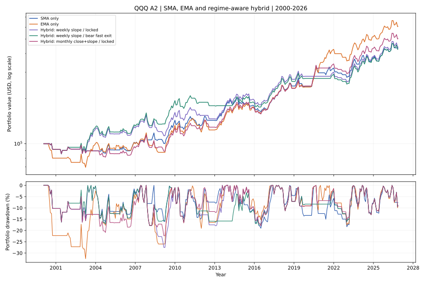

# A2 Hybrid：周线／月线判定趋势，熊市用 SMA、牛市用 EMA

> 2026-11-10；第三个独立研究分支 `experiment/hybrid-sma-ema-regime`；与 SMA `main`、EMA `experiment/ema-a2-n20` **隔离**。本报告是历史样本内实验，不是下一交易日的实时信号。

## 结论先行

假设：通过已完成周 K 或月 K 识别下行趋势，低迷阶段使用原 SMA20/60 金叉与 SMA10/20 的 N20 保护，上行阶段使用 EMA20/60 金叉与 EMA10/20 的 N20 保护。目标是**降低下行阶段的损失，保留上行趋势中 EMA 更长的持仓**。

**实验否定了“简单按趋势切换均线即可兼得两者优势”的强假设。**周线斜率选择入场后，账户 MDD −29.05%，比原 SMA 的 −20.29% 差。额外增加熊市快速退出后，MDD 收缩至 −19.48%，但 CAGR 只有 5.57%，低于 SMA 的 5.64% 和 EMA 的 6.96%。月线筛选同样存在取舍。**2020 年错过 EMA 的 +67.48% 大波段**，是周线切换模式关键的反例。

| 同口径回测 | 已完成交易 | 终值 ($100k 初始) | CAGR | MDD | Payoff | 资金在场 |
|---|---:|---:|---:|---:|---:|---:|
| **SMA 原版** | 60 | $436,163 | 5.64% | **−20.29%** | **4.04** | 51.42% |
| **EMA 独立版** | 54 | **$608,362** | **6.96%** | −32.52% | 3.62 | 65.98% |
| 周线 20 周 SMA，斜率 4 周；入场锁定均线 | 54 | $443,131 | 5.70% | −29.05% | 3.31 | 56.23% |
| **周线斜率 + 下行快速退出** | 54 | $428,950 | 5.57% | **−19.48%** | 2.90 | 50.15% |
| 月线 10 月 SMA，斜率 1 月；入场锁定 | 57 | $518,836 | 6.32% | −32.36% | 3.40 | 59.67% |
| 月线斜率 + 下行快速退出 | 57 | $354,415 | 4.83% | −30.99% | 2.98 | 53.12% |
| 周线“收盘站上 + 斜率向上”；入场锁定 | 47 | $476,432 | 5.99% | −29.05% | **4.13** | 50.71% |
| 周线“收盘站上 + 斜率向上” + 下行快速退出 | 47 | $294,577 | 4.11% | −19.76% | 2.40 | 35.33% |
| 月线“收盘站上 + 斜率向上”；入场锁定 | 57 | $503,132 | 6.20% | −23.99% | 3.66 | 54.62% |
| 月线“收盘站上 + 斜率向上” + 下行快速退出 | 57 | $350,415 | 4.78% | −20.75% | 2.98 | 47.51% |



> 图中展示每月末的抽样权益线以保持 SVG 可读。报告里的 CAGR 和最大回撤均基于 **6,754 个实际回测交易日的逐日权益**，而非月度抽样后重新计算；最新截止日为美东 **2026-11-09**。历史回撤是样本内最大值，不是未来最大损失上限。

## 1. 冻结规则：两层而非一个“智能均线”

### 1.1 第一层：入场时选择信号家族

1. 使用上一根**已经完整结束**的周 K 或月 K 计算趋势。当天周 K／月 K 未完成的收盘不能使用，即使金叉当天恰逢周五也只使用上周的完整周 K。
2. **上行**：使用 EMA20/60 当日刚发生的金叉，**下一交易日开盘买入**。
3. **下行**：使用 SMA20/60 当日刚发生的金叉，下一交易日开盘买入。
4. 入场后该笔仓位**锁定** SMA 或 EMA 家族；平仓依据锁定家族的 N20 快速死叉、慢速死叉。禁止在持仓中无记录地切换另一套 MA，防止状态机口径混乱。
5. 空仓时若周／月趋势变更，但新选中的慢均线**已经金叉过了**，不会凭“当前已多头排列”临时追买；仍须等下一次**新的**金叉。这严格延续原 A2 的 fresh-cross 原则。

### 1.2 周线／月线的两个事先声明的上行判别口径

| 名称 | 取值基础 | 上行条件 | 下行条件 |
|---|---|---|---|
| `weekly_slope` | 前一根完成周 K 的最后复权收盘 | 周 SMA20 高于 **4 周前**的周 SMA20 | 不满足上行（含尚不足以计算的历史预热） |
| `monthly_slope` | 前一根完成月 K 的最后复权收盘 | 月 SMA10 高于 **1 个月前**的月 SMA10 | 同左 |
| `weekly_close_slope` | 同周线 | 上述斜率上行，**并且**前周收盘高于周 SMA20 | 同左 |
| `monthly_close_slope` | 同月线 | 上述斜率上行，**并且**上月收盘高于月 SMA10 | 同左 |

`weekly` 20 周约覆盖 100 个交易日；`monthly` 10 个月约覆盖 200 个交易日。这里选的是透明、可解释的先验敏感性定义；不能把四种口径历史表现最好的一个事后称为“最优参数”。四种定义的起始 warmup 未成熟时默认保守使用 SMA。

### 1.3 第二层：单独测试风险自适应提前退出

在上述 **`locked`** 版本的基础上，另设 **`bear_fast`** 版本，不偷偷并入 `locked`：

- 持有任何 SMA／EMA 家族仓位，只要**上一根完成周／月 K 判断下行**，并且**当日复权收盘的日 SMA10 < SMA20**，就在下一个交易日开盘全部退出。该退出使用**均线状态**，不是要求当天发生新的交叉，因此能在进入下行阶段时响应已经发生的快速死叉。
- 不限于持仓前 20 个交易日，也不要求亏损；它可以保护浮盈，但也会在牛市回调时打断后续大行情。
- 优先级：原家族 MA20/60 死叉退出 > 熊市快速退出 > 原家族 N20 止损。所有退出均在次日开盘模拟，含隔夜跳空风险。

**风险隔离原则**：`locked` 与 `bear_fast` 是两项独立实验。后者同时改变了出场规则，不能把结果单独归因于“入场选择 SMA 或 EMA”。

## 2. 最关键正反例：2000 与 2020

### 2000 年：周线能避开 EMA 首笔 −14.66%，但月线斜率未必能

- 2000-06-21，EMA20/60 新金叉；**周 SMA20 处于下行**，`weekly_slope` 只允许 SMA，于是拒绝这笔 EMA 入场。
- 2000-06-23，SMA20/60 新金叉；周线仍下行，周线混合策略于 **2000-06-26 买入 SMA，2000-07-06 N20 平仓，−1.71%**。与 EMA 首笔 −14.66% 的风险形成鲜明对比。
- **反例**：同一时点，上月月 SMA10 仍保持上行斜率。因此 `monthly_slope` **允许了 EMA 首笔 −14.66%**；单纯月均线斜率并不能识别这个高风险的早期熊市反弹。
- `monthly_close_slope` 增加月收盘站上 10 月线后，2000 年首笔退回 SMA，避免了该笔 EMA 首亏，但它同时会带来下面的 2020 机会成本。

### 2020 年：周线双金叉被趋势分类切换卡住，整段主升浪错过

| 日期与事件 | 当日的已知周线斜率分类 | 混合规则为何不买入 |
|---|---|---|
| **2020-04-24**：EMA20/60 新金叉 | 仍判为下行 | 只能采用 **SMA** 信号，所以忽略 EMA 金叉 |
| **2020-04-30**：SMA20/60 新金叉 | 已判为上行 | 只能采用 **EMA** 信号；但 EMA 金叉已在 4/24 发生，不再是新金叉 |

结论：**周线入场混合策略整个 2020 年没有持有那段大行情**。独立 EMA 在 2020-04-27 至 2021-10-12 一笔 **+67.48%**；独立 SMA 在 2020-05-01 至 2020-10-08 一笔 **+31.75%**。周线 `locked`、`bear_fast` 两个版本都错过这段上涨，这是长期复利逊于 EMA 的核心原因之一。

这是**跨周期信号竞争／状态机“空档”**的问题，不是价格数据错误。简单“取两套里更早出现的金叉”或“切换时自动追买”会新增不同策略规则，必须单独实验，不能回填为本次结果。

相反，`monthly_slope` 因 2020-04-24 上月斜率已上行，买到 EMA 的 +67.48%，但它没避开 2000 年 -14.66%；`monthly_close_slope` 能避开 2000 年首亏，却在 2020 选择 SMA，只拿到 +31.75% 的原 SMA 波段。这是典型**相互冲突的过滤收益与机会成本**。

## 3. 下行提前退出的收益与代价

周线 `bear_fast` 比周线 `locked` 的账户 MDD 从 **−29.05% 降为 −19.48%**，但终值从 **$443,131 减为 $428,950**，Payoff 从 3.31 降到 2.90，共有 **15 笔已完成交易由熊市快速规则退出**。

它在部分年份确实保护了利润：例如 2008-04-10 买入 SMA 的交易，原周线 `locked` 到 2008-07-03 才退出，约 **+0.08%**；加快退出后改为 **2008-06-04**，约 **+8.9%**。但这种局部改善不代表全样本复利改善，尤其持续趋势中的假警报有复利成本。

更严格的“周线收盘站上且斜率上行” + `bear_fast`，MDD 虽约 **−19.76%**，终值只有 **$294,577**：**风险提前出场过于频繁（28 笔熊市快速退出），严重牺牲上涨暴露**。

月线 `bear_fast` 效果更弱：`monthly_slope` 终值由 $518,836 大降到 **$354,415**，MDD 仅从 −32.36% 小降到 −30.99%。月线趋势本来就慢，等它判断下行再用日 SMA10/20 状态退场，往往已经损失较多；且会在长期反弹前过早退出。

### 预定义市场段表现（各段起止日账户收益，非单笔胜率）

| 策略 | 2000—2003 | 2007—2009 | 2020—2021 | 2022 | 2023—2026/11 |
|---|---:|---:|---:|---:|---:|
| SMA 原版 | −10.4% | +42.6% | +33.2% | −14.2% | +57.2% |
| EMA 原版 | +0.5% | +32.3% | **+78.4%** | −17.2% | +70.6% |
| 周线斜率锁定 | +25.7% | +26.6% | **+6.5%** | −14.9% | +71.6% |
| 周线斜率 + 熊市快退 | +29.4% | +47.5% | **+6.5%** | −14.9% | +71.6% |
| 月线收盘+斜率锁定 | −10.4% | +35.7% | +40.4% | −14.9% | +71.6% |

分段收益取每段第一个实际交易日权益作基准；分段 MDD 见 [`period_slices.csv`](../../research/results/hybrid_2026_11_09/period_slices.csv)，与全样本 MDD 不是相同指标，也不能把各段收益简单相加为全期收益。

## 4. 回测边界、反例和下一步假设

1. **同一份复权 QQQ 历史**：1999-03-10 至 2026-11-09 的 **6,961** 条完整日 K；2000-01-03 开始空仓等待真实金叉；初始 $100,000，全进全出；单边费 0.05%；现金 0 利息；未计税、滑点、汇率和实际分红预扣。
2. **时间一致**：所有日线信号在已完成收盘确认，次日调整开盘价模拟成交。周／月分类严格使用**上一个完整周／月**，不能拿当天未完成的周月收盘偷看未来。
3. **无事后首笔删除**：2000 年的 SMA/EMA 首笔仍在历史样本里。未手动修剪亏损交易，也未做任何网格参数“最优选择”。
4. **程序复核**：实验过程中先重演独立 SMA 冻结引擎和 EMA 原引擎；原 SMA 与冻结逐日权益、逐笔交易一致。仓库执行 `PYTHONPATH=src python -m unittest discover -s tests -v`，**27 项通过**，含周／月未来价格不影响当前分类的单元测试。
5. **核心结论**：风险分段确实可以压 MDD，但**两套均线分别有不同交叉日**，按跨周期状态只选择其中一套会造成“信号掉入切换空档”；强制风险退出又损失大趋势。没有一个目前测过的简单组合同时在 CAGR、MDD、Payoff 三个维度严格优于两条原基准。

建议下次独立研究时，首先解决“两个金叉先后与周月趋势翻转的**信号切换空档**”，例如在明确时限内保留已经确认过的金叉状态、或把入场和退出的条件分层；同时必须坚持次日开盘执行，不得事后按 2020 年幸运方向补单。此建议仅是待检验假设。

## 5. 可复现性与文件

源文件（仅本地、**不允许复制到公开 GitHub**）：`sources/qqq_merged_updated_local.csv`，SHA-256：

`2e0f003b81d46ab432b303d63ede8c768adfe59fcd3d44ecb9540875d0c80e9c`

授权、拼接、来源见 [`docs/DATA_SOURCES.md`](../DATA_SOURCES.md)。本分支只提交研究代码、派生交易与权益统计、静态 SVG，不提交第三方原始行情。

```bash
python -m pip install -e '.[charts]'
PYTHONPATH=src python -m unittest discover -s tests -v
python research/experiments/a2_hybrid_regime.py \
  --csv sources/qqq_merged_updated_local.csv --end 2026-11-09
```

- [`summary.csv`](../../research/results/hybrid_2026_11_09/summary.csv)：全部 **2 个冻结对照 + 8 个混合方案**，包含成交数、MDD、CAGR、Payoff、持仓占比与快退次数。
- [`period_slices.csv`](../../research/results/hybrid_2026_11_09/period_slices.csv)：科网泡沫、金融危机、疫情、2022 加息熊市、2023—2026 分阶段表现。
- [`monthly_equity.csv`](../../research/results/hybrid_2026_11_09/monthly_equity.csv)：每个方案的月末权益，不能代替日度 MDD 计算。
- [`Hybrid_*_trades.csv`](../../research/results/hybrid_2026_11_09/)：**8 份全量逐笔派生交易**，包含家族选择、入场信号日／成交日、退出原因、MFE/MAE、复利账户权益。
- [静态资产曲线图](../../assets/a2_hybrid_equity_drawdown_2000_2026.svg)；[完整策略与重放代码](../../research/experiments/a2_hybrid_regime.py)；[单元测试](../../tests/test_hybrid_regime.py)。

**研究状态：仅可作为样本内反事实研究和后续纸面跟踪的候选，不应以最佳一行当成新的已验证实盘策略。**
