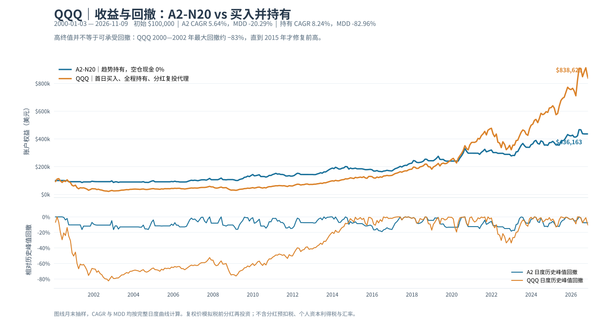

# QQQ A2-N20 vs 买入并持有：同起点收益、−83% 回撤与税务边界

> 研究日期：2026-11-10。版本：独立比较层，不修改 A2-N20 V1.0 入场、N20、趋势出场或交易费参数。**税前、历史样本内回放；不是税后实盘业绩。**

## 1. 要回答的问题与主要结论

一个账户如果历史终值最高，但期间曾经从峰值跌掉约 83%，能否与一个终值较低但最大回撤约 20% 的账户仅按 CAGR 排名？

**不能只按 CAGR。** 买入并持有在本次长样本中积累的终值明显高于 A2；A2 的重要价值则是减少历史组合最深回撤，减少对漫长水下阶段的承受要求。反过来，−20.29% 的历史 MDD **不是**未来下行保底，A2 也没有被证明长期优于买入持有。

| 同一账户口径，初始 $100,000 | 冻结截至 2026-07-13：A2 | 冻结：QQQ 买入持有 | 更新截至 2026-11-09：A2 | 更新：QQQ 买入持有 |
|---|---:|---:|---:|---:|
| 样本内终值（持仓按收盘估值） | **$450,595.85** | **$877,700.20** | **$436,162.72** | **$838,629.04** |
| 累计收益率 | +350.60% | **+777.70%** | +336.16% | **+738.63%** |
| CAGR | 5.84% | **8.53%** | 5.64% | **8.24%** |
| 按完整日度权益计算 MDD | **−20.29%** | −82.96% | **−20.29%** | −82.96% |
| 已完成往返交易 | 58 | 0（始终不卖） | 60 | 0（始终不卖） |
| 截止日状态 | 一笔尚未平仓 | 始终持有 | 空仓 | 始终持有 |

上述数据**不是收益/波动经统一风险预算调整的同风险可比组合**，仅是同一初始本金、同一起始时间、同一基础标的的两种实际持仓轨迹。A2 的多次买卖确有交易费用且会导致更早的应税实现，买入持有少交易但没有途中回撤保护。



### 为什么最大回撤要作为硬约束

- 历史 QQQ 峰值 **2000-03-27** → 谷底 **2002-10-09**，日度收盘权益相对既往峰值 **−82.9639%**。
- 跌到峰值的 17.04% 后，回到峰值需要从谷底**上涨约 +486.99%**，不是反弹 +82.96% 就能解套。
- 原峰值直到 **2015-02-20** 才由复权权益首次重新站上，水下约 **14.90 年**。A2 的低 MDD 不能直接代表容易坚持，但 Buy&Hold 的这个时间跨度是真实的行为与流动性压力测试。
- **不要预设未来每次长跌都恰好只有 −20%。** 这只是本历史样本的最坏观测；黑天鹅、不同起点、交易延迟、税收和费用会改变结果。

策略研究应当以 `CAGR / MDD / 交易频率 / 最长水下时间 / 税费后的可投资现金` 为一组目标，而不是孤立追高年化。例如短债空仓计息是另一独立账户收益层，并**没有**在历史动态收益率情景中使 A2 MDD 变得更小，参见[现金利息研究](A2_空仓美债现金收益_独立回测_2026-11-10.md)。

## 2. 完全一致的计算口径

| 维度 | A2-N20 V1.0 | Buy & Hold 独立比较器 |
|---|---|---|
| 样本起始日 | 2000-01-03 | **同日**，首个交易日常规盘 `adj_open` 买入，不是开盘前买 |
| 初始本金 | $100,000 | $100,000 |
| 行情 | 同一个 QQQ 复权日 K 序列 | 同一个 QQQ 复权日 K 序列 |
| 交易动作 | 收盘后识别金/死叉，次日开盘执行 | 首日买一次，之后从不卖出 |
| 买卖成本 | 每次买/卖各 0.05% | 首次买入 0.05%，样本末日**尚未卖出**，未收尾部卖出费 |
| 现金收益 | 现金 0%（另有独立浮动美债实验） | 始终满仓，不假设额外现金 |
| 每日账户权益 | 现金 + 持仓数量 × 当日复权收盘 | 固定份额 × 当日复权收盘 |
| 复权/分红 | 复权价近似**税前分红再投资总回报** | 相同；不是含实际预扣税的券商现金流 |
| 税、汇率及滑点 | 均不计 | 均不计；故无法把本表叫“税后收益” |

买入并持有份额：

`shares = $100,000 / (QQQ_first_adjusted_open × (1 + 0.0005))`

`equity[t] = shares × QQQ_adjusted_close[t]`

`CAGR = (equity[end] / 100000) ^ (365.25 / 日历天数) − 1`

`MDD = min_t(equity[t] / max_{s≤t}(equity[s]) − 1)`

**截止日不是卖出日。** 若只计算末日额外假设一次卖出费 0.05%（不考虑税/价格冲击），持有组冻结期会从 $877,700.20 降至 **$877,261.35**，更新期会从 $838,629.04 降至 **$838,209.73**。截图中约 $877,700 来自**首日复权开盘进场 + 单次 0.05% 费**；若错误改成首日收盘买入，终值与 CAGR 会不同。

样本下限来自原价格序列的长短均线 warmup；A2 在真实新金叉出现前留现金，买入持有在 2000-01-03 已经有全仓。这个**自然起点差异是策略定义的一部分**，不是应当事后抹平的“偏差”。

## 3. 税务：买卖频率确实影响税后复利，但不能擅自设置统一税率

**先纠正一个简化理解：买入持有通常可推迟股票价差的“已实现资本利得”纳税时点，却不表示持有期间一分钱税都没有。** QQQ 本身会派息，而美国来源的 ETF 分红可能在发放当时就被美国预扣；本报告用 `Adj Close` 累积的税前总回报代理**没有扣掉这部分税**。

具体要分三层：

| 问题 | 常见税务时点 | 与两策略的关系 |
|---|---|---|
| 买入 QQQ | 单纯买入一般不产生**已实现资本利得**；但有佣金/交易费等 | A2 反复买卖，成本更多 |
| QQQ 派息 | 派发/入账当年就可能发生美国源泉预扣及居民国纳税 | 买入持有 **也可能有经常性税负**，复投时实际净分红少于复权价模型 |
| 卖出 QQQ 实现价差 | 视该纳税年度的税务居民地法律及豁免规定 | A2 多次提前实现；买入持有通常推迟到真正卖出，但不保证最终一定有税 |

### 按税务居民地分支（截至本报告日期的官方规则）

1. **中国个人税务居民**：个税法原则上对居民个人境内、境外所得征税；境外股票转让所得属于财产转让所得，股息红利为另一类所得；法律对财产转让、利息股息红利规定的比例税率为 **20%**，具体应纳税所得额、费用、当年损益抵扣、境外已缴所得税抵免需依法单独核算。境外所得一般在**次年3月1日至6月30日**申报。不能把“港美券商账户”理解成自动免除中国居民国税负。原文：[中华人民共和国个人所得税法](https://www.chinatax.gov.cn/n810219/n810744/n3752930/n3752974/c3970366/content.html)；[财政部/税务总局2020年第3号公告](https://www.chinatax.gov.cn/chinatax/n810219/n810744/n3752930/n3752974/c5143076/content.html)。
2. **新加坡个人税务居民，持有个人投资**：IRAS 表述通常将个人投资股票与其他金融工具的买卖价差视为**不征税**，但若活动实际被认定为经营/交易性质应另评估；不能用“频率高”一个变量孤立判断。与之独立的**美国源泉股息预扣**仍要核算。官方：[IRAS：股票及金融工具出售收益](https://www.iras.gov.sg/taxes/individual-income-tax/basics-of-individual-income-tax/what-is-taxable-what-is-not/gains-from-sale-of-property-shares-and-financial-instruments)。
3. **美国非居民个人（NRA），且符合相关条件**：IRS 一般认为，在美国停留不足 **183 天**、交易收益不是与美国经营有效关联等情况下，出售股票的资本利得通常**不征美国联邦所得税**（存在例外）；但美国源泉分红通常按 **30%** 或符合税收协定规定的更低税率预扣，使用 `W-8BEN` 主张适用资格。不同国籍/居住国条约资格、账户形式及美国居民判定需另核实。官方：[IRS：非居民美国源泉收入与资本利得](https://www.irs.gov/individuals/international-taxpayers/federal-income-tax-withholding-and-reporting-on-other-kinds-of-us-source-income-paid-to-nonresident-aliens)。

**美国税不征** ≠ **个人税务居民国不征**；“护照国籍”“账户开户地”“当前旅行所在国家”都不应单独当作税务居民归属。本报告没有判断实际使用者属于哪一分支。

### 为什么不能用 `末期收益 × 20%` 给 A2 与买入持有直接排税后排名？

- A2 的每次开平仓时点和利润/亏损在**不同纳税年度**出现，亏损是否可抵减、能否跨年结转、资本所得性质不同，会改变多年的再投资本金与复利路径。
- Buy&Hold 的卖出之前**价差通常尚未实现**，但每次 ETF 分红都有现金流与可能的预扣税，复权价包含毛额再投资的简化假设；若首日投资与最后一年税务居民身份改变，最终规则还会不同。
- 如果用户始终不卖，未实现收益并不是“永远免税的财富”；是纳税时点、估值与流动性条件不同。某些税制可能另有特殊征税机制，需按持有人身份核对。

实现可审计的税后回测之前，需要保存：逐年**税务居民国/身份**、账户持有人类型、美国预扣税率与条约资格、QQQ 每次**实际现金分红**、成本基础/复投份额、每笔 A2 实现盈亏、各年亏损抵扣规则与纳税支付时间、可用的境外抵免，以及最终是否实际卖出。需要拿到未调整的分红表及复投规则，不能把 `Adj Close` 的毛额总回报直接乘一个固定税率。

在这些参数和真实投资人身份确认前，**本仓库只发布税前基准和税务情景框架，不假装已完成税后回测。**

## 4. 复现、输出与审计边界

```bash
python -m pip install -e '.[charts]'
PYTHONPATH=src python research/experiments/a2_buy_hold_benchmark.py \
  --old sources/qqq_jtang.csv --new sources/qqq_james.csv \
  --csv sources/qqq_merged_updated_local.csv
```

`--old`、`--new` 与 `--csv` 都是使用者**自行合法取得并本地处理**的日行情；2026-11-09 的合并复权数据需先按[补样报告](A2_2026_07_14到11_09_样本扩展复核.md)重现。公开输出：

- [`research/results/a2_vs_buy_hold_2026_07_13_and_11_09.json`](../../research/results/a2_vs_buy_hold_2026_07_13_and_11_09.json)：两次全日度统计、首次入场价、末期卖出费敏感性及回撤的峰/谷/修复日期。
- [`research/results/a2_vs_buy_hold_monthly_equity.csv`](../../research/results/a2_vs_buy_hold_monthly_equity.csv)：最新样本账户权益/回撤的**每月末派生值**，供读者画图和人工比对（不是第三方价格数据）。
- [`assets/a2_vs_buy_hold_equity_drawdown.svg`](../../assets/a2_vs_buy_hold_equity_drawdown.svg)：README 可直接嵌入的静态 SVG，无需 HTML。
- [`src/qqq_a2/benchmarks.py`](../../src/qqq_a2/benchmarks.py) 与 [`tests/test_benchmarks.py`](../../tests/test_benchmarks.py)：独立 B&H 逻辑及合成行情边界测试。

校验门槛：① A2 冻结 58 笔、终值、MDD 不漂移；② 最新 60 笔、终值不漂移；③ 两版本共同历史的 B&H 收益一致；④ 结果日度算 MDD，月末压缩**只为绘图**，不能把月频 MDD 冒充日度 MDD。

## 5. 对下一轮策略研究的约束

**优化方向**：尝试提高持有期收益占比，同时保留可接受的回撤上限；不要因为 B&H CAGR 更高就废除低回撤目标，也不要因为历史 A2 MDD 更低就断言 A2 在所有起点更优。

1. 退出策略：分析止盈回吐前的**当时可观测**风险特征，而不是用历史顶部选点；新策略另列版本和交易清单。
2. 现金层：同时比较 A2 现金0%、浮动短债参考收益及**可交易、税后、流动性约束**下的现金替代，不能把未来 4%/年固定计息当真实历史。
3. 税后层：先定个人税务假设及分红口径，再逐年按真实发生日期计税，不改当前税前 V1.0 报告。
4. 敏感度：分别审视 2000–02、2008–09、2020、2022 和最近 84 个交易日；各子样本起止点变动会影响 CAGR，不能仅靠 2000 顶部起始夸大所有人都能体验到的 Buy&Hold 最坏回撤。

这份研究最大的结论不是“哪个策略必胜”，而是：**长期复利的数学结果、回撤期间的资金可用性、人的可执行性和各年实际纳税现金流，必须共同纳入策略评价。**
