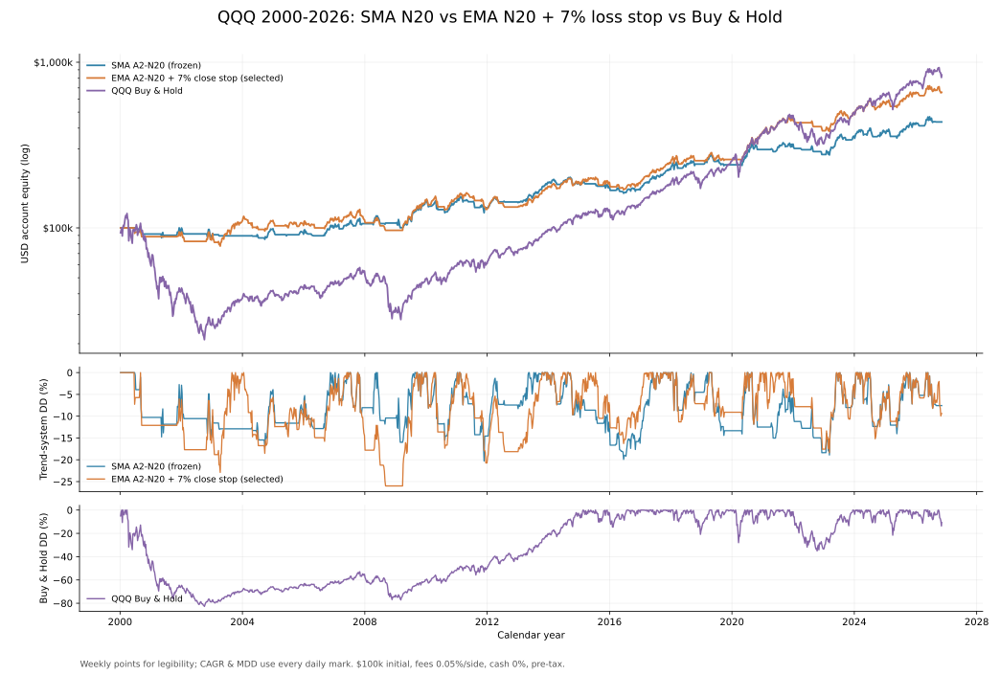

# QQQ A2：SMA N20 / EMA N20 + 7% 收盘止损 / Buy & Hold 三方案对照

> 研究决定：将 **EMA20/60 + N20 + 全程 7% 收盘亏损止损**设为当前*优先研究与模拟跟踪*方案；**SMA A2-N20 V1.0 继续作为不可变基线**；QQQ Buy & Hold 始终作为机会成本基准。这里的“定版”不是已获得样本外验证、真实交易安全承诺或自动下单授权。

## 一、统一样本下的总结果

**QQQ 复权日线；2000-01-03 至 2026-11-09 完整收盘；初始 $100,000；无初始持仓；信号在日收盘确认、下一常规交易日开盘交易；每次买入或卖出各收 0.05%；空仓现金收益 0；税前，不含滑点。** Buy & Hold 在首日开盘建仓并支付一次手续费，截止日仍持有，因此没有假设末日额外清仓费。

| 指标 | **SMA A2-N20（冻结 V1.0）** | **EMA A2-N20 + 7%（当前研究定调）** | **QQQ Buy & Hold** |
|---|---:|---:|---:|
| 期末账户权益 | $436,163 | **$658,227** | **$838,629** |
| 累计回报 | +336.16% | **+558.23%** | **+738.63%** |
| 年化 CAGR | 5.64% | **7.27%** | **8.24%** |
| 日末账户最大回撤 MDD | **−20.29%** | −26.00% | −82.96% |
| 已完成交易 | 60 | 54 | 不适用（持续持有） |
| 盈 / 亏笔数 | 25 / 35 | 24 / 30 | 不适用 |
| 胜率 | 41.67% | 44.44% | 不适用 |
| 平均盈亏比 Payoff | **4.04** | 3.84 | 不适用 |
| Profit Factor | 2.89 | **3.07** | 不适用 |
| 市场持仓日占比 | 51.42% | 65.56% | 100% |
| 已完成单笔最差回报（含费） | −7.63% | −8.32% | 不适用 |
| 2026-11-09 日末状态 | 空仓 | 空仓 | 持有至截止日 |



**三个方案不存在单一赢家。** EMA 相对 SMA：期末多约 **$222,064**，CAGR 高约 **1.63 个百分点**，但账户历史 MDD 加深 **5.71 个百分点**、多持仓约 **14.14%** 的日子。EMA 相对 Buy & Hold：期末少约 **$180,402**，CAGR 低约 **0.97 个百分点**，但样本内账户日末 MDD 从约 **−83%** 降到 **−26%**。不能根据回测差距推定未来优劣或最佳仓位。

## 二、确切的信号和成交规则

| 条件 | SMA A2-N20（V1.0） | EMA A2-N20 + 7%（新增版本） | Buy & Hold |
|---|---|---|---|
| 入场 | 日线 **SMA20 新上穿 SMA60**，次交易日开盘全仓买入 | 日线 **EMA20 新上穿 EMA60**，次交易日开盘全仓买入 | 2000-01-03 第一交易日开盘全仓买入 |
| 前 20 日保护（N20） | 买入后的前 **20 个完整持仓交易日**，SMA10 新下穿 SMA20 **且当日收盘低于买入调整开盘价**，次日开盘卖出 | 同条件，改为 **EMA10 新下穿 EMA20** | 无 |
| 常规趋势离场 | SMA20 新下穿 SMA60，次交易日开盘卖出 | EMA20 新下穿 EMA60，次交易日开盘卖出 | 无 |
| 新增固定亏损保护 | 无 | **从入场起持续有效**：按扣除往返手续费后的单笔回报，当日收盘达到 **−7% 或更差**，次交易日开盘卖出；与 N20、趋势死叉并行 | 无 |
| 再入场 | 离场后等待新的 SMA20/60 金叉 | 离场后等待新的 EMA20/60 金叉；**不因止损后反弹立即回补** | 不离场 |
| 规则起点 | 从空仓开始，必须实际出现新金叉 | 同左，不删除首笔失败交易 | 第一天买入并持续持有 |

所有交叉只检测已完成的当日 K 线与前一个交易日状态；当日收盘信号不能用当日收盘价成交。EMA **7% 是信号阈值，不是可保证成交价，也不是账户的 MDD 上限**。例如 2011-10-14 买入的一笔，收盘触发后至 2011-11-25 开盘成交，最终实际净亏 **−8.32%**。跳空、流动性和真实滑点会带来更差的结果。

## 三、每个方案真正的优势与代价

### SMA：更小的历史回撤、更长的空仓休息

- 样本 MDD **−20.29%** 为三者最低，市场敞口仅 **51.42%**，买卖次数仍属低频。
- 低频且慢的 SMA 能在长熊市保留现金；例如 2004—2009 区间的既有仓位总回报约 **+60.13%**，高于同一阶段的 EMA **+31.98%** 和 Buy & Hold **+29.06%**。
- 代价是回到上行趋势的时机较晚：2000—2026 的期末权益和 CAGR 均显著落后于 EMA 与 Buy & Hold。研究目的应是控制风险，不是据此声称必然跑赢长期持有。

### EMA + N20 + 7%：风险与趋势捕捉之间的折中

- 更敏感的 EMA 让策略在一些上行阶段持仓时间更长。2016—2021 历史阶段回报约 **+145.92%**，明显高于 SMA 的 **+79.97%**，但低于 Buy & Hold 的 **+272.88%**。
- 三个止损信号并行，新增 7% 收盘阈值能在部分单次失败行情中比均线死叉更早离场；本次全周期内 **3 笔**标记为 7% 触发（含 **1 笔**与趋势离场同日触发）。
- 与**不加 7% 的原 EMA**比较：期末从 **$608,362** 升至 **$658,227**，MDD 从 **−32.52%** 改善至 **−26.00%**。但提升高度依赖首笔 2000 年交易：2000-06-22 入场，原 EMA 到 2000-08-03 才卖、亏 **−14.66%**；7% 版本于 2000-06-26 卖出、亏 **−5.73%**。2011 年则是反例：7% 版本提前卖出实际亏 **−8.32%**，原 EMA 晚几日退出只亏 **−6.41%**。
- 历史最深账户回撤仍为 **−26%**，发生在 2007—2008 附近。它并没有解决熊市里连续错入、市场重启失败与浮盈回吐，也没有降低到 SMA 的风险水平。

### Buy & Hold：长期收益基准，但持续承受所有熊市

- 全周期终值和 CAGR 均为三者最高，执行最简单、交易费用低，避免趋势策略空仓时错过反弹。
- 但 2000 年互联网泡沫期间账户历史 MDD **−82.96%**；只有长期能够承受大幅浮亏、并且不会因极端行情中途退出的资金，才可能实现这条历史路径。三种模型的复权价格口径相同，未计入真实税务差异。
- 不能把 Buy & Hold 的“交易胜率/平均盈亏比”填为 100% 或 0：这些指标对持续持有至样本终点并不具有相同定义。

## 四、不同市场阶段核对（不是样本外）

各阶段的收益是**沿用完整回测当时的账户权益**，相对于该阶段开始前最后一个模拟交易日计算；并非每段重新注入 $100,000。阶段回撤在该阶段内重新设定高水位，不能直接与全周期 MDD 混同。

| 阶段 | SMA 阶段收益 / 局部 MDD | EMA + 7% 阶段收益 / 局部 MDD | Buy & Hold 阶段收益 / 局部 MDD |
|---|---:|---:|---:|
| 2000—2003（科网熊市） | −10.42% / −16.85% | **+11.03%** / −23.68% | −62.10% / −82.96% |
| 2004—2009（含金融危机） | **+60.13% / −17.78%** | +31.98% / −26.00% | +29.06% / −53.40% |
| 2010—2015 | +24.02% / −20.29% | +28.09% / −21.36% | **+161.68%** / −16.10% |
| 2016—2021 | +79.97% / −15.03% | +145.92% / **−12.75%** | **+272.88%** / −28.56% |
| 2022—2026-11-09 | +36.23% / −14.76% | +42.59% / −17.99% | **+75.71%** / −34.83% |

**决策边界：**这个选择偏重于比 SMA 多参与上行、又避免 Buy & Hold 绝大部分历史深熊市回撤的**折中**，不是 EMA 无条件优于 SMA。尤其不能把当前全周期表现当作 7% 精确最优的证据：在此前参数扫描中，**从 2004、2010 年独立建仓**，7% 方案终值均不及未加固定亏损保护的原 EMA；在 2016 年之后开始，7% 甚至没有触发差异。先把 7% 当作已冻结的风控预算，再用后续未见过的数据检验，而不是继续从 5% 到 9% 逐格挑最高收益。

## 五、复现与可审计文件

```bash
python -m pip install -e '.[charts]'
PYTHONPATH=src python -m unittest discover -s tests -q
python research/experiments/a2_threeway_current.py \
  --csv sources/qqq_merged_updated_local.csv --end 2026-11-09
```

源码行情为使用者本地有授权的**复权 OHLCV**，不会公开到仓库。此次复现的数据源 SHA-256：`2e0f003b81d46ab432b303d63ede8c768adfe59fcd3d44ecb9540875d0c80e9c`；不同复权、拆分、分红与开盘成交假设会改变结果。1999 年预热数据仅用于 SMA/EMA 指标计算，模拟资金从 2000-01-03 空仓起步。

- [三策略统一跑分脚本](../../research/experiments/a2_threeway_current.py)；[EMA 金叉与 N20 独立逻辑](../../research/experiments/a2_ema_comparison.py)；[EMA 7% 收盘止损执行逻辑](../../research/experiments/a2_ema_hard_stop8.py)
- [完整汇总（机器可读）](../../research/results/threeway_current_2026_11_09/summary.csv)；[各阶段敏感性](../../research/results/threeway_current_2026_11_09/period_metrics.csv)；[每月底权益与回撤](../../research/results/threeway_current_2026_11_09/monthly_equity.csv)
- [SMA 全部完成交易](../../research/results/threeway_current_2026_11_09/SMA_A2_N20_trades.csv)；[EMA + 7% 全部完成交易](../../research/results/threeway_current_2026_11_09/EMA_A2_N20_close7_trades.csv)；[假设与数据指纹](../../research/results/threeway_current_2026_11_09/audit_metadata.json)
- [三策略对比 SVG](../../assets/a2_threeway_sma_ema7_buyhold_2000_2026.svg)；[新增对照测试](../../tests/test_threeway_current.py)
- 保留冻结的 [SMA V1.0 规则](../STRATEGY_V1.md) 和原先 2026-07-13 的 **58 笔冻结快照**，不把 11 月更新至 60 笔的样本悄然覆盖旧记录。

本文全部结论都是**样本内回顾性研究**。税、资本利得实现时点、股息预扣、券商实际费用、买卖价差、延迟和真实日内委托不可由本报表直接推出；没有生产交易系统或自动下单。
