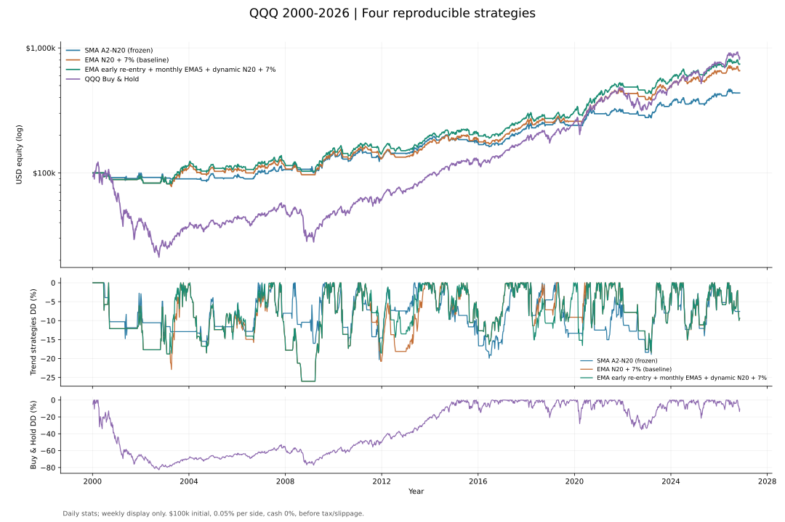
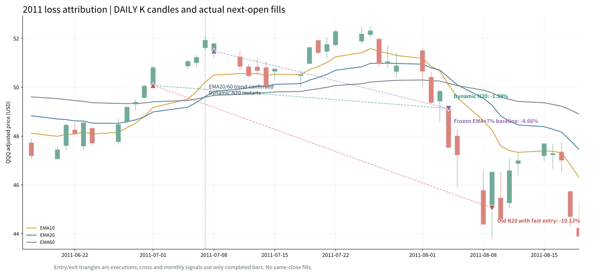
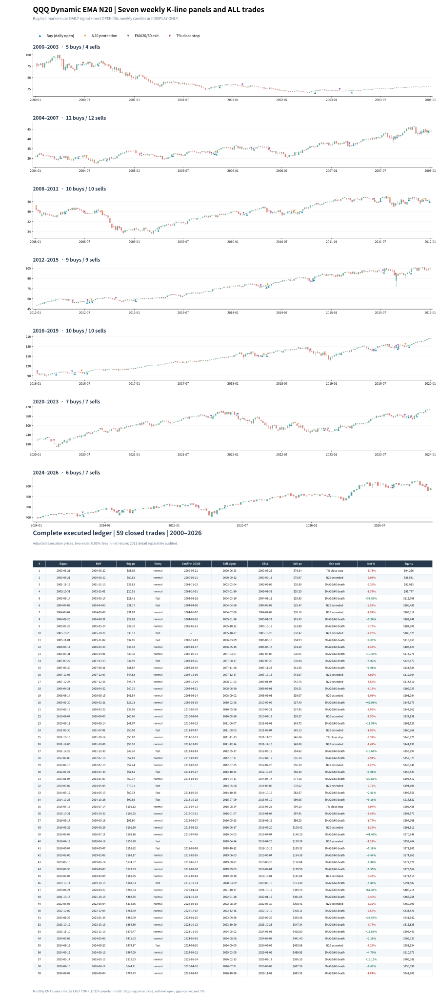

# QQQ A2：第四方案——月 EMA5 提前回补 + 趋势确认后动态 N20（2026-11-10）

> **研究状态：新增第四个可复现、可审计的样本内候选方案。** 原三方案和其发布快照均保留不变；没有真实交易授权。主要发现是：提前入场后把 N20 从 EMA20/60 趋势确认时重新计时，修复了“尚未确认趋势，保护窗口却已经耗尽”的结构缺陷。但其相对旧提前入场方案的全周期超额终值，实际只来自 **2011 年一笔退出日期改变**，不能视为样本外证明。

## 一、同一资金、同一完整样本的四方案

QQQ 调整后日 OHLCV，1999 年仅用于指标预热，模拟从 **2000-01-03** 空仓开始；止于 **2026-11-09** 已完成收盘。初始资金 **$100,000**，有仓位时全仓、不加杠杆，买入、卖出分别收 **0.05%**，无现金利息、税费及额外滑点。趋势信号在已完成日线收盘确认、订单于下一常规交易日复权开盘价成交。买入持有于首个样本交易日开盘建仓，末日仍持仓且未扣虚构卖出费。

| 指标 | 冻结 SMA A2-N20 | EMA N20 + 7% 收盘止损 | **EMA 月 EMA5 + 动态 N20 + 7%（第四方案）** | Buy & Hold |
|---|---:|---:|---:|---:|
| **期末权益** | $436,163 | $658,227 | **$742,703** | **$838,629** |
| 累计收益 | +336.16% | +558.23% | **+642.70%** | +738.63% |
| 年化 CAGR | 5.64% | 7.27% | **7.75%** | 8.24% |
| 日末账户 MDD | **−20.29%** | −26.00% | −26.00% | −82.96% |
| 完成交易 | 60 | 54 | **59** | 不适用 |
| 盈 / 亏笔 | 25 / 35 | 24 / 30 | **26 / 33** | 不适用 |
| 胜率 | 41.67% | 44.44% | 44.07% | 不适用 |
| 平均盈亏比 Payoff | **4.04** | 3.84 | **3.96** | 不适用 |
| Profit Factor | 2.89 | 3.07 | **3.12** | 不适用 |
| 市场持仓日占比 | 51.42% | 65.56% | **68.46%** | 100% |
| 已完成最差单笔 | −7.63% | −8.32% | −8.32% | 不适用 |
| 截止日状态 | 空仓 | 空仓 | 空仓 | 持仓 |

[](../../assets/a2_fourway_sma_ema7_dynamic_buyhold_2000_2026.svg)

第四方案比原 EMA + 7% 基线多约 **$84,476** 终值和 **0.48 个百分点** CAGR，但也多交易 5 笔、更多时间暴露在市场。它不是无条件优于原 EMA：**2016—2021 的局部 MDD 从 −12.75% 加深至 −18.32%**。与 SMA 的 −20.29% 全周期 MDD 相比，动态 EMA 的 −26.00% 风险更高；与 Buy & Hold 相比，仍明显牺牲累计收益以换取较浅的熊市回撤。

## 二、精确规则：不是永久跟随 EMA10/20 死叉

### 1. 原 EMA 常规入场（保留）

- 日 EMA20 **新上穿**日 EMA60，确认信号后下一个常规交易日开盘买入；这条普通入场**不受月线过滤**。
- 普通入场仍执行原来的 N20：买入后前 **20 个完整持仓交易日**，若日 EMA10 **新下穿** EMA20，且当日复权收盘价低于实际复权买入开盘价，次日开盘卖出。

### 2. 退出后可以更早回补（新）

先前因 **EMA20/60 死叉、7% 强制止损或 N20** 任何一种理由退出后，进入等待状态。只有同时成立才在下一交易日开盘重新买入：

1. 日 EMA10 **当日新上穿** EMA20（不是已经维持 `EMA10 > EMA20` 就任意进场）。
2. **上一个已经完成的日历月** 的月线 EMA5 大于再上一个已完成月的月线 EMA5，即月 EMA5 斜率向上。

月 EMA5 使用 **月末复权收盘价计算 `ewm(span=5, adjust=False, min_periods=5)`**。当前月份尚未收完的月 K 完全不用于早期回补信号。这是**月 EMA5**，不是 SMA5，也不是周线 MA5。

初次入场依然要求普通 EMA20/60 新金叉；没有为 2000 年开头制造无信号的特殊初始仓位。如果当天出现普通 EMA20/60 金叉，优先归类为常规买入。

### 3. 动态 N20 三状态（新）

仅对**提前回补**的仓位应用新的计时逻辑：

| 状态 | 保护期限 | 有效退出 |
|---|---|---|
| **提前回补、慢趋势尚未确认** | 直到出现 EMA20/60 新金叉；若迟迟未确认，保护持续有效 | EMA10/20 **新死叉且收盘低于实际买价** → 次日开盘退出 |
| **EMA20/60 刚确认** | 从该日收盘开始，保护再延续 **20 个交易日** | 同上，即使实际提前买入已经超过 20 天 |
| **成熟趋势** | 上述 20 个交易日结束 | 不再因一次 EMA10/20 死叉退出；继续使用 EMA20/60 死叉和全程 7% 强制止损 |

这里没有“持仓一盈利就因 EMA10/20 死叉卖出”的规则。**死叉必须发生在受保护窗口内、必须为新交叉、且收盘仍低于真实买入价。** 本次正式第四方案使用 **1 日确认**；连续 2/3 日过滤只是单独保留的反向敏感性实验。

### 4. 全程双保险与实际成交

- 无论早期回补或普通入场，从真实买入价开始始终检查**扣除模拟往返手续费后的 −7% 收盘单笔亏损阈值**；达到或低于阈值，**次交易日开盘卖出**。
- EMA20 **新下穿** EMA60 仍始终为趋势退出信号。
- 同一收盘日如果多个退出理由同时出现，只执行**一次**下一开盘卖出；为审计记载重合理由。止损不是保证成交价，**隔夜跳空可能使实际单笔亏损超过 7%**。
- 无盘中猜测、无盈利 MFE 保护、无多次加仓、无杠杆；没有用尚未发生的未来最高点过滤信号。

## 三、最关键的 2011 年交易归因

**新 N20 与原始提前回补规则的交易事件，26 年内仅有这一笔真正发生退出日期差异。** 对于其他 58 笔已经完成的相同入场，退出日一致；后续金额差异来自前一笔少亏后更高的复利底数，不应算作 58 次额外优化。

| 2011 年事件 | 提前回补 + 原固定 N20 | 提前回补 + 动态 N20 |
|---|---|---|
| 06-30 EMA10/20 金叉 | 07-01 开盘买入 | 同上 |
| 07-07 EMA20/60 金叉 | 原 N20 继续按 07-01 买入日数天 | **确认后 N20 重新计算** |
| 08-03 EMA10/20 新死叉，收盘跌至买价以下 | 已买入超过 20 天，N20 不再有效 | 在延长窗口内，发出卖出信号 |
| 实际卖出 | **08-09**（7% 收盘止损 / 趋势退出同日触发） | **08-04**（延长 N20） |
| 单笔净回报 | **−10.13%** | **−1.99%** |

[](../../assets/a2_ema_dynamic_n20_2011_daily_candles.svg)

**单笔少亏 8.14 个百分点，整个回测账户终值从 $681,032 变成 $742,703，相差 $61,671。** 这体现了复利路径依赖，**不是** 26 年中每笔交易普遍进步。2011 年图中额外叠加**原 EMA+7% 基线**的买卖点：原基线 07-08 买、08-04 卖，约 **−4.66%**，不能与两种 07-01 的提前买入策略混为同一笔。

完整全周期买卖点放在七段**周 K 背景**中，蓝色买入三角及橙色 N20 / 紫色趋势 / 红色 7% 退出三角使用**日线实际成交日期与价格**，图下部直接附 **59 笔完整成交记录**：

[](../../assets/a2_ema_dynamic_n20_trade_map_2000_2026.svg)

完整 59 笔交易中：**44** 次常规 EMA20/60 买入，**15** 次提前 EMA10/20+月 EMA5 买入；**39** 次 EMA20/60 趋势退出、**17** 次 N20 退出（原式 11 次、延长式 6 次）、**3** 次有 7% 收盘止损（含同日重合）。最差单笔 **−8.32%**。该分布不代表未来频率。

## 四、对“担心一次 EMA10/20 死叉过早被洗出去”的负面对照

仅延长提前入场的保护窗口，其他完全不变：

| 回补 N20 版本 | 期末权益 | CAGR | 全周期 MDD | 最差交易 |
|---|---:|---:|---:|---:|
| 旧版：买入后固定 20 天 | $681,032 | 7.41% | −26.00% | −10.13% |
| **确认慢趋势后重算，1 次亏损死叉** | **$742,703** | **7.75%** | −26.00% | **−8.32%** |
| 重算，但连续 2 日 EMA10 < EMA20 且亏损 | $740,498 | 7.74% | −26.00% | −8.32% |
| 重算，但连续 3 日确认 | $730,810 | 7.69% | −26.00% | −10.13% |

- 延迟一天可能减少误触发，但**样本没有给出正向收益证据**。2011 年单笔 1 日退出 −1.99%，2 日退出 −4.23%，3 日退出 −10.13%；验证快速下跌风险大于减少一次“假死叉”带来的收益。
- **全周期 MDD 均仍约 −26%**，主要发生在 2007—2008 年；这是更大范围的熊市多次失败交易问题，动态 N20 本身没有解决。
- 候选的优势明显依赖 **2011 一次早退出**，而 2016—2021 的**局部回撤比旧 EMA 基线更深**，都应保留为反证，不能据此宣称动态版必然优越。

## 五、各市场阶段：同一账户，不在分段重新入金

阶段收益相对**上一阶段最后一个完整日的真实模拟账户权益**计算；区间内部独立重设高水位求局部回撤，不可用这些局部回撤代替全周期 MDD。

| 市场阶段 | SMA 累计收益 / 局部 DD | EMA+7% | **动态 N20 + 月 EMA5** | Buy & Hold |
|---|---:|---:|---:|---:|
| 2000—2003 | −10.42% / −16.85% | +11.03% / −23.68% | **+17.23% / −19.42%** | −62.10% / −82.96% |
| 2004—2009 | +60.13% / −17.78% | +31.98% / −26.00% | +33.26% / −26.00% | +29.06% / −53.40% |
| 2010—2015 | +24.02% / −20.29% | +28.09% / −21.36% | +34.00% / −19.15% | +161.68% / −16.10% |
| 2016—2021 | +79.97% / −15.03% | +145.92% / −12.75% | **+148.46% / −18.32%** | +272.88% / −28.56% |
| 2022—2026-11-09 | +36.23% / −14.76% | +42.59% / −17.99% | +42.80% / −17.99% | +75.71% / −34.83% |

## 六、如何完整复算／交叉检查

```bash
python -m pip install -e '.[charts]'
PYTHONPATH=src python -m unittest discover -s tests -q
python research/experiments/a2_fourway_current.py \
  --csv sources/qqq_merged_updated_local.csv \
  --end 2026-11-09
```

- [四方案统一回测脚本](../../research/experiments/a2_fourway_current.py)、[独立动态 EMA/N20 交易状态机](../../research/experiments/a2_ema_dynamic_n20.py)、[K 线与标注 SVG 生成器](../../scripts/render_ema_dynamic_trade_charts.py)
- [四方案 summary.csv](../../research/results/fourway_current_2026_11_09/summary.csv)、[逐阶段收益与回撤](../../research/results/fourway_current_2026_11_09/period_metrics.csv)、[每月底权益](../../research/results/fourway_current_2026_11_09/monthly_equity.csv)
- [动态方案完整 59 笔交易](../../research/results/fourway_current_2026_11_09/EMA_A2_DynamicN20_monthEMA5_close7_trades.csv)、[EMA 原基线 54 笔](../../research/results/fourway_current_2026_11_09/EMA_A2_N20_close7_trades.csv)、[SMA 原基线 60 笔](../../research/results/fourway_current_2026_11_09/SMA_A2_N20_trades.csv)
- [动态 N20 与固定 N20 的实际交易变化记录](../../research/results/fourway_current_2026_11_09/dynamic_n20_changed_trades.csv)、[1/2/3 日确认敏感性](../../research/results/fourway_current_2026_11_09/n20_confirmation_sensitivity.csv)、[数据哈希与完整假设](../../research/results/fourway_current_2026_11_09/audit_metadata.json)
- [自动化回归测试](../../tests/test_fourway_dynamic_n20.py)、[冻结 SMA 策略](../STRATEGY_V1.md)、[前三方案原始快照](A2_SMA_EMA7_BuyHold_三方案定版_2026-11-10.md)

本次本地授权源哈希保存在 `audit_metadata.json`；只发布派生指标、买卖价、交易记录与可视化，**不上传任何付费或再分发许可未明确的日 OHLCV 数据**。研究并非样本外证明；缺少期货对冲、盘中止损成交价、真实滑点、税、佣金变动、市场冲击及空仓利息。没有向券商提交交易或开启自动交易。
