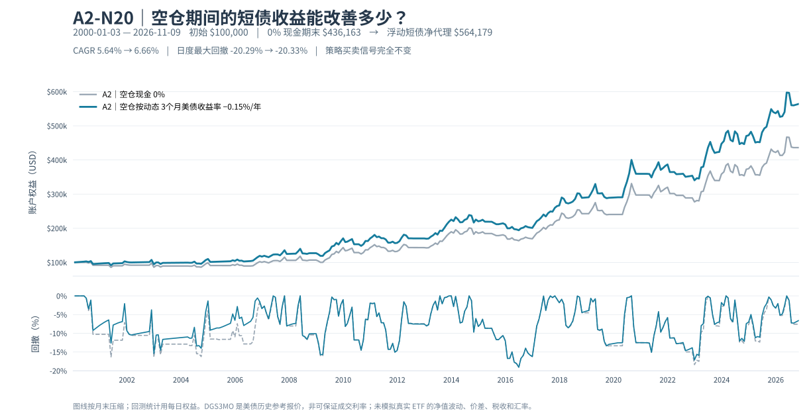

# A2-N20 空仓现金收益：历史 3 个月期美债浮动利率的独立回测

> 研究日期：2026-11-10。此实验是 **A2 V1.0 的资产计息层**，不是新择时策略，不改变交易信号或冻结的 58 笔完成交易。所有结果截至 2026-07-13，属于样本内、美元名义回测，而非实际可执行的固定收益组合。

## 1. 提出的问题及先验假设

A2 只有持仓/空仓两种状态。原 V1.0 将空仓账户收益率设为 0，长期空仓意味着错过短期无风险利率。实验回答：

1. 在空仓时加入接近美国短期国库券利率的现金收益，是否改善长期账户终值及 CAGR？
2. 收益改善是否意味着账户最大回撤（MDD）也会降低？
3. 如果粗略假定每年固定赚 2%、3%、4%，会如何误导收益估算？

**预先明确：**收益与回撤是两个独立问题。现金生息大概率会抬高终值，但 MDD 是账户相对历史净值高峰的最大跌幅，峰值和后续下跌轨迹同时改变，因此没有「多赚利息 ⇒ MDD 必然降低」的数学定理。

## 2. 不同的空仓停泊工具

| 工具 | 利率/持有逻辑 | 适用于 A2 的限制 | 实验如何处理 |
|---|---|---|---|
| 4–13 周短期美国国库券（T-bill） | 单张国库券按拍卖买入、持有至到期，其到期价值确定；**每次滚动再买时的收益率不确定** | 美债结算、到期前卖出的市价、入场信号出现时的资金可用性 | 用 DGS3MO 的历史变动利率代理，不逐笔模拟实际国债买卖 |
| 0–3 月短债 ETF（例如 SGOV） | 持有短久期国债，按基金分配收益；可在交易时段买卖 | 并非存款；盘中价差、ETF 净值波动、费率、分红再投资及税负；SGOV 在 2020 年才成立 | **不当作 2000–2026 的真实 SGOV 回测**；仅进行示意性 15bp 年化折减 |
| 美元货币市场基金 / 券商现金管理 | 浮动收益，可能便于空仓持有 | 各基金资产、费用、可赎回时间、货币基金是否可及时转用于买入均不同 | 暂无对应历史净值，无产品级回测 |
| 美元定期存款 / CD | 某一存期利率可锁定；到期再续利率变化 | 可能提前取款受罚或不及时到账；存款保险有条件及上限 | 不假设可随时按固定收益率无罚金退出 |
| 单纯 USD 现金 | 无默认利息 | 通胀侵蚀购买力 | 原 A2：0% 基准 |

优先考虑期限与 A2 重新入场需求匹配的工具。若使用者以人民币核算生活资产，还要单独承受 USD/CNY 汇率变化；**美元低波动不等于人民币本位无风险**。实际券商是否对闲置现金计息，须以账户协议为准，不能把 DGS3MO 视为可以直接获得的存款利率。

## 3. 数据来源、时点与许可

### 3.1 QQQ 与 A2 交易

- QQQ 历史复权日 K 用 `sources/qqq_jtang.csv` 与 `sources/qqq_james.csv` 两份本地已获取行情拼接，具体上游与重叠核验见 [../DATA_SOURCES.md](../DATA_SOURCES.md)。
- 日期从 2000-01-03 至 2026-07-13，严格新 `MA20` 上穿 `MA60` 后次交易日开盘买入；前 20 日亏损下的 `MA10/20` 新死叉触发 N20；其余时间等 `MA20/60` 新死叉；次交易日开盘卖出。
- 初始权益 **$100,000**；买卖单边收费 **0.05%**；滑点、税费及资金出入金暂为 0。冻结 **58 笔已完成 + 1 笔期末持仓**，不得为了现金收益修改交易状态。

### 3.2 3 个月短期美债的每日参考利率

- 官方指标：[FRED DGS3MO — Market Yield on U.S. Treasury Securities at 3-Month Constant Maturity, Quoted on an Investment Basis](https://fred.stlouisfed.org/series/DGS3MO)；上游为美国联储 H.15，频率日度，数值单位为**年化百分比**，不是小数。这里特意选 **DGS3MO 投资收益率口径**，不是贴现收益率口径的 `DTB3`。
- 本次研究运行使用 `rasmuspeterk-ctrl/recession/v5/data/raw/2026-10-27/DGS3MO.csv` 内的 FRED 历史镜像快照，按需校验了相异公开镜像中不同年代的样本观测。源快照覆盖 1999-11-12 至 2026-10-23，足够覆盖 A2 截止日；本次本地文件 SHA-256：`5f795620cdc28b3a14d9e509ba1f3dc65704aa1aa45754a6d3fa2ba0279237e1`。
- **不把原始利率 CSV 提交仓库**。使用者应从 FRED 自行合法下载 `DGS3MO.csv` 放入 `sources/`，以便核对日期、缺失值、上游修订及各自适用的数据使用条款。重跑时若上游修订历史记录，结果可能存在小额差异。
- 遇周末或美国市场非交易日，用**当时已发布的上一个报价**；在某交易日的现金日收益计算使用**上一个交易日已经知道的利率**，不使用当天尚未出炉的利率。任何报价断档超过十个日历日会报错，不做无限向前填充。

## 4. 计息方式与假设

先按原冻结引擎生成每个交易日的账户权益 `E0[t]` 和该日**收盘后**是否持有 QQQ。定义冻结交易因子：

`A2_factor[t] = E0[t] / E0[t-1]`。

如果上一交易日收盘时空仓，则这段相隔 `d` 个**日历日**的期间给当日账户额外乘以：

`Cash_factor[t] = 1 + AnnualRate[t-1] / 100 × d / 365`。

否则 `Cash_factor = 1`。每日权益：

`E[t] = E[t-1] × A2_factor[t] × Cash_factor[t]`。

这意味着：

- 若上一日收盘是现金，下一日开盘发生买入，模型仍让隔夜现金计息；买入后的股票涨跌和原来入场手续费不变。
- 若前一日收盘仍持有 QQQ，下一日开盘才卖出，不给前一晚尚未卖出的股票补算现金利息。
- 周五到周一共有三天，模型按日历天数累计现金利息；周末也计息。
- 各新现金收益按日复合；**从不回写或优化 A2 的交易**。它是一个便利的「日度现金计息代理」，实际短债 ETF 净值、T-bill 期限与分红日可能不同。
- 固定 2%/3%/4% 情景仅用于展示**假设长期稳定同一利率**时的效果，**不是历史事实、可买产品或可锁定 26 年利率**。
- 动态毛利率 = 当时 DGS3MO；动态净代理 = `DGS3MO - 0.15` **个百分点/年**，即扣除假设 15bp 的全年化摩擦。这个 15bp 是人为统一测试情景，**不是任何一只 ETF 的真实历史费率，且不能替代实际滑点或税费**。实际零利率年份该扣减可能出现极小负净收益，已保留这一保守假设。

## 5. 全部结果：同一 A2 交易的六种现金账户情景

| 资金处理 | 期末账户 USD | 比 0% 多赚 | CAGR | 每日回测 MDD |
|---|---:|---:|---:|---:|
| **A2 基准：空仓 0%** | **450,595.85** | — | **5.8397%** | **−20.2882%** |
| 历史 DGS3MO（原始年化参考利率） | 587,708.40 | +137,112.55 | 6.9051% | −20.2763% |
| **历史 DGS3MO − 15bp 年化摩擦** | **576,561.67** | **+125,965.82** | **6.8279%** | **−20.3290%** |
| 假设永远 2% 年息 | 581,667.72 | +131,071.87 | 6.8635% | −19.5819% |
| 假设永远 3% 年息 | 660,867.38 | +210,271.53 | 7.3790% | −19.2265% |
| 假设永远 4% 年息 | 750,845.60 | +300,249.75 | 7.8970% | −18.8694% |

计算中空仓时间为 **4660 / 9688 个日历日 = 48.10%**（按上一交易日收盘状态区分区间），空仓时段按天数加权的历史 DGS3MO 报价均值约 **2.081%/年**。这解释了为什么永远 4% 的场景异常乐观：历史实际资金可赚的短端利率远非一直处在高位。

**最大回撤反例：**净代理账户终值比基准多 27.96%，CAGR 高约 **0.99 个百分点**，却把 MDD 从 `−20.2882%` 略变成 `−20.3290%`。最大回撤由**历史峰值和随后低谷共同决定**；额外空仓利息推高某些高点，之后仍按相同股票波动下降，相对峰值的最大下跌仍可能不改善。两者只差约 0.04pp，不能统计性地宣称哪种机制更安全。

这些结果不证明 B 两日观察、快速退出、加杠杆或其他交易候选策略有效：它们没有进入本实验。

## 6. 图片与数据核查



> 此图特意指向**旧提交固定 SHA 的 2026-07-13 快照**，避免仓库根目录的同名资产已更新到2026-11-09后，与本文仍然冻结的数字冲突。新图、新实验及新增两笔交易详见 [11月9日补样审计](A2_2026_07_14到11_09_样本扩展复核.md)。

- 蓝线：动态 3 个月美债参考收益率**减 15bp** 后的资产；灰线：原 A2 空仓不计利息。
- 上图为月末抽样的权益线，下图为月末回撤连线，便于阅读而减少 SVG 大小。**表格的 MDD 使用完整每日账户权益计算**，不以图上的月末点代替日度极值。
- 原始 QQQ 日线、FRED 利率原始 CSV 均不随报告再分发；派生数据见 [a2_cash_yield_scenarios.csv](../../research/results/a2_cash_yield_scenarios.csv) 和 [a2_cash_yield_monthly_equity.csv](../../research/results/a2_cash_yield_monthly_equity.csv)。

## 7. 如何独立复现

在仓库根目录运行：

```bash
python -m pip install -e '.[charts]'
python -m unittest discover -s tests -v
python research/verify_frozen_baseline.py \
  --old sources/qqq_jtang.csv --new sources/qqq_james.csv
python research/experiments/a2_cash_yield_backtest.py \
  --old sources/qqq_jtang.csv --new sources/qqq_james.csv \
  --yield-csv sources/DGS3MO.csv --end 2026-07-13 \
  --outdir research/results --chart assets/a2_cash_yield_equity.svg
```

若复现者只持有一份合法日线 CSV，可改为 `--csv sources/qqq_daily.csv`，但与冻结两源拼接基准不同，指标可能不完全相同。若不具备历史利率 CSV，**拒绝把 2026 年某一天的高利率套用到整个 2000–2026 年**。

### 下一步需要真正检验的边界

1. 2020 年后使用真实短债 ETF **含分红再投资的总回报**、实际费率与 Bid/Ask 价差，进行独立子区间回测；不能把 SGOV 填进它不存在的 2000–2019 年。
2. 国库券滚动到期与 A2 信号打架时，现金能否在次日开盘前完成卖券、到账和 QQQ 买入；如不能，需建模延迟入场的机会成本。
3. 把券商现金收益、税务居民适用的利息/分红税、交易佣金及汇率转换单独记录；美元权益与实际可消费人民币权益不得混淆。
4. 在未参与本研究的新样本期观察真实执行成本及利率；不因为这一轮模拟结果改变已冻结的 A2 信号。

## 8. 研究结论

**合理的持仓观念是：把短期美债/现金管理作为「闲置美元的收益增强」，而不是当作另一套止损系统。** 历史浮动利率的确对长时间空仓的 A2 贡献可观的终值，但资产净值保障、再入场时的资金可用性、税费和汇率需要独立验证。能更稳地赚取现金收益，和能否降低 QQQ 趋势策略的最大回撤，**是两道不同的考题**。
