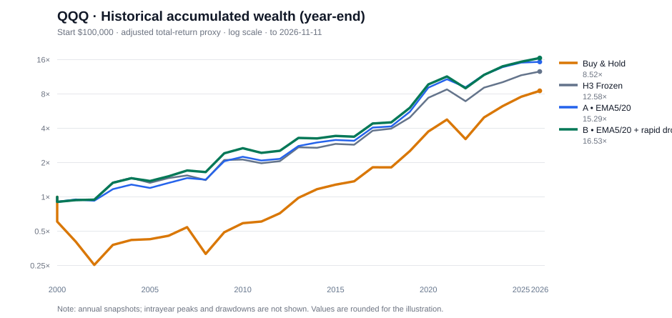

# QQQ H3 的两种中周期利润保护：A / B / 冻结 H3 / Buy & Hold 完整回测对照（2026-11-13）

> **最终研究判断：B 的历史收益和交易次数更优；A 的利润保留比例和 2022 年防御更好。B 并没有降低原 H3 的最大账户回撤，尚不能晋级正式策略。** 本文是复现与归因，不再选新阈值。研究截至 **2026-11-11 美股完整收盘**，不包含此后的交易。
>
> 代码：[四组基准与派生指标完整重算](../../research/experiments/h3_profit_guard_ab_full_report.py)；[A/B 信号及真实账户叠加层](../../research/experiments/h3_midcycle_fast_ema_overlay_reentry.py)；[成功 GitHub Actions](https://github.com/hawtim/qqq-a2-strategy/actions/runs/43360474392)；[逐日、逐笔、年度和再入场原始派生 CSV / manifest](https://github.com/hawtim/qqq-a2-strategy/actions/runs/43360474392/artifacts/14007318752)。**A 的整条日度权益曲线与上一轮独立实现逐日核对一致；H3 的整条日度曲线与冻结引擎逐日核对一致。**

## 执行摘要

- QQQ 全周期 **2000-01-03～2026-11-11**，初始 **$100,000**：买入持有 **CAGR 8.31% / MDD −82.96%**；冻结 H3 **9.89% / −24.30%**；方案 A **10.69% / −23.94%**；方案 B **11.01% / −24.30%**。
- B 期末资产约 **$1.653m**，相对 H3 **+31.38%**、A **+8.10%**。但其收益更好不是「识别顶部胜率很高」：B 只在 **22 笔**原始 H3 持仓中干预，**10 笔改善、12 笔损害**；**10笔改善全部来自卖出后不再买回，12笔实际重入全部降低了收益**。
- A 则额外干预 28 笔，最终 **15/28→10/28** 笔「最高浮盈至少10%后，期末吐回过半」的严重利润回吐；B 的相应结果为 **11/28**。**A 的利润保护略胜 B，B 的复利和低频程度胜 A**。
- B **并未防住 2022 年**：当年 H3 / B 均 **−21.20%**，A **−14.95%**；B 的最长账户水下期 590 个交易日，也长于 H3 的 465 和 A 的 442。这是“只防急跌”的显著成本。
- **样本外未验证**。2000 年科网泡沫顶端开始买入持有的基准回撤极深；换成 2010 年之后多个时期，Buy & Hold 仍可能大幅跑赢三种择时策略。无法据此宣称已稳健战胜 B&H。

*图以每年末的净值抽样绘制、采用对数纵轴；不是盘中或逐日最大回撤图。精确逐日曲线及年度净值见研究 ZIP。*

## 一、对照实验设计——严格固定策略，不偷换 H3 状态机

| 对照 | 完整规则 |
|---|---|
| **Buy & Hold** | 2000-01-03 以调整后的常规开盘价一次买入 QQQ，持有至 2026-11-11 最后完整收盘价，单边买入手续费0.05%，最后不执行卖出。分红复权价仅是税前再投资代理。 |
| **H3 Frozen** | 原冻结的 EMA V3.1-H3 入场和月线过滤、N20 早期亏损保护、7%净亏收盘止损、EMA20/60 趋势退出、FAST 入场资格保持完全不变；下一常规开盘执行。 |
| **A：利润保护** | 仅在原 H3 持仓：已经至少持有10交易日、截至当时最高**收盘浮盈≥10%**、当日仍为正浮盈、EMA20>EMA60；当日 **EMA5 从上向下穿 EMA20**，下一常规开盘全部额外卖出；以后 **EMA5 从下向上穿 EMA10** 且 EMA20>EMA60，下一常规开盘全仓买回。**每个原 H3 持仓最多一次额外卖出和一次买回**。 |
| **B：仅在快跌时保护** | 完全继承 A，退出时还必须满足 **EMA10>EMA20**，以及**最近3个交易日调整后收盘价下降≥1.5×当日 ATR20**。其余入场、重买、交易次数约束均与 A 完全相同。 |

**重要实现定义：** 无论 A/B 在中途是否临时空仓，底层 H3 仍以原始虚拟持仓独立计算 N20、月线过滤、FAST 状态和最终退出。A/B 最迟在原 H3 退出日解除，下一次原 H3 入场仍依照冻结状态机。这是一个**影子 H3 + 现实资金叠加层**，并非让每次真实卖出重置整个 H3 状态机。如果实盘实现采用“每卖一次就从头重跑 H3 状态”，结果将不同，不能引用本报告的收益。

**统一交易假设：** 初始 $100,000，全仓或全现金；每次买卖各按0.05%费率扣费，现金0利率，税收/额外开盘滑点/冲击成本未模拟。所有决策只依赖当日已收盘数据，次日常规开盘成交；没有使用历史事后顶部做触发条件。QQQ 为同一轮提供商日线复权价快照，单次运行所有4个策略，避免异源或截止日混用。

## 二、完整账户指标

| 指标 | Buy & Hold | H3 Frozen | A | B |
|---|---:|---:|---:|---:|
| 期末账户 | **$852,247** | $1,257,938 | $1,528,788 | **$1,652,616** |
| 长期 CAGR | 8.31% | 9.89% | 10.69% | **11.01%** |
| 账户最大回撤 MDD | −82.96% | −24.30% | **−23.94%** | −24.30% |
| 日线收益年化波动率 | 26.75% | 15.41% | **14.46%** | 14.59% |
| Sharpe（无风险利率设0） | 0.43 | 0.69 | 0.78 | **0.79** |
| Calmar（CAGR / |MDD|） | 0.10 | 0.41 | 0.45 | **0.45** |
| 最长账户水下时间（交易日） | 3747 | 465 | **442** | 590 |
| 资金在场比率 | 100% | 67.47% | 63.56% | 64.34% |
| 原 H3 交易窗口数 | 不适用 | 60 | 60 | 60 |
| 完整 H3 窗口收益为正的比例 | 不适用 | 43.3% | **51.7%** | 48.3% |
| 平均盈利 / 平均亏损（Payoff） | 不适用 | **5.42** | 4.31 | 4.93 |
| 利润因子 PF（完成窗口） | 不适用 | 4.14 | **4.61** | **4.61** |
| 在 H3 交易上新增的卖出 / 买回 | 0 / 0 | 0 / 0 | 28 / 18 | **22 / 12** |
| 新增实际订单动作总量 | 0 | 0 | 46 | **34** |

**口径细节：** A/B 的「完成窗口胜率、Payoff、PF」以原 H3 的60个不重叠持仓窗口，计算每个窗口经过额外进出后的实际账户净收益；**不是把每次额外卖出/回补都算成独立交易**。B&H 只买一次，因此不应把它的收益切成60笔去构造胜率/Payoff。Sharpe 以全部日度权益回报、年化252交易日、零无风险利率测算，未计现金的历史美债收益。最大回撤与最长水下时间由完整逐日账户曲线计算，不是只取月末。

**H3 相对 B&H 的 CAGR 优势 +1.58 个百分点；A +2.38pp；B +2.70pp。** 在本样本内 B 的增量收益更多，但相对 H3 最大回撤从−24.30%变成−24.30%，几乎完全没变。

### 最大风险来自不同时间段

| 最大回撤区间（以该策略自身账户高点为起点） | 峰值日 | 谷底日 | MDD |
|---|---|---|---:|
| Buy & Hold | 2000-03-27 | 2002-10-09 | −82.96% |
| H3 | 2021-09-07 | 2023-03-10 | −24.30% |
| A | 2000-09-01 | 2001-10-17 | **−23.94%** |
| B | 2021-09-07 | 2023-03-10 | −24.30% |

**关键盲点：B 并没有改变冻结 H3 在 2021–2023 这段最坏的账户回撤。** 它主要改善了若干趋势内交易的利润保留和最终财富，但仍未构建更低的账户 MDD 下限。

## 三、到底有没有保护住最高浮盈？

历史「最高浮盈至少10%」的原 H3 完成交易共有 **28 笔**。对所有策略，统一使用**原 H3 对应交易窗口中实际已观察到的最高收盘浮盈**为参照峰值，再减去策略对该窗口实际完成的**净**收益，得到**最终利润回吐比例**。这不是实时交易触发器；利润回吐可以超过100%，而 H3 初始最高收益是毛数、退出是净数，费用的轻微影响已保留。

| 指标 | H3 | A | B |
|---|---:|---:|---:|
| 最高浮盈≥10%后，期末净利润吐回≥50% 的窗口 | **15/28** | **10/28** | **11/28** |
| 上述28笔利润最终回吐比例中位数 | 57.89% | **41.86%** | 43.44% |
| 上述28笔利润最终回吐比例均值 | 58.47% | **48.81%** | 49.76% |
| 相比原 H3 减少的此类事件数 | — | **5** | 4 |

这个指标回答了用户的核心问题：**A/B 的历史账户复利改善中，确实有一部分来自已经获得的浮盈未被全部吐回。** 但它不证明某几次中途价格回撤被完全避免：A/B 卖出后可能买回更贵，或者原 H3 后来还创新高。

### 保护信号触发时还有多少利润？

| 首次触发额外卖出当日截面 | A | B |
|---|---:|---:|
| 提前卖出次数 | 28 | **22** |
| 历史已知最高浮盈中位数 | +14.53% | +19.98% |
| 当日仍有的浮盈中位数 | +9.60% | +14.23% |
| 已吐回此前最高浮盈的比例中位数 | 31.62% | **28.44%** |
| 现金离场天数中位数（卖出到买回或原 H3 退出） | 9 交易日 | 9 交易日 |
| 最终买回的次数 | 18 | 12 |
| 到原 H3 卖出还未买回 | 10 | 10 |
| 买回价高于先前卖出价 | **17/18** | **12/12** |
| 真正买回时「买回价比此前卖价高」的中位幅度 | +2.02% | +1.93% |

**关键观察：这不是传统意义的「高卖低买」。** 绝大多数买回都比前次卖出贵。策略收益可能来自**某些交易提前卖出后根本没有在原持仓期买回**，也可能来自其他持仓路径和重入时机的组合净差。不要只凭某次回避回调就认定做对了中间价差；这组模型更适合称作「风险段暂时退出＋确认后恢复」，而非高抛低吸。

### 决定性交易归因：重新入场几乎从未创造额外收益

对 `a_b_sell_and_reentry_diagnostics.csv` 逐笔对应原 H3 退出收益，严格分开「**提前卖出后买回**」和「**提前卖出后直到原 H3 退出都没有买回**」：

| 分支与逐笔净收益差 | A | B |
|---|---:|---:|
| 实际买回的额外卖出 | 18 | 12 |
| 其中相对原 H3 改善的交易 | **1** | **0** |
| 其中相对原 H3 损害的交易 | **17** | **12** |
| 真正买回者相对原 H3 单笔平均收益差 | **−2.75pp** | **−2.49pp** |
| 提前卖出后直到原 H3 退出未买回 | 10 | 10 |
| 其中相对原 H3 改善的交易 | **10** | **10** |
| 未买回者相对原 H3 单笔平均收益差 | **+6.70pp** | **+5.47pp** |

**这对整体研究目标是一个较大的否定性证据。** B 的历史优势**全部来自那10笔提前退出并在原 H3 结束前一直持有现金的交易**；按原H3退出窗口比较，B 的12笔实际「卖出→再次买回」均比完全不干预更差。A 的18笔重买里仅1笔更好（2020-04-13 入场的 H3 交易，2020-09-30 重买，比之前卖出价约低1.71%）。B 的12次重买无一例外高于先前卖价，手续费进一步削减收益。

所以**不能将这次 A/B 回测概括为「已经抓住小周期高卖低买」**。反而是一个需要进一步解释的风险退出系统：成功例来自决定不回补直到原 H3 出场，而每一次防守后重新回补的 B 操作都没有完成净收益改善。未来研究应将「提前退出后为何不回补」和「何时重入才能不卖飞」分开成为两个命题。由于原 H3 在这段时间仍持有，这些历史差值与真实新状态机受月线资格约束的重入结果可能不同。
## 四、每个时期是否都能跑赢？全样本优势的路径依赖

以下均为**子期间累计收益**（不是 CAGR，也不是每十年重启 H3 状态机）：期间起始继承当时已在运行的账户，然后在对应年份末计算区间增长。

| 年代 | B&H | H3 | A | B |
|---|---:|---:|---:|---:|
| 2000–2009 | −51.09% | +110.76% | +105.54% | **+141.32%** |
| 2010–2019 | **+415.99%** | +136.27% | +171.43% | +150.80% |
| 2020–2026-11-11 | **+237.66%** | +152.62% | **+174.02%** | +173.06% |

**重要反证：从2010年后多头样本来看，B&H的累计收益大幅超过H3/A/B。** H3/A/B 在整个2000起点的历史都跑赢 B&H，受2000年科技泡沫见顶后 B&H 初期 −80%+ 崩盘影响非常大。**不能将「2000年起算跑赢」推断为「任何建仓年份跑赢」**，更不能宣称历史择时在任意年代都更优。

### 选取几个关键年份

| 年份 | Buy & Hold | H3 | A | B | 研究意义 |
|---|---:|---:|---:|---:|---|
| 2000 | −39.34% | −9.63% | −9.63% | −9.63% | H3 初期大熊市防御，不是利润保护额外改善 |
| 2008 | −41.73% | −8.99% | −3.16% | −3.16% | 两组都保护部分利润 |
| 2010 | +20.14% | +0.89% | +9.32% | **+10.73%** | 中周期防御效果明显的一年 |
| 2014 | +19.18% | −1.00% | **+7.37%** | −1.00% | B 的快跌过滤错过 A 的一笔保护机会 |
| 2020 | +48.41% | +48.76% | **+62.92%** | +60.30% | 两组保留了更多趋势收益 |
| **2022** | **−32.58%** | **−21.20%** | **−14.95%** | **−21.20%** | B 无法防御这轮账户最坏回撤 |
| 2024 | +25.58% | +11.59% | +16.68% | **+18.96%** | B 在某些中周期恢复/退出上有优势 |
| 2026 至11月11日 | +12.77% | +7.72% | +1.38% | +7.72% | A 的额外退出在这一年明显卖飞，B 避免了该误判 |

完整27行逐年表现见 artifact 内 **four_strategy_calendar_year_returns.csv**；完整每日权益、每日 MDD 见 **four_strategy_daily_equity.csv**。

## 五、逐笔交易归因——“B 更好”不等于“B 更准”

| 交易归因 | A | B |
|---|---:|---:|
| 原H3交易窗口 | 60 | 60 |
| 触发过额外提前退出 | 28 | **22** |
| 干预后最终表现高于原 H3 | 11 | 10 |
| 干预后最终表现低于原 H3 | 17 | **12** |
| 受干预交易的平均改善 | +0.62pp | **+1.13pp** |
| 受干预交易改善值的中位数 | −1.52pp | **−0.86pp** |
| 相对 H3 期末财富增量 | +21.53% | **+31.38%** |

**B 是「低频、低命中、较高单次收益优势」的历史结构，而不是胜率超过50%的顶部预测器。** B 的22笔干预中只有10笔净收益比不干预更好。不能用账户级 CAGR 掩盖信号命中率不高。

### B 哪些时候成功防守？

| 原 H3 买入至卖出区间 | 原 H3 单笔净收益 | B 单笔净收益 | B 改善 |
|---|---:|---:|---:|
| 2010-03-02～05-21 | −4.18% | +5.16% | **+9.35pp** |
| 2019-10-02～2020-03-10 | +8.25% | +16.65% | **+8.40pp** |
| 2024-06-04～08-07 | −1.35% | +6.31% | **+7.66pp** |
| 2019-01-14～06-04 | +8.06% | +15.65% | **+7.59pp** |

### B 错卖了哪些趋势？

| 原 H3 买入至卖出区间 | 原 H3 单笔净收益 | B 单笔净收益 | B 损失 |
|---|---:|---:|---:|
| 2003-03-17～2004-03-11 | +37.82% | +32.10% | **−5.72pp** |
| 2009-03-31～2010-02-09 | +42.96% | +39.23% | −3.73pp |
| 2025-05-15～2026-02-17 | +16.15% | +12.91% | −3.23pp |

### 相比 A，B 过滤掉的“好”与“坏”都要保留

A、B 在60笔原始 H3 中，**14笔交易**结果存在实质差异。B 相比 A 在其中9笔做得更好、5笔做得更差。

- **B 的过滤有用：** 2026-04-10 入场的一笔，A 比原 H3 **少赚6.62pp**，B 没有干预因此避免卖飞；2001-10-15 的 A 额外卖出也导致 **−6.56pp**，B 同样避免；2002-10-16 的一笔 A 相对 H3 **−4.07pp**，B 反而 **+3.96pp**。
- **B 的过滤有害：** 2014-06-03 的一笔，A 相对 H3 **+8.44pp**，B 因条件不满足没有保护；2022-07-20 的一笔 A **+7.79pp**，B 也未干预；这是 B 在 2022 年风险改善缺位的一个具体原因。

因此，不应继续机械地把“快跌阈值提高一点”理解为“更高置信度”。快跌过滤既删除错误信号，也会删除真正值得执行的早退信号。

## 六、对少数大收益交易的依赖程度

为衡量过拟合风险，不重新改变入场日期，只在叠加层记录中**把最多贡献增量的1笔或3笔干预替换成原 H3 的交易收益**，其余事件照常复利。该反事实是固定 H3 窗口账本上的灵敏度，不是一个全新可交易策略或严格样本外试验。

| 敏感性审计：相对 H3 期末财富 | A | B |
|---|---:|---:|
| 所有干预真实历史结果 | **+21.53%** | **+31.38%** |
| 删除贡献最大的1笔干预增量 | +10.73% | **+19.70%** |
| 删除贡献最大的3笔干预增量 | **−5.40%** | **+3.08%** |

B 相比 A 对「最好的3笔」依赖略低，但删除3笔后优势仅剩约3%，还不足以证明稳健可复制。特别注意 A/B 交易在同一 H3 底层时间窗内相关，并非独立同分布实验观测。

## 七、研究判断及下一轮升级门槛

**A 的可取之处：** 账户最深回撤略小、利润回吐较少，2022年相对H3有效保护，但会出现较多早卖和2026年踏空。

**B 的可取之处：** 更少的额外操作、较高的样本内复利与风险调整后收益；对长期趋势中的一部分普通波动较不敏感。

**B 的明确失败：** 2021～2023账户最大回撤不变、2022年全年与H3表现相同，水下时间最长，仍有12/22笔干预的最终交易收益变差，未达到“提前识别大多数危险下跌”的标准。

**不升级冻结 H3。** 后续如要推进，先冻结 A/B 两条方案（包括10%浮盈门槛、1.5ATR快跌、最多一次卖出重买），不要再仅凭2000—2026 QQQ网格挑更高CAGR的阈值。下一步最有价值的是：

1. 按账户逐年和市场阶段，分析**B在2021～2023为何未降低MDD、A在2022保护有效而B失效**；检查截至信号日的快跌幅度、EMA10/20状态、买回时机，而不是事后看底部拟合。
2. 单独审计重入：B的 **12/12** 次重入都比此前卖价高，这说明“从风险中出来”的代价很大。可以测试更稳健、仍不要求买在原卖价以下的再入场确认机制，但每笔H3最多一轮操作不变。
3. 在**2010年后和新指数/样本外时期**检验是否仍优于 H3、B&H，并计入额外滑点、税及现金利息敏感性。若优势不稳，保留原 H3；如果有稳定证据，再考虑小仓位真实纸面观察。

## 八、复现与完整文件

- [完整可复现 Python 实验](../../research/experiments/h3_profit_guard_ab_full_report.py)
- [GitHub Actions 成功执行和来源记录](https://github.com/hawtim/qqq-a2-strategy/actions/runs/43360474392)
- [GitHub Actions 研究产物（全部 CSV 与 manifest）](https://github.com/hawtim/qqq-a2-strategy/actions/runs/43360474392/artifacts/14007318752)

ZIP 内文件包括：

- \`four_strategy_stats.csv\`——完整总体指标、Sharpe、Calmar、交易额外次数、MDD定位；
- \`four_strategy_daily_equity.csv\`——**6756个交易日**×四条账户每日权益及每日回撤；
- \`four_strategy_month_end_equity.csv\`——四条账户月末权益/回撤；
- \`four_strategy_calendar_year_returns.csv\`、\`four_strategy_decade_returns.csv\`——年度与年代子样本表现；
- \`h3_a_b_trade_comparison.csv\`、\`h3_a_b_trade_difference.csv\`——60笔交易的逐笔净收益对照；
- \`a_b_extra_actions.csv\`、\`a_b_sell_and_reentry_diagnostics.csv\`——每次特殊退出/重入的信号日、实际成交日、当时峰值浮盈和ATR；
- \`concentration_and_top_trades.json\`、\`manifest.json\`——贡献集中度、数据源和执行口径。

**数据治理与限制**：无需分发第三方未授权的原始 OHLCV，报告只保存派生的权益、信号和分析。Yahoo 分红复权历史可能随供应商调整而变化，下载批次和内容 SHA-256 在 manifest 内。费用按双边建模，不计现金收益、预扣税、真实点差/滑点、订单延迟。回测所有阈值都已经参考过这段历史，收益不能视作独立的样本外发现。
